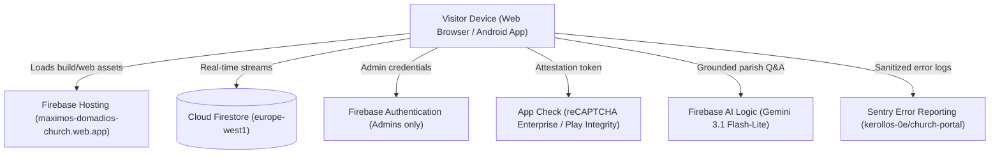
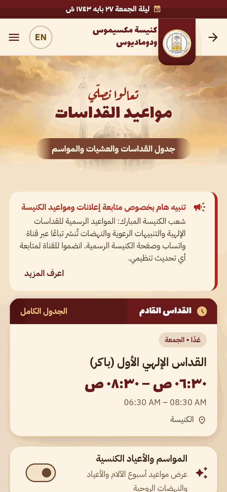
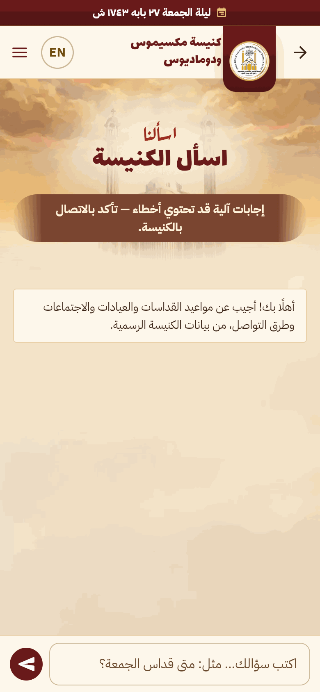
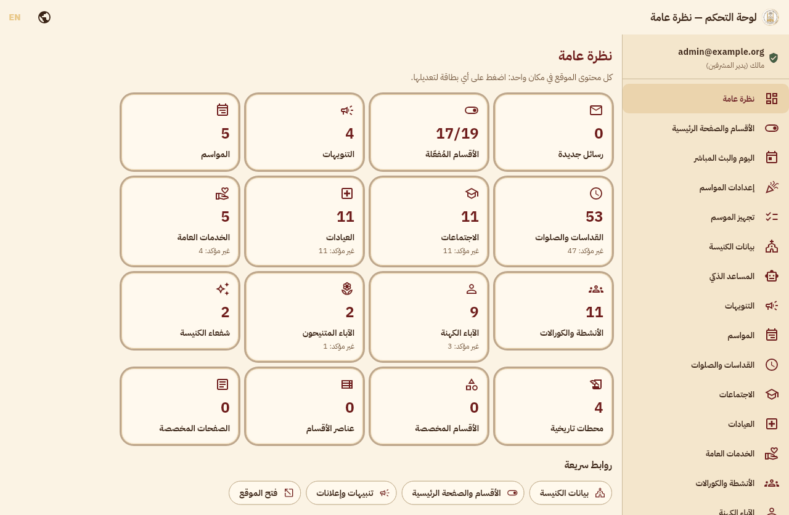

# St. Maximus & Domadius Church Portal

<div align="center">


### كنيسة القديسين مكسيموس ودوماديوس والقوي الأنبا موسى الأسود
**Coptic Orthodox Church of Saints Maximus & Domadius and the Strong Anba Moussa the Black**  
*End of Street 45, El‑Asafra Qebly, Montaza District, Alexandria, Egypt*

[](https://flutter.dev)
[](https://dart.dev)
[](https://firebase.google.com)
[](https://firebase.google.com/docs/firestore)
[](https://firebase.google.com/docs/hosting)
[](https://ai.google.dev/)
[](https://sentry.io)
[](https://github.com/features/actions)
[](https://web.dev/progressive-web-apps/)
[](https://www.w3.org/WAI/standards-guidelines/wcag/)
[](https://github.com/Kerollosmm/church-portal/releases)

---

**[🌐 Live Portal](https://maximos-domadios-church.web.app)** • **[📲 Download Android APK](https://github.com/Kerollosmm/church-portal/releases)** • **[📖 English Documentation](documentation/en/README.md)** • **[📜 الدليل العربي](documentation/README.md)** • **[🧠 Memory Bank](docs/memory-bank/00-README.md)** • **[🔒 Hidden Admin (`/admin`)](https://maximos-domadios-church.web.app/admin)**

</div>

---

## 🌟 Overview

The **Church Portal** is a high-performance, lightweight digital directory and parish home for the Coptic Orthodox Church of Saints Maximus & Domadius and the Strong Anba Moussa the Black in Alexandria, Egypt. 

Engineered with **Flutter Web and Android**, it delivers an **Arabic-first (RTL)** experience with seamless **English (LTR)** localization, instant offline fallback, dynamic liturgical theming, and an AI assistant grounded strictly in parish data.

### Guiding Principles
- **Public Directory, Not an ERP/CSMS:** Intentionally excludes membership records, confidential pastoral notes, financial ledgers, or attendance tracking (ADR-001). This eliminates data privacy liabilities and allows the entire system to run perpetually on the free **Firebase Spark** tier with zero hosting costs.
- **Immediate Visitor Answers:** Liturgy schedules, "Happening Now" status, live streaming badges, Coptic calendar feasts, charity clinics, priest directories, and emergency contact channels answer visitor questions in seconds.
- **Empowered Non-Technical Admins:** Parish servants manage nearly 100% of the site's content, announcement banners, season presets, and theme adjustments via `/admin` without writing code or redeploying.
- **Offline & First-Load Resilience:** If Firebase is unreachable or unconfigured, the application gracefully falls back to bundled seed data (`assets/seed/seed.json`) without crashing.

---

## 📲 Android Application & APK Download

In addition to the Web Portal, an official standalone Android application is distributed directly via GitHub Releases:

- **📥 Latest Release:** **[Download APK from GitHub Releases](https://github.com/Kerollosmm/church-portal/releases)**
- **Version:** `1.0.3` (build `4`) in `pubspec.yaml` (`1.0.3+4`). The link above stays the latest published `apk-v*` release (`apk-v1.0.2`) until tag `apk-v1.0.3` is pushed. The higher build number is what lets the in-app updater offer this release.
- **Architecture Flavors:**
  - `church-portal-arm64.apk` — **64-bit ARM (`arm64-v8a`)** for modern devices (~18 MB).
  - `church-portal-arm32.apk` — **32-bit ARM (`armeabi-v7a`)** for older devices (~16 MB).
- **Core Mobile Capabilities:**
  - 🔔 **Offline Local Notifications (ADR-058):** Daily verses (07:00 AM), Katameros daily readings (06:30 AM), feast announcements, and user reminders («ذكّرني») scheduled 9 days ahead with zero server polling.
  - 📖 **Complete Katameros Reader (`/readings/<date>`):** Offline readings reader with Cairo liturgical calendar integration, adjustable font sizes, and adaptive focus mode.
  - 🔄 **In-App Seamless Updater:** Automatic background update notifications with SHA-256 certificate verification and resumable downloads.
  - 🔋 **OEM Battery Diagnostics (`/notifications/battery`):** Built-in settings guides for Samsung, Xiaomi, Oppo, Realme, and Huawei to ensure reminders fire reliably.

---

## 🏗️ Architecture & Technology Stack



### Technical Pillars
- **Framework & State:** Built with **Flutter** (Web & Android, iOS-ready) and **Riverpod 3** reactive stream providers.
- **Pure-Dart Domain Layer (`lib/domain/`):** Completely decoupled from UI and Firebase SDKs, enabling 100% deterministic unit testing.
- **Timezone Sanctity (`CairoTime`):** All schedule windows, active season overrides, and liturgical transitions are computed in `Africa/Cairo` time (EET UTC+2 / EEST UTC+3 DST) via IANA zone data.
- **Liturgical Eve Transition (18:00 / Sunset):** At 18:00 (or calculated parish sunset), the portal automatically transitions to the Coptic liturgical "Eve" of the next day.
- **Zero-Cost Inline Media:** To operate within Spark plan constraints (no Cloud Storage bucket), uploaded images are compressed client-side (≤ 800px WebP, ~250 KB) and stored in Firestore's `media/{id}` collection, fetched lazily by cards.
- **PageSpeed 90+ Engineering:** Atmospheric haze and ray shimmering in the hero section are implemented via a pure CSS DOM overlay (`HeroAmbientLayer`) on web, eliminating per-frame Flutter canvas repaints.

---

## 📱 Visual Showcase

Captured from the live site (Arabic, 390 px phone viewport) and, for the dashboard, from the real admin UI rendered against local Firestore-emulator data (no live sign-in).

| Home | Mass Schedule | Ask the Church (AI assistant) |
|:---:|:---:|:---:|
|  |  |  |

**Admin dashboard** (overview after sign-in: section sidebar and content tiles)



---

## 🗺️ Application Features & Routes

| Route | Page | Visitor Experience & Capabilities | Section Guard |
|---|---|---|---|
| `/` | **Home** | Seamless hero with ambient light motion, daily Scripture verse (Arabic & English), top utility bar with live Coptic calendar, "Next Liturgy" card with "Happening Now" status, urgent notice banner, patron saints teaser, orderable directory cards, and interactive GPS map. | Always On |
| `/about` | **About the Church** | Founding chronicle, consecrated altars, biographies of patron saints (Saints Maximus & Domadius, Strong Anba Moussa), directory of currently serving priests, and memorial list of departed fathers. | `history`, `saints`, `priests`, or `departedPriests` |
| `/mass-schedule` | **Mass Schedule** | Tabbed liturgy schedule (Friday, Sunday, Wednesday, Saturday, Other days) with bilingual times (Latin & Arabic-Indic digits), celebrants, halls, vespers/praises, and Holy Season schedule overrides. | `schedule` |
| `/church-education` | **Church Education** | Age-stage timelines from nursery angels to youth and seniors with meeting days, times, church halls, and links to WhatsApp/Facebook groups. | `meetings` |
| `/church-activities` | **Activities & Choirs** | Directory of fellowship groups: St. Moses Scouts, St. Stephen Deacons School, David's Harp Hymns Institute, Bible study fellowships, and cultural exhibitions. | `activities` |
| `/clinics` | **Charity Clinics** | Specialized charity medical clinics with specialty filtering, "Available Today" badges by Cairo weekday, direct phone call (`tel:`) buttons, and WhatsApp booking links. | `clinics` |
| `/public-services` | **Public Services** | St. Mary Nursery, community employment services, St. Joseph Condolence & Event Halls, and the parish lending library. | `services` |
| `/contact` | **Contact & Location** | Verified parish phone numbers, WhatsApp channel, social media links, embedded Google Map, transport directions, and secure contact form with hall bookings and anonymous boxes. | `contactInfo`, `socials`, or `contactForm` |
| `/section/:slug` | **Custom Sections** | Admin-created dedicated sections (e.g. Youth Conventions, Summer Trips) with custom items and navigation links. | `customSections` |
| `/page/:slug` | **Custom Pages** | Dynamic rich-text pages containing paragraphs, images, buttons, external links, and official church donation details (InstaPay, Bank Accounts, Wallets). | `customPages` |
| `/priest/:slug`, `/saint/:slug`, etc. | **Item Detail Pages** | Shareable deep-linked detail views with zoomable multi-image galleries, key facts, add-to-calendar links, GPS directions, and social sharing. | Parent Section |
| `/ask` | **AI Assistant** | Conversational assistant powered by Gemini (via Firebase AI Logic) answering questions strictly from parish data. Gated behind App Check. | `Sections.assistant` + `assistantEnabled` |
| `/admin` | **Admin Dashboard** | Hidden, role-based administrative studio. Desktop sidebar and mobile drawer navigation. Excluded from search engines (`noindex`). | Firebase Auth (`admins/{uid}`) |

---

## 🎨 Dynamic Occasion Themes & Season Presets

The portal features an automated liturgical theming system that changes colors, backgrounds, and accents to match church seasons:

```
Golden Hour (Parchment & Gold) ──► Standard year-round identity
Holy Week (Charcoal & Crimson) ──► Pascha Week (Zero violet, zero gold)
Resurrection (Ivory & Gold)    ──► 50 Days of Pentecost & Feast of the Resurrection
Nativity & Epiphany (Midnight) ──► Nativity Fast & Theophany
Fasts & Apostles (Stone & Ash) ──► Apostles Fast, Jonah's Fast, St. Mary Fast
Marian Feasts (Heavenly Blue)  ──► Feasts of the Theotokos
```

- **WCAG 2.2 AA Contrast Enforcement:** All color palettes are programmatically checked against accessibility standards (≥ 4.5:1 for body text). If an admin overrides accent colors in `/admin`, the engine automatically corrects lightness to guarantee readability.
- **One-Click Season Presets («تجهيز الموسم»):** Admins can apply complete seasonal settings (theme, banners, season verses, wedding booking suspension) in a single transaction that automatically reverts when the season concludes.

---

## 🛡️ Security, Privacy & Compliance

1. **Egyptian PDPL Compliance:**
   - The contact form includes an explicit privacy notice and required consent checkbox (`ContactField.consent`).
   - Sentry error monitoring employs client-side scrubbing: visitor names, phone numbers, email addresses, and AI assistant prompts are completely redacted before leaving the browser. IP address collection is strictly disabled.
2. **Contact Form Abuse Defense:**
   - Client-side validation: Name (2–80 chars), Message (5–1,000 chars), valid Egyptian phone or email.
   - Invisible honeypot field (`website`) blocks automated spambots.
   - Atomic server-side rate throttle: Enforced via `meta/contact_rate` batch writes in Firestore security rules (requires ≥ 10s between global submissions).
3. **App Check Protection:**
   - Enforced on Firebase AI Logic (Gemini API) using **reCAPTCHA Enterprise** on Web and **Google Play Integrity** on Android, preventing unauthorized API abuse.
4. **Firestore Security Rules:**
   - Per-collection key allow-lists.
   - Update delta auditing using `diff().affectedKeys()`.
   - Strict expression budget optimization staying under Firestore's 1,000-expression limit.

---

## 🏛️ Subdirectories & System Boundaries

- [`lib`](./lib/README.md): Core Flutter application architecture, pure-Dart domain logic, Riverpod state streams, Firestore data repositories, and UI presentations.
- [`tool`](./tool/README.md): Administrative, content generation, and deployment automation tooling (seed generators, scripture/Synaxarium fetchers, sitemap generators, branding asset pipelines, Firestore seeding).
- [`web`](./web/README.md): Web platform host shell, PWA manifest, SEO/OpenGraph metadata, liturgical splash lifecycle, early language detection, and Web Push / Service Worker bridge.
- [`android`](./android/README.md): Android native platform shell, Gradle build configuration, platform channels for OEM battery optimization, autostart routing, and APK signature verification / installation.
- [`ios`](./ios/README.md): Native iOS application wrapper, lifecycle delegates, SceneDelegate multi-window support, implicit Flutter engine plugin bridging, and App Store permissions.

## 🔒 Global System Invariants

- **Pure-Dart Domain Decoupling**: Pure business logic in `lib/domain/` with zero Flutter UI or Firebase SDK dependencies (Golden Rule 2).
- **Timezone Sanctity (`CairoTime`)**: All calendar, schedule, season transitions, and reminder computations evaluate via Africa/Cairo wall time (UTC+2 / UTC+3 DST) (Golden Rule 2).
- **Complete Feature Toggle Disappearance**: Any section disabled in `FeatureSettings` vanishes completely across UI, navigation, drawer, footer, assistant grounding, and sitemap (Golden Rule 6).
- **Ecclesiastical Data Integrity**: Never invent church content; unconfirmed items remain marked `sample: true` and are scrubbed from public output (Golden Rule 1).
- **Firestore Rules Expression Budget**: All document schemas and updates must strictly respect Firestore's 1,000-expression ceiling (ADR-020, ADR-044).
- **Zero Hardcoded Content**: Everything configurable from `/admin` via schema-driven forms; no user-facing strings hardcoded (Golden Rule 1, 5).
- **Optional Media**: Missing or unconfigured images never break geometry or trigger errors; inline Base64 storage in Firestore's `media/{id}` collection operates within Spark plan quotas (Golden Rule 9, ADR-017).
- **PII-Free Telemetry**: Sentry error capture strips all form inputs, prompts, user IDs, IPs, and query strings (Golden Rule 10, ADR-034).

## 🌐 Global Side Effects

- **Cloud Firestore**: Real-time snapshot streams and transactional writes (`europe-west1`), with inline Base64 image storage in `media/{id}`.
- **Firebase Authentication**: Administrative email/password sign-in and password resets.
- **Firebase AI Logic / Google Gemini**: Grounded Q&A over church data, gated behind App Check (reCAPTCHA Enterprise / Play Integrity).
- **Sentry**: Network error reporting and JS error interception via client-side sanitized events.
- **Local Device Storage**: SharedPreferences (IO) and localStorage/sessionStorage (Web) for user reminders, push preferences, language choices, and prompt quotas.
- **Operating System Services**: Native Android alarm scheduling (`AlarmManager`), notification channels (`NotificationManager`), OEM battery optimization intents, and FileProvider-based APK updates.

---

## 🛠️ Developer Quickstart

### Prerequisites
- **Flutter SDK:** Stable channel (tested on Flutter 3.47+ / Dart 3.13+).
- **Node.js:** v20+ LTS (for Firebase tools and rules testing).
- **Firebase CLI:** `npm install -g firebase-tools`.

### Local Setup & Verification

```bash
# 1. Clone repository and install dependencies
git clone https://github.com/Kerollosmm/church-portal.git
cd church-portal
flutter pub get

# 2. Run static analysis (0 warnings required)
flutter analyze

# 3. Run unit, widget, and domain tests
flutter test

# 4. Launch locally in Chrome (uses bundled seed fallback if Firebase is unconfigured)
flutter run -d chrome

# 5. Build production web bundle
flutter build web --release --dart-define=RECAPTCHA_SITE_KEY=<YOUR_RECAPTCHA_KEY>
```

### Firestore Security Rules Testing (Emulator)
Security rules are verified against the local Firebase Firestore emulator (requires Java 11+):

```bash
cd tool/rules_test
npm ci
npm test
```

### Deterministic Seed Generation
The database seed in `assets/seed/seed.json` is generated deterministically from Python source:

```bash
python3 tool/gen_seed.py
```
> *Note: CI automatically fails if `tool/gen_seed.py` is edited without regenerating and committing `assets/seed/seed.json`.*

---

## 🚀 Deployment & Operations

Deployments are fully automated via GitHub Actions:
- **Pull Requests:** Every PR deploys to an ephemeral preview channel at `https://maximos-domadios-church--pr-<number>-<hash>.web.app` (active for 7 days).
- **Squash-Merge to `main`:** Automatically deploys Firestore rules, composite indexes, generates `sitemap.xml` directly from Firestore, fingerprints icon fonts, and deploys to Firebase Hosting.

### GitHub Repository Secrets & Variables

| Name | Type | Description |
|---|---|---|
| `FIREBASE_SERVICE_ACCOUNT_ASAFRA_CHURCH_PORTAL` | Secret | JSON service account key for automated deployments and sitemap generation. |
| `RECAPTCHA_SITE_KEY` | Variable | Public reCAPTCHA Enterprise site key ("church-portal-web") passed to production web builds for App Check. |
| `FIREBASE_WEB_API_KEY` | Variable | Optional. Extracted automatically from `lib/firebase_options.dart` if omitted. |
| `SENTRY_DSN` | Variable | Optional. Overrides the public fallback DSN embedded in `app_config.dart`. |

---

## 📚 Documentation Index

For complete and detailed guides, please refer to:

- 🇬🇧 **[English Documentation Portal](documentation/en/README.md)**
  - 🏛️ **[Architecture & Technical Design](documentation/en/architecture.md)** — Flutter structure, routing, Firestore models, rules, and theming.
  - ⚙️ **[Operations & Deployment Runbook](documentation/en/operations.md)** — CI/CD pipelines, secrets, safe database seeding, and admin onboarding.
  - 📋 **[Master Feature Reference Guide](documentation/en/features.md)** — Comprehensive breakdown of all 31 portal features.
- 🇪🇬 **[الدليل العربي للميزات والتشغيل](documentation/README.md)** — دليل استخدام ميزات الموقع ولوحة التحكم والتشغيل باللغة العربية.
- 🤖 **[Coding Agent Memory Bank](docs/memory-bank/00-README.md)** — Internal system specifications, architectural decisions (ADR-001 through ADR-048), and open tasks.
- 📋 **[Verified Content Sources](docs/CONTENT_SOURCES.md)** — Field-by-field verification sources for parish data.

---

<div align="center">
Made with dedication for the congregation and servants of <b>St. Maximus & Domadius Coptic Orthodox Church</b>.
</div>
