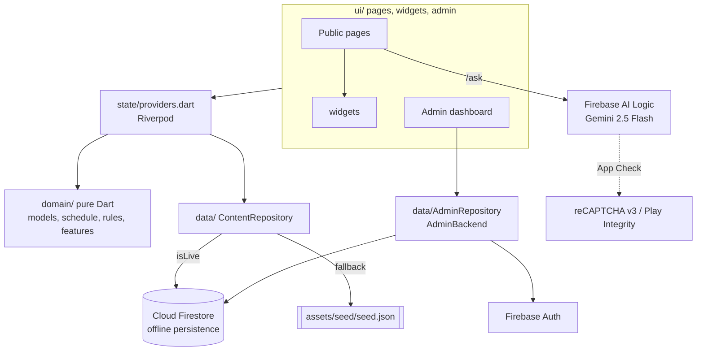
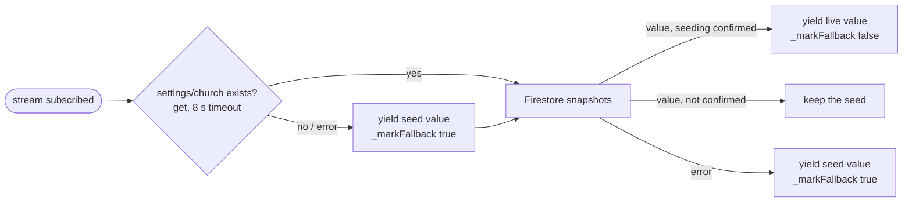

# 03 — Architecture

## Stack

| Concern | Choice (file) |
|---|---|
| UI | Flutter, Material 3. Widgets are imported from **`package:material_ui/material_ui.dart`** (pub package `material_ui ^1.9.0`), not `package:flutter/material.dart` — follow that convention. |
| Platforms | Web (primary, Firebase Hosting) + Android (`com.asafrachurch.church_portal`). iOS project exists, Firebase iOS app **not registered** (placeholders). |
| SDK | Dart `^3.13.7` (`pubspec.yaml`); README: built with Flutter 3.47 / Dart 3.13, stable channel |
| State | `flutter_riverpod ^3.4.3` (`lib/state/providers.dart`) |
| Routing | `go_router ^18.1.2` (`lib/router.dart`), **path URL strategy** (`usePathUrlStrategy()` in `main.dart`) |
| Backend | Firebase: `cloud_firestore`, `firebase_auth` (admins only), `firebase_app_check`, `firebase_ai` (Gemini), `firebase_core` |
| Time | `timezone ^0.11.2` (IANA `Africa/Cairo`, `lib/domain/cairo_time.dart`) |
| Fonts | Bundled (SIL OFL 1.1, `assets/fonts/`, licences registered in `main.dart`): **IBM Plex Sans Arabic** (body/UI, family `Plex`), **Lalezar** (poster display titles, `Lalezar`), **Aref Ruqaa** (calligraphic accent word, `Ruqaa`). No `google_fonts`, no runtime fetch (ADR-022 revised, branch `design/coptic-identity`) |
| Links | `url_launcher` (`lib/core/launch.dart`) |
| Web interop | `web` package (`<html lang>` sync, map iframe) |

## Layers

```
lib/
  main.dart                 bootstrap: seed + Firebase in parallel (never crashes) -> ProviderScope overrides
  app.dart                  ChurchPortalApp: MaterialApp.router, locale, theme preset, <html lang>
  router.dart               routerProvider (GoRouter), FeatureGate wrapper, ?lang=en sync, 404; /admin and /ask
                            are deferred imports (`deferred as`) loaded by DeferredLoader
  firebase_options.dart     DefaultFirebaseOptions (web + android real, iOS PLACEHOLDER)
  config/app_config.dart    AppConfig: geminiModel, recaptchaV3SiteKey, App Check debug flags, adminPath
  domain/                   PURE DART (no Flutter/Firebase imports) — unit-tested business logic
    models.dart             ChurchSettings, PhoneEntry, Altar, Alert, Season, Liturgy, Meeting, Activity,
                            Clinic, Facility, Priest, Milestone, Saint (+ tolerant fromMap, parseHm, parseDate)
    features.dart           Sections, HomeBlocks, ThemePresets, FeatureSettings, routeSections,
                            normalizeHomeOrder, Hideable, publicItems
    schedule.dart           computeNextMass, occurrencesForDay, effectiveLiturgiesForDay, seasons helpers,
                            ScheduleTab, regularLiturgiesForTab, vespersAndPraise, seasonalSchedule
    rules.dart              alerts, clinics, digits/phones (Egypt), wa.me/tel links, contact validation,
                            ContactRateLimiter
    cairo_time.dart         CairoTime (fromInstant, at, startOfDay, calendarDate)
    time_format.dart        formatTimeLatin/Arabic, ranges, weekday names, formatDate, formatLooseDate
    assistant_context.dart  buildAssistantInstruction (Gemini grounding prompt)
    media.dart              MediaImage (optional `image` map), MediaLimits, isValidImageUrl, fitWithin,
                            orphanedMediaIds
    custom_content.dart     CustomCategory, CategoryEntry, CustomPage, PageBlock (encode/fromStored), BlockTypes,
                            isValidSlug, publicCategories/publicPages, entriesOf, entryIdsToHide, linkTargets
                            (PR #18, ADR-027)
    contact_categories.dart ContactSettings (defaults), ContactCategory (encode/fromStored), ContactKinds,
                            MessageStatus, inboxBoxOf, messageIsOpen (PR #18, ADR-028)
    item_detail.dart        DetailKind (basePath/parentPath/collection), detailPathFor, parseDetailPath,
                            detailStateFor (detail-page gating), itemSocialsShown (PR #13, ADR-020),
                            weeklyCalendarUrl, absoluteDetailUrl, pickRelated (PR #14, ADR-021)
  data/
    firebase_bootstrap.dart bootstrapFirebase() -> FirebaseStatus{available, appCheckActive}; App Check
    content_repository.dart ContentRepository (interface), SeedRepository, FirestoreRepository,
                            normalizeFirestoreValue/normalizeDoc
    seed_data.dart          SeedData: typed view over assets/seed/seed.json
    admin_repository.dart   AdminBackend (interface; `media`), AdminRepository (Firestore+Auth), AdminDoc, AdminRoles
    media_repository.dart   MediaRepository, FirestoreMediaRepository (media/{id} base64), StorageMediaRepository
                            (Blaze stub), MediaCache (in-memory LRU), EncodedImage
    image_processing.dart   prepareUpload/compressDecoded; codecs image_codec/image_codec_web.dart (canvas, WebP)
                            and image_codec_io.dart (`image` package, JPEG) via conditional import
  state/providers.dart      all Riverpod providers (see below)
  core/                     theme.dart (AppColors, buildTheme), l10n.dart (_strings, tr/pick/isAr),
                            launch.dart (openUrl, callPhone, openWhatsApp, maps URLs), document_lang*.dart,
                            locale_storage*.dart (LanguageStore: localStorage on web, no-op elsewhere)
  ui/pages/                 one file per public route; item_detail_page.dart (ItemDetailPage) serves the 7 detail
                            routes
  ui/widgets/               item_image (ItemImage, MediaImageView, showImageViewer), app_shell, cards (LiturgyCard, NextMassCard, AlertBanner, DirectoryCard,
                            ActionChipButton, cardDetailPath, DetailTapArea, DetailsLink, CardImageLead), common
                            (PageBody, PageHeader, CustomizablePageHeader, PageIntro, SectionTitle, ResponsiveGrid,
                            Skeleton*, EmptyState, ErrorState, AsyncSection, PendingConfirmationNote,
                            SampleBadge, Pill, IconLine, TimeRangeText, Footer), feature_gate, map_embed*,
                            deferred_loader (DeferredLoader: spinner → page, retry on chunk failure), assistant_gate,
                            coptic_cross
  ui/admin/                 admin_page (sign-in, role check, dashboard shell), admin_schema (FieldDef,
                            CollectionDef, adminCollections, churchInfoDoc), doc_editor (generic form),
                            collection_list, features_editor, admin_screens (overview, church info,
                            messages, admins), admin_validators
```

Rule of thumb: **business logic goes in `lib/domain/` as pure Dart with tests**; widgets only render and call it.



## Startup (`lib/main.dart`)

1. `WidgetsFlutterBinding.ensureInitialized()`, `usePathUrlStrategy()`, `CairoTime.ensureInitialized()`.
2. `Future.wait([SeedData.load(), bootstrapFirebase()])` — both never throw.
   - `SeedData.load()` reads `assets/seed/seed.json` (on error → empty `SeedData`).
   - `bootstrapFirebase()`: `DefaultFirebaseOptions.currentPlatformOrNull` (null for placeholder/unsupported
     platforms) → `Firebase.initializeApp` (10 s timeout) → Firestore `persistenceEnabled: true`,
     `cacheSizeBytes: 40 MB` → `_activateAppCheck()`.
3. Repository choice: `status.available ? FirestoreRepository(db, seed) : SeedRepository(seed)`; `AdminRepository`
   only when Firebase is available (otherwise `/admin` shows `adminUnavailable`).
4. `ProviderScope(overrides: [firebaseStatusProvider, repositoryProvider, adminRepositoryProvider])`.

## Offline / seed fallback (`lib/data/content_repository.dart`)



- `SeedRepository`: every stream emits the bundled value once; `servingSeed` is always true; `submitContact` throws
  `ContactUnavailableException`.
- `SeedGate` (`FirestoreRepository._gate`): `settings/church` existence check; only a positive answer is cached (a
  missing doc or a failed/timed-out read is re-checked by the next subscription or live value). If the DB is not
  seeded, **every** stream serves the seed.
- `_guard(key, live, fallback, confirms:)` → `guardSeeded` (a `StreamController`, so a cancel takes effect at once;
  unit-tested in `test/content_guard_test.dart`): per-stream fallback on errors; `servingSeed` (a `ValueNotifier`) is true
  while any stream is on the seed → the `Footer` shows «تعرض البيانات المحفوظة مع التطبيق / Showing bundled content».
- **Recovery (PR 1, BUG-05):** when the seeding check fails or times out (cold start, weak signal), the stream yields
  the seed **and stays subscribed** to the live query. Each live value re-checks seeding; when that check succeeds,
  or still cannot answer but the value itself proves its own data exists (`confirms`: a non-empty collection, or an
  existing `settings/church`; it never vouches for other streams), live values replace the seed and
  `_markFallback(key, false)`. A known-unseeded database
  (`settings/church` absent) keeps serving the seed until a later check finds the marker. A stream cancelled while on the seed clears its fallback mark
  (`finally`), so the banner is never stranded.
- Timestamps are normalised to UTC `DateTime` (`normalizeFirestoreValue`) before `fromMap`.
- `settings/features` missing → `seed.features` (all sections on).
- `seed_firestore.js` writes `settings` **last** so an interrupted seed never marks the DB as seeded.

## Riverpod providers (`lib/state/providers.dart`)

| Provider | Type | Notes |
|---|---|---|
| `firebaseStatusProvider` | `Provider<FirebaseStatus>` | overridden in `main` |
| `repositoryProvider` | `Provider<ContentRepository>` | overridden in `main` (throws if not) |
| `adminRepositoryProvider` | `Provider<AdminRepository?>` | null when Firebase unavailable |
| `mediaRepositoryProvider` | `Provider<MediaRepository?>` | overridden in `main` with `admin.media`; null → inline images show placeholders |
| `settingsProvider` | `StreamProvider<ChurchSettings>` | `settings/church` |
| `featuresStreamProvider` | `StreamProvider<FeatureSettings>` | `settings/features` |
| `featuresProvider` | `Provider<FeatureSettings>` | value or `FeatureSettings.defaults` (all on) |
| `featuresReadyProvider` | `Provider<bool>` | true once the features stream has a value or error; `FeatureGate` waits on it |
| `alertsProvider`, `liturgiesProvider`, `meetingsProvider`, `activitiesProvider`, `clinicsProvider`, `facilitiesProvider`, `priestsProvider`, `milestonesProvider`, `saintsProvider` | `StreamProvider<List<T>>` | wrapped by `_public` → `publicItems` (drops `visible == false`, stable sort by `order`) |
| `categoriesProvider`, `customPagesProvider` | `StreamProvider<List<…>>` | PR #18: `categories` / `pages` through `publicCategories` / `publicPages` (visible, valid slug, unique, by `order`); empty when the collections do not exist |
| `entriesProvider` | `StreamProvider<List<CategoryEntry>>` | every entry; pages filter with `entriesOf` |
| `contactSettingsProvider` | `StreamProvider<ContactSettings>` | `settings/contact`, code defaults when missing (and in seed mode) |
| `seasonsProvider` | `StreamProvider<List<Season>>` | **not** filtered (seasons have no `visible`/`order`) |
| `nowProvider` | `StreamProvider<DateTime>` | ticks every 30 s (next mass, "available today", alerts) |
| `assistantVisibleProvider` | `Provider<bool>` | `features.enabled(assistant) && fb.available && fb.appCheckActive && settings.assistantEnabled` |
| `languageStoreProvider` | `Provider<LanguageStore>` | `PlatformLanguageStore` (`lib/core/locale_storage.dart`): `window.localStorage['church_portal_lang']` on web via `package:web` (conditional import, errors swallowed), no-op on Android/iOS; overridden in tests |
| `localeProvider` | `NotifierProvider<LocaleNotifier, Locale>` | initial = `LocaleNotifier.initialLocale(Uri.base, saved)`: explicit `?lang=en`/`?lang=ar` → saved choice → `ar`; `toggle()`/`set()` = visitor's choice (URL follows, choice saved in the `LanguageStore`), `syncFromUrl()` = the URL asked (no rewrite, not saved), `consumeUserChange()` read once by the router. A saved English choice on a parameter-free URL makes the first redirect add `?lang=en` |
| `routerProvider` | `Provider<GoRouter>` (in `router.dart`) | |

## Routing (`lib/router.dart`)

- `GoRouter(initialLocation: '/')`, **path URL strategy** (`/mass-schedule`, not `/#/mass-schedule`). Firebase
  Hosting rewrites `**` → `/index.html` (`firebase.json`), so deep links and reloads work.
- **Two-way `?lang=` sync** (PR 2 of the review plan, BUG-07) — pure rules in `resolveLangSync(uri, english:,
  userToggled:, fromPlatform:)`:
  - EN/ع toggle (`LocaleNotifier.consumeUserChange()`), or a refresh of the same URL (`lastSyncedUri`): the URL
    follows the language (`_syncLangQuery`: `lang=en` in English, no parameter in Arabic).
  - explicit `?lang=en` / `?lang=ar` (deep link, shared or in-app link, Back/Forward): the **language follows the
    URL** (`syncFromUrl`, scheduled in a microtask because the redirect may run during build); `lang=ar` is dropped
    (Arabic is the canonical, parameter-free URL).
  - no `lang` while English: a URL reported by the platform (browser Back/Forward, address bar, Android deep link —
    detected by `_PlatformRouteObserver`, a `WidgetsBindingObserver` registered before go_router's that flags
    `didPushRouteInformation`) means Arabic; in-app `context.go('/x')` keeps English and adds `lang=en`.
  `refreshListenable` is a `ValueNotifier` bumped by `ref.listen(localeProvider)` so redirects re-run on a language
  change without rebuilding the router.
- A `ShellRoute` wraps all public pages in `AppShell(location, child)`; each page is built by `_page(state, child)` =
  `NoTransitionPage(child: FeatureGate(path: s.uri.path, child: child))`.

| Route | Widget | Gate (`routeSections` in `features.dart`) |
|---|---|---|
| `/` | `HomePage` | none (always on) |
| `/about` | `AboutPage` | any of history, saints, priests, departedPriests |
| `/mass-schedule` | `MassSchedulePage` | schedule |
| `/church-education` | `EducationPage` | meetings |
| `/church-activities` | `ActivitiesPage` | activities |
| `/clinics` (`?specialty=<key>`) | `ClinicsPage(initialSpecialty)` | clinics |
| `/public-services` | `PublicServicesPage` | services |
| `/contact` | `ContactPage` | any of contactInfo, socials, contactForm |
| `/ask` | `AssistantGate` → `assistant_page.AssistantPage` (deferred) | assistant (+ the page itself checks `assistantVisibleProvider`) |
| `/church-education/:id` | `ItemDetailPage(DetailKind.meeting)` | meetings (prefix-aware `sectionsForPath`) |
| `/church-activities/:id` | `ItemDetailPage(activity)` | activities |
| `/clinics/:id` | `ItemDetailPage(clinic)` | clinics |
| `/public-services/:id` | `ItemDetailPage(facility)` | services |
| `/about/priests/:id` | `ItemDetailPage(priest)` | any of priests, departedPriests (+ the page checks the section matching the father's status) |
| `/about/saints/:id` | `ItemDetailPage(saint)` | saints |
| `/about/milestones/:id` | `ItemDetailPage(milestone)` | milestones |
| `/section/:slug` | `CategoryPage` (PR #18) | customSections (+ the category's own `visible`) |
| `/page/:slug` | `CustomPageView` (PR #18) | customPages (+ the page's own `visible`) |
| `/admin` (`AppConfig.adminPath`) | `admin_page.AdminPage` (deferred, `fullScreen` placeholder) | outside the shell, not gated, not linked anywhere public |
| anything else | `errorBuilder` → `AppShell` + "Page not found" + Back home | — |

`FeatureGate` shows a spinner (`Key('featuresLoading')`) until `featuresReadyProvider`, then the page or
`SectionUnavailable` («هذا القسم غير متاح حاليًا» + Back to home).

**Item detail pages** (PR #13, ADR-020): the 7 routes above are generated from `DetailKind.values`
(`'${kind.basePath}/:id'`, flat routes inside the `ShellRoute`, so the list page is not built underneath).
`ItemDetailPage` watches the collection's existing stream provider (`meetingsProvider` … `milestonesProvider`) and
finds the item by id — **no extra Firestore read**; only inline gallery / cover bytes (`media/{id}`) are fetched,
through `MediaCache`, when the page mounts. `detailStateFor` (pure, `domain/item_detail.dart`): missing, hidden
(clinics also inactive) or `detailsEnabled` explicitly `false` (missing = on since PR #14, ADR-021) → «هذه الصفحة غير متاحة حاليًا» (`Key('itemUnavailable')`) with a
Back-to-section button, `noindex`; a priest whose status section is off (departed father while `departedPriests`
is off, serving while `priests` is off) → `SectionUnavailable`, `noindex`; otherwise the page, indexable with its
canonical URL (`setDocumentRouteMeta(path: detailPathFor(kind, id), …)`, called after `FeatureGate`'s so it wins).
Detail URLs are not in `sitemap.xml` (static file; every visible item has a page since PR #14 — see open tasks).
"More in this section" (PR #14) is picked from the same already-loaded list (`pickRelated`), so it costs no read either.

**Per-route `<head>` sync** (PR #10, amends ADR-019): `lib/core/document_lang.dart` holds the pure
`kCanonicalOrigin`, `canonicalUrlForPath(path)` (`''`/`/` → origin + `/`, else origin + path without trailing `/`,
query or fragment), `DocumentHeadSpec {canonicalUrl, noIndex}`, `routeHeadSpec(path:, indexable:)` (indexable →
canonical, no `noindex`; otherwise `noindex` and no canonical, never both) and `setDocumentRouteMeta(path:,
indexable:)`, which applies the spec through the conditional import (`document_lang_web.dart` creates/updates/removes
`<link rel="canonical">` and `<meta name="robots" content="noindex">`; the stub is a no-op) and reports it to the
`@visibleForTesting debugOnRouteMeta` hook. Callers: `FeatureGate` (indexable while features load, then
`indexable: enabled`), `ItemDetailPage` (`indexable` only when the item's page is available), `AssistantGate` (`/ask`, `indexable: visible` once settings resolve), the `/admin` builder and
`errorBuilder` (`indexable: false`). `?lang=` sync (`_syncLangQuery`, `resolveLangSync`'s `lang=ar` branch) keeps
the URL `#fragment`.

**Deferred routes** (PR 3 of the review plan): `router.dart` imports `ui/admin/admin_page.dart deferred as admin_page`
and `ui/pages/assistant_page.dart deferred as assistant_page`; the routes build
`DeferredLoader(loadLibrary: x.loadLibrary, builder: (_) => x.Page())`, so dart2js emits them as separate
`main.dart.js_*.part.js` chunks fetched only on the first visit to `/admin` or `/ask` (the AI SDK `firebase_ai` is
imported only by `assistant_page.dart`). `/ask` is wrapped in `AssistantGate` (`ui/widgets/assistant_gate.dart`,
eager): it waits for `settings/church`, shows «المساعد غير متاح حاليًا» **without** fetching the chunk when
`assistantVisibleProvider` is false, and only then builds the `DeferredLoader` (CodeRabbit review). `DeferredLoader` shows a spinner (live region «جارٍ تحميل الصفحة…») and an
`ErrorState` with Retry if the chunk download fails (a retry in flight shows the spinner again). Only the page code is deferred: anything also imported eagerly
(e.g. `data/admin_repository.dart`, used by `providers.dart`/`main.dart`, and shared widgets) stays in the main
bundle. Never import `admin_page.dart` / `assistant_page.dart` (or a library only they need) eagerly elsewhere in
`lib/`, or the split silently disappears; tests may import them directly. Path URL strategy is unaffected (the
chunks are fetched relative to `<base href>`).

## App shell & navigation (`lib/ui/widgets/app_shell.dart`)

- `navItems`: home, massSchedule, clinics, education, activities, publicServices, about, contact; `askNavItem` added
  when `assistantVisibleProvider`. `visibleNavItems(f, showAsk:)` filters by `f.routeEnabled(path)`.
- Wide layout when `width / textScale ≥ 1024` (large system text forces the compact bar): text links
  (home/about/education), a **Services** popup (activities, public services, contact, ask), gold **Mass times** and
  white **Clinics** highlight buttons, language toggle (`EN` / `ع`).
- Narrow: compact 48×48 dp Mass/Clinics `IconButton`s (`_HighlightButton`), language toggle, ☰ opens an **end
  drawer** (`_AppDrawer`). Below **360 px**, at **≥ 150 % text**, or on a subpage below **400 px** (the Back arrow
  takes another 48 dp) the highlight buttons are dropped from the bar (they are in the drawer) so the title keeps a
  readable width. Phone subpages (`location != '/'`) get a leading
  **Back-to-Home** arrow (`Key('backHome')`, `Icons.arrow_back_rounded`, mirrored in RTL) — every in-app link is a
  sibling `context.go`, so there is nothing to pop, and installed PWAs have no browser back button. On an item
  detail page the arrow is parent-aware (PR #13): `parentRouteOf(location)` (pure, `app_shell.dart`) returns
  `DetailKind.parentPath` — `/church-education`, `/church-activities`, `/clinics`, `/public-services`, `/about`
  (priests, saints) or `/` (milestones: their cards live on Home) — shown as `Key('backParent')` with the tooltip
  «العودة إلى …» (`backToLabel`); every other route keeps `Key('backHome')` → `/`.
- `PageBody` (common.dart) = width-capped (`kMaxContentWidth = 1100`) scroll view + `Footer`.

## i18n — Arabic-first RTL + English (`lib/core/l10n.dart`)

- Locales `ar` (default) and `en`; `MaterialApp.router(locale:, supportedLocales:, GlobalMaterialLocalizations.delegates)`
  gives RTL/LTR automatically. `web/index.html` deliberately has **no `dir="rtl"`** (breaks platform-view/iframe
  positioning); `<html lang>` is synced by `setDocumentLanguage` (web only).
- UI strings: `const Map<String, List<String>> _strings` — `key: [ar, en]`. Use `context.tr('key', {'n': '3'})`
  (`{name}` placeholders). Unknown keys render the key itself.
- Content fields come in pairs (`nameAr`/`nameEn`…); render with `context.pick(ar, en)` — falls back to the other
  language when one is empty. `context.isAr` for conditional logic.
- Digits: `toArabicDigits` / `normalizeDigits` (`rules.dart`); `localDigits(context, s)` (common.dart).
  Times are always shown in both systems (`TimeRangeText`: «٠٦:٣٠ ص – ٠٨:٣٠ ص» and "06:30 AM – 08:30 AM").
- Choice labels for stored keys (`opt_<key>`, e.g. `opt_holy_week`) via `choiceLabel` in `doc_editor.dart`.
- Admin labels live inline in `admin_schema.dart` (`labelAr`, `labelEn`).

## Theming (`lib/core/theme.dart`) — "Golden hour" identity (branch `design/coptic-identity`, ADR-022 revised)

- Palette from the parish posters (`docs/design/direction.md`): `AppColors.burgundy` = poster maroon `#6E1C1C`
  (default preset), `script` `#9A2A1E` (accent word), `gold` `#C9963F` (**decorative only**), `goldText` `#7A5410`
  (gold text on light), `goldLight` `#E7C27A` (gold text on maroon), `amber` (sun/rays), `cream` `#FBF3E4` (page
  wash), `parchment` `#F4E6CC`, `vellum` `#FFF9EE`, translucent `panel` (checked against `panelOverDark`), `ink`
  `#3A2416`, `muted` `#6A4A2E`. Contrast is asserted in `test/golden_hour_test.dart`.
- **Occasion themes (PR #17, ADR-025):** every public colour comes from the active theme's palette, the
  `OccasionColors` `ThemeExtension` built by `buildTheme(locale, palette:, key:)` and read with **`context.pal`**
  (`.primary, .onPrimary, .onPrimaryAccent, .background, .surface, .surfaceAlt, .ink, .muted, .goldText, .script,
  .panel, .card, .hairline, .dark, .artFilter, .artCssFilter, .textureOpacity`). Public widgets never use the fixed
  `AppColors.ink/muted/goldText/cream/parchment/vellum/panel/goldLight` tokens any more; `AppColors` stays for the
  admin dashboard (which `router.dart` wraps in a Golden hour `Theme`) and for the few fixed light boxes (sample
  badge, "times pending" note, alert box) that keep dark text. `primaryDarkOf` = `palette.primaryDeep` (darker for a
  dark primary, lighter for Holy Week's silver). Dark scenes pass the art through `sceneArt()` (greyscale, 42 %
  brightness; CSS `filter` on the web video / YouTube frame). `readableOn(color, grounds)` lifts status colours
  (success green) on dark panels (`Pill`).
- Palettes, contrast maths and auto-correction are pure Dart in `lib/domain/occasion_theme.dart`
  (`ThemePalette.checks/failures/normalized`, `ensureContrast`); the theme in force is `activeThemeProvider`
  (`state/providers.dart`: `settings/features` + `nowProvider` → Cairo day → `ActiveTheme(key, source, palette,
  video)`; `ChurchPortalApp` watches it with `select`, so the 30 s clock does not rebuild the theme).
- **Public widgets never use `AppColors.burgundy*` directly**: they read `Theme.of(context).colorScheme.primary`
  (`test/accessibility_test.dart`); `primaryDarkOf` for tab gradients.
- `buildTheme(locale, primary:)`: body `Plex`; headings `AppFonts.heading` (Lalezar); `displayStyle(context, …)` for
  poster titles; `kPanelRadius` 20, `kPanelShadow` soft warm shadow; cards are translucent cream with a hairline gold
  border.
- **Layout tokens:** `Space` (`xs 4 · s 8 · m 12 · l 16 · xl 24 · xxl 32`, `grid 16`, `card 16`);
  `kMaxContentWidth` 1200 (`common.dart`); `ResponsiveGrid` + `gridColumns(width)` = 1/2/3 columns at < 560 / < 900 /
  ≥ 900 px of grid width (`maxColumns` cap, `minItemWidth` only lowers the count); the grid takes the full width so
  rows start at the reading edge in RTL; cards keep their own height.
- Art & motion (`lib/ui/widgets/golden.dart`): `ArtAssets` (hero wide/tall, Nile, clouds, painted patrons, hero
  video wide/tall + posters), `HaloPortrait` (gold halo ring), `HaloCrossFill`, `LightRaysPainter` (blurred rays),
  `HeroStage` (full-bleed layers: still/poster with Ken Burns, `HeroVideo`, mirrored haze strip, rays; each feathered
  by `BottomFeather` in `hero_feather.dart` so the hero dissolves into the page — no box edges), `TextScrim`
  (elliptical radial glow bleeding past the text). `HeroVideo` (`hero_video.dart`, conditional export): web =
  native `<video muted playsinline loop>` via `HtmlElementView.fromTagName` with a CSS mask + fade-in on `playing`
  (`hero_video_web.dart`); Android/iOS = `video_player` (`hero_video_io.dart`). PR #17 (ADR-026): `HeroStage(youtubeId:)`
  plays the hero video library's YouTube link instead (`hero_youtube.dart`, conditional export: web =
  `hero_youtube_web.dart`, a youtube-nocookie IFrame-player `<iframe>` driven over the IFrame API postMessage channel,
  CSS-masked and cover-sized by `youtubeCover`; Android/iOS = `youtube_player_iframe` in `hero_youtube_io.dart`), and
  falls back to the bundled clip on error / blocked autoplay / no "playing" within 12 s. Gated by `settings/features.heroMotion`
  and the visitor's reduced-motion / save-data (`lib/core/motion_env*.dart`); phones get the portrait crop.
- **Image display styles (ADR-023):** `lib/ui/widgets/styled_image.dart` — `CardCover` (top of a card for
  `card`/`banner`), `CardLead` (title-row lead: halo avatar for `avatar`, the section icon when there is no image),
  `HaloAvatar`, `FittedCover` (whole picture, `contain` over a blurred sepia copy, clipped), `DetailCover`;
  resolution via `FeatureSettings.imageStyleFor(collection, item.imageStyle)`.
- The admin picks the **theme** from `ThemePresets` (`settings/features.theme`, `lib/domain/occasion_theme.dart`):
  `goldenHour` (default, maroon `#6E1C1C`), `holyWeek`, `resurrection`, `nativity`, `epiphany`, `fasting`, `marian`,
  and the accent-only `navy`, `green`, `brown`, `purple`. The stored legacy key `burgundy` (and anything unknown)
  reads as `goldenHour` (`ThemePresets.normalize`). Before PR #17 the app mapped `burgundy` to the old oxblood
  `#7B2216`; it now renders the documented `#6E1C1C`.
- Brand colours for social buttons in `cards.dart`: `whatsappGreen` `#157338`, `facebookBlue` `#145DBF` (darkened
  so white button text is ≥ 4.5:1), `youtubeRed`, `instagramPink`.
- Accessibility helpers: `TitleWithBadge` (title + `SampleBadge` in a `Wrap`), `Pill` text wraps (2 lines + ellipsis
  by default; `maxLines: null` for the next-mass season list, which must stay complete),
  `ActionChipButton.semanticLabel` / `actionSemanticLabel(action, target)` ("Call — Dental clinic"),
  `SkeletonBox` is static under `MediaQuery.disableAnimationsOf`.
- `CopticCross` widget is the logo (custom painter).

## Platform-specific bits

- Conditional imports `*_stub.dart` / `*_web.dart` (`if (dart.library.js_interop)`): `document_lang`, `map_embed`
  (iframe `HtmlElementView` on web, tappable static card elsewhere).
- `ChurchMap` uses keyless Google Maps embed `maps.google.com/maps?q=<mapsQuery>&output=embed&hl=<ar|en>`
  (`mapsEmbedUrl(settings, lang:)` follows the UI language);
  "Open in Google Maps" (`mapsSearchUrl`) and GPS "Directions" (`mapsDirectionsUrl`, `travelmode=driving`).
- `openUrl` treats scheme-less links as https, opens http(s) in a new tab/external app.

## Responsive breakpoints

| Where | Breakpoint |
|---|---|
| App bar full links | `width / textScale ≥ 1024` |
| App bar highlight buttons moved to the drawer | `width < 360`, text scale ≥ 1.5, or subpage and `width < 400` |
| Alert "Learn more" under the text instead of beside it | `width < 600` or text scale ≥ 1.5 |
| Home: Next-mass + phones side by side, Contact: info + form side by side | `width ≥ 900` |
| Hero compact | `width < 600` |
| Admin sidebar vs drawer | `width ≥ 1000` |
| `ResponsiveGrid` | columns = `floor(width / minItemWidth)` clamped 1–4 |
