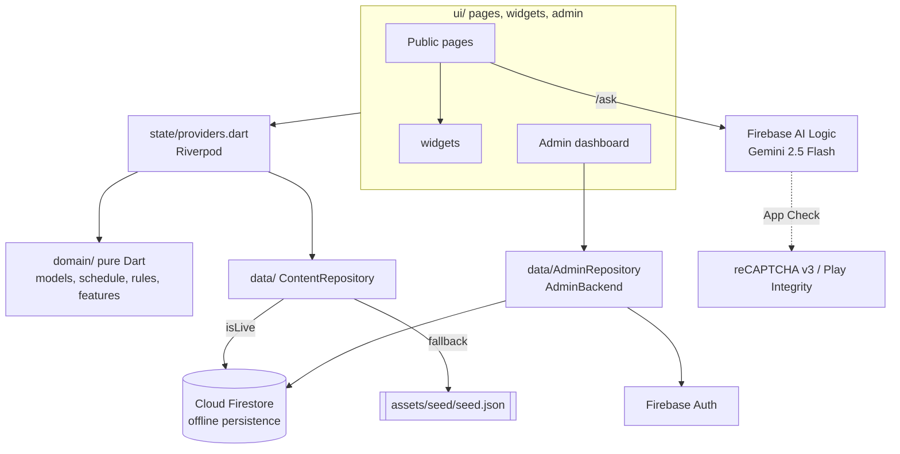
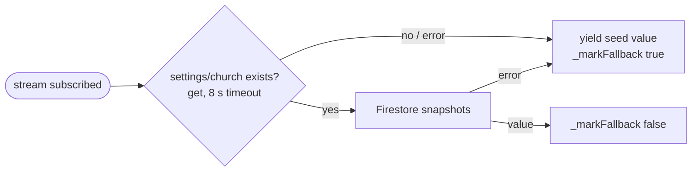

# 03 — Architecture

## Stack

| Concern | Choice (file) |
|---|---|
| UI | Flutter, Material 3. Widgets are imported from **`package:material_ui/material_ui.dart`** (pub package `material_ui ^1.9.0`), not `package:flutter/material.dart` — follow that convention. |
| Platforms | Web (primary, Firebase Hosting) + Android (`com.asafrachurch.church_portal`). iOS project exists, Firebase iOS app **not registered** (placeholders). |
| SDK | Dart `^3.13.7` (`pubspec.yaml`); README: built with Flutter 3.47 / Dart 3.13, stable channel |
| State | `flutter_riverpod ^3.4.3` (`lib/state/providers.dart`) |
| Routing | `go_router ^18.1.2` (`lib/router.dart`), **path URL strategy** (`usePathUrlStrategy()` in `main.dart`) |
| Backend | Firebase: `cloud_firestore`, `firebase_auth` (admins only), `firebase_app_check`, `firebase_ai` (Gemini), `firebase_core` |
| Time | `timezone ^0.11.2` (IANA `Africa/Cairo`, `lib/domain/cairo_time.dart`) |
| Fonts | `google_fonts` Cairo (`GoogleFonts.cairoTextTheme`), runtime fetching allowed (`GoogleFonts.config.allowRuntimeFetching = true`) |
| Links | `url_launcher` (`lib/core/launch.dart`) |
| Web interop | `web` package (`<html lang>` sync, map iframe) |

## Layers

```
lib/
  main.dart                 bootstrap: seed + Firebase in parallel (never crashes) -> ProviderScope overrides
  app.dart                  ChurchPortalApp: MaterialApp.router, locale, theme preset, <html lang>
  router.dart               routerProvider (GoRouter), FeatureGate wrapper, ?lang=en sync, 404
  firebase_options.dart     DefaultFirebaseOptions (web + android real, iOS PLACEHOLDER)
  config/app_config.dart    AppConfig: geminiModel, recaptchaV3SiteKey, App Check debug flags, adminPath
  domain/                   PURE DART (no Flutter/Firebase imports) — unit-tested business logic
    models.dart             ChurchSettings, PhoneEntry, Altar, Alert, Season, Liturgy, Meeting, Activity,
                            Clinic, Facility, Priest, Milestone, Saint (+ tolerant fromMap, parseHm, parseDate)
    features.dart           Sections, HomeBlocks, ThemePresets, FeatureSettings, routeSections,
                            normalizeHomeOrder, Hideable, publicItems
    schedule.dart           computeNextMass, occurrencesForDay, effectiveLiturgiesForDay, seasons helpers,
                            ScheduleTab, regularLiturgiesForTab, vespersAndPraise, seasonalSchedule
    rules.dart              alerts, clinics, digits/phones (Egypt), wa.me/tel links, contact validation,
                            ContactRateLimiter
    cairo_time.dart         CairoTime (fromInstant, at, startOfDay, calendarDate)
    time_format.dart        formatTimeLatin/Arabic, ranges, weekday names, formatDate, formatLooseDate
    assistant_context.dart  buildAssistantInstruction (Gemini grounding prompt)
  data/
    firebase_bootstrap.dart bootstrapFirebase() -> FirebaseStatus{available, appCheckActive}; App Check
    content_repository.dart ContentRepository (interface), SeedRepository, FirestoreRepository,
                            normalizeFirestoreValue/normalizeDoc
    seed_data.dart          SeedData: typed view over assets/seed/seed.json
    admin_repository.dart   AdminBackend (interface), AdminRepository (Firestore+Auth), AdminDoc, AdminRoles
  state/providers.dart      all Riverpod providers (see below)
  core/                     theme.dart (AppColors, buildTheme), l10n.dart (_strings, tr/pick/isAr),
                            launch.dart (openUrl, callPhone, openWhatsApp, maps URLs), document_lang*.dart
  ui/pages/                 one file per public route
  ui/widgets/               app_shell, cards (LiturgyCard, NextMassCard, AlertBanner, DirectoryCard,
                            ActionChipButton), common (PageBody, PageHeader, SectionTitle, ResponsiveGrid,
                            Skeleton*, EmptyState, ErrorState, AsyncSection, PendingConfirmationNote,
                            SampleBadge, Pill, IconLine, TimeRangeText, Footer), feature_gate, map_embed*,
                            coptic_cross
  ui/admin/                 admin_page (sign-in, role check, dashboard shell), admin_schema (FieldDef,
                            CollectionDef, adminCollections, churchInfoDoc), doc_editor (generic form),
                            collection_list, features_editor, admin_screens (overview, church info,
                            messages, admins), admin_validators
```

Rule of thumb: **business logic goes in `lib/domain/` as pure Dart with tests**; widgets only render and call it.



## Startup (`lib/main.dart`)

1. `WidgetsFlutterBinding.ensureInitialized()`, `usePathUrlStrategy()`, `CairoTime.ensureInitialized()`.
2. `Future.wait([SeedData.load(), bootstrapFirebase()])` — both never throw.
   - `SeedData.load()` reads `assets/seed/seed.json` (on error → empty `SeedData`).
   - `bootstrapFirebase()`: `DefaultFirebaseOptions.currentPlatformOrNull` (null for placeholder/unsupported
     platforms) → `Firebase.initializeApp` (10 s timeout) → Firestore `persistenceEnabled: true`,
     `cacheSizeBytes: 40 MB` → `_activateAppCheck()`.
3. Repository choice: `status.available ? FirestoreRepository(db, seed) : SeedRepository(seed)`; `AdminRepository`
   only when Firebase is available (otherwise `/admin` shows `adminUnavailable`).
4. `ProviderScope(overrides: [firebaseStatusProvider, repositoryProvider, adminRepositoryProvider])`.

## Offline / seed fallback (`lib/data/content_repository.dart`)



- `SeedRepository`: every stream emits the bundled value once; `servingSeed` is always true; `submitContact` throws
  `ContactUnavailableException`.
- `FirestoreRepository._seeded`: one cached `settings/church` existence check (a failed/timed-out read is not cached,
  so the next subscription retries). If the DB is not seeded, **every** stream serves the seed.
- `_guard(key, live, fallback)`: per-stream fallback on errors; `servingSeed` (a `ValueNotifier`) is true while any
  stream is on the seed → the `Footer` shows «تعرض البيانات المحفوظة مع التطبيق / Showing bundled content».
- Timestamps are normalised to UTC `DateTime` (`normalizeFirestoreValue`) before `fromMap`.
- `settings/features` missing → `seed.features` (all sections on).
- `seed_firestore.js` writes `settings` **last** so an interrupted seed never marks the DB as seeded.

## Riverpod providers (`lib/state/providers.dart`)

| Provider | Type | Notes |
|---|---|---|
| `firebaseStatusProvider` | `Provider<FirebaseStatus>` | overridden in `main` |
| `repositoryProvider` | `Provider<ContentRepository>` | overridden in `main` (throws if not) |
| `adminRepositoryProvider` | `Provider<AdminRepository?>` | null when Firebase unavailable |
| `settingsProvider` | `StreamProvider<ChurchSettings>` | `settings/church` |
| `featuresStreamProvider` | `StreamProvider<FeatureSettings>` | `settings/features` |
| `featuresProvider` | `Provider<FeatureSettings>` | value or `FeatureSettings.defaults` (all on) |
| `featuresReadyProvider` | `Provider<bool>` | true once the features stream has a value or error; `FeatureGate` waits on it |
| `alertsProvider`, `liturgiesProvider`, `meetingsProvider`, `activitiesProvider`, `clinicsProvider`, `facilitiesProvider`, `priestsProvider`, `milestonesProvider`, `saintsProvider` | `StreamProvider<List<T>>` | wrapped by `_public` → `publicItems` (drops `visible == false`, stable sort by `order`) |
| `seasonsProvider` | `StreamProvider<List<Season>>` | **not** filtered (seasons have no `visible`/`order`) |
| `nowProvider` | `StreamProvider<DateTime>` | ticks every 30 s (next mass, "available today", alerts) |
| `assistantVisibleProvider` | `Provider<bool>` | `features.enabled(assistant) && fb.available && fb.appCheckActive && settings.assistantEnabled` |
| `localeProvider` | `NotifierProvider<LocaleNotifier, Locale>` | initial from `Uri.base` `?lang=en`, else `ar`; `toggle()`, `set()` |
| `routerProvider` | `Provider<GoRouter>` (in `router.dart`) | |

## Routing (`lib/router.dart`)

- `GoRouter(initialLocation: '/')`, **path URL strategy** (`/mass-schedule`, not `/#/mass-schedule`). Firebase
  Hosting rewrites `**` → `/index.html` (`firebase.json`), so deep links and reloads work.
- `redirect: _syncLangQuery` keeps `?lang=en` in the URL in sync with the locale (adds it in English, removes it in
  Arabic). `refreshListenable` is a `ValueNotifier` bumped by `ref.listen(localeProvider)` so redirects re-run on
  toggle without rebuilding the router.
- A `ShellRoute` wraps all public pages in `AppShell(location, child)`; each page is built by `_page(state, child)` =
  `NoTransitionPage(child: FeatureGate(path: s.uri.path, child: child))`.

| Route | Widget | Gate (`routeSections` in `features.dart`) |
|---|---|---|
| `/` | `HomePage` | none (always on) |
| `/about` | `AboutPage` | any of history, saints, priests, departedPriests |
| `/mass-schedule` | `MassSchedulePage` | schedule |
| `/church-education` | `EducationPage` | meetings |
| `/church-activities` | `ActivitiesPage` | activities |
| `/clinics` (`?specialty=<key>`) | `ClinicsPage(initialSpecialty)` | clinics |
| `/public-services` | `PublicServicesPage` | services |
| `/contact` | `ContactPage` | any of contactInfo, socials, contactForm |
| `/ask` | `AssistantPage` | assistant (+ the page itself checks `assistantVisibleProvider`) |
| `/admin` (`AppConfig.adminPath`) | `AdminPage` | outside the shell, not gated, not linked anywhere public |
| anything else | `errorBuilder` → `AppShell` + "Page not found" + Back home | — |

`FeatureGate` shows a spinner (`Key('featuresLoading')`) until `featuresReadyProvider`, then the page or
`SectionUnavailable` («هذا القسم غير متاح حاليًا» + Back to home).

## App shell & navigation (`lib/ui/widgets/app_shell.dart`)

- `navItems`: home, massSchedule, clinics, education, activities, publicServices, about, contact; `askNavItem` added
  when `assistantVisibleProvider`. `visibleNavItems(f, showAsk:)` filters by `f.routeEnabled(path)`.
- Wide layout when `width / textScale ≥ 1024` (large system text forces the compact bar): text links
  (home/about/education), a **Services** popup (activities, public services, contact, ask), gold **Mass times** and
  white **Clinics** highlight buttons, language toggle (`EN` / `ع`).
- Narrow: compact circular Mass/Clinics buttons, language toggle, ☰ opens an **end drawer** (`_AppDrawer`).
- `PageBody` (common.dart) = width-capped (`kMaxContentWidth = 1100`) scroll view + `Footer`.

## i18n — Arabic-first RTL + English (`lib/core/l10n.dart`)

- Locales `ar` (default) and `en`; `MaterialApp.router(locale:, supportedLocales:, GlobalMaterialLocalizations.delegates)`
  gives RTL/LTR automatically. `web/index.html` deliberately has **no `dir="rtl"`** (breaks platform-view/iframe
  positioning); `<html lang>` is synced by `setDocumentLanguage` (web only).
- UI strings: `const Map<String, List<String>> _strings` — `key: [ar, en]`. Use `context.tr('key', {'n': '3'})`
  (`{name}` placeholders). Unknown keys render the key itself.
- Content fields come in pairs (`nameAr`/`nameEn`…); render with `context.pick(ar, en)` — falls back to the other
  language when one is empty. `context.isAr` for conditional logic.
- Digits: `toArabicDigits` / `normalizeDigits` (`rules.dart`); `localDigits(context, s)` (common.dart).
  Times are always shown in both systems (`TimeRangeText`: «٠٦:٣٠ ص – ٠٨:٣٠ ص» and "06:30 AM – 08:30 AM").
- Choice labels for stored keys (`opt_<key>`, e.g. `opt_holy_week`) via `choiceLabel` in `doc_editor.dart`.
- Admin labels live inline in `admin_schema.dart` (`labelAr`, `labelEn`).

## Theming (`lib/core/theme.dart`)

- Coptic palette `AppColors`: burgundy `#6B1426` (+dark/light), gold `#C9A227`, goldLight, cream `#FBF6EC`
  (scaffold), parchment, ink, muted, success, alert.
- `buildTheme(locale, primary:)`: `ColorScheme.fromSeed(seedColor: primary)`, Cairo text theme, app bar in primary.
- The admin picks the **primary** from `ThemePresets.all` (`settings/features.theme`): burgundy (default), navy,
  green, brown, purple; `ChurchPortalApp` watches `featuresProvider.select((f) => f.theme)`.
- Brand colours for social buttons in `cards.dart`: `whatsappGreen`, `facebookBlue`, `youtubeRed`, `instagramPink`.
- `CopticCross` widget is the logo (custom painter).

## Platform-specific bits

- Conditional imports `*_stub.dart` / `*_web.dart` (`if (dart.library.js_interop)`): `document_lang`, `map_embed`
  (iframe `HtmlElementView` on web, tappable static card elsewhere).
- `ChurchMap` uses keyless Google Maps embed `maps.google.com/maps?q=<mapsQuery>&output=embed&hl=ar`;
  "Open in Google Maps" (`mapsSearchUrl`) and GPS "Directions" (`mapsDirectionsUrl`, `travelmode=driving`).
- `openUrl` treats scheme-less links as https, opens http(s) in a new tab/external app.

## Responsive breakpoints

| Where | Breakpoint |
|---|---|
| App bar full links | `width / textScale ≥ 1024` |
| Home: Next-mass + phones side by side, Contact: info + form side by side | `width ≥ 900` |
| Hero compact | `width < 600` |
| Admin sidebar vs drawer | `width ≥ 1000` |
| `ResponsiveGrid` | columns = `floor(width / minItemWidth)` clamped 1–4 |
