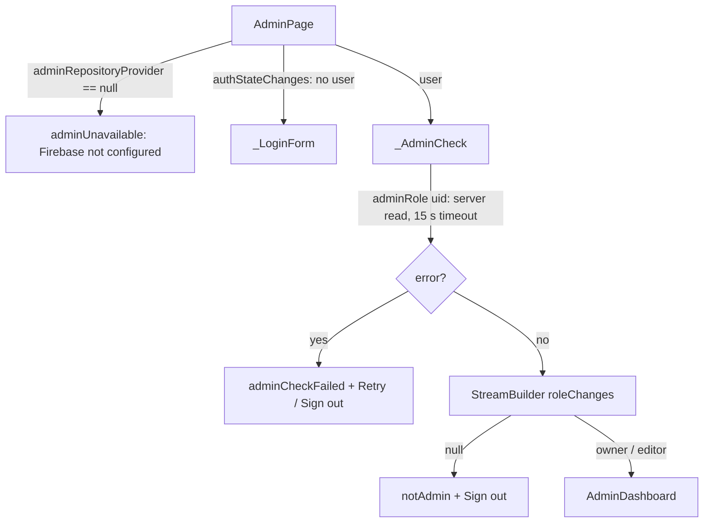

# 07 — Admin dashboard (`/admin`)

Code: `lib/ui/admin/` — `admin_page.dart`, `admin_schema.dart`, `doc_editor.dart`, `collection_list.dart`,
`features_editor.dart`, `admin_screens.dart`, `admin_validators.dart`; data access `lib/data/admin_repository.dart`.
Tests: `test/admin_test.dart`; server rules: `firestore.rules` + `tool/rules_test`.

## How to sign in

1. Open **`https://asafra-church-portal.web.app/admin`** (not linked from the public site; `AppConfig.adminPath`).
2. Email + password (Firebase Auth). "Forgot password?" sends a reset email.
3. The account must have a document **`admins/{uid}`** (`{email, role}`). Otherwise: «هذا الحساب ليس لديه صلاحية
   التعديل» + Sign out.
4. Arabic-first; `EN`/`ع` toggles the language. Desktop (≥ 1000 px): sidebar; phones: ☰ drawer.

Bootstrap the **first owner** (no owner can exist before): Firebase console → Firestore → `admins/<UID>` =
`{ "email": "...", "role": "owner" }`, or the **Seed Firestore** workflow input `admin_email` (finds/creates the Auth
user, makes it owner, emails a set-password link), or `admin` = `UID:email`, or locally
`node tool/seed_firestore.js --only none --admin <UID>:<email>`.

## Sign-in / permission flow (`admin_page.dart`)

- `adminRole(uid)` reads `admins/{uid}` **from the server** (`Source.server`) so a cold cache never shows "not admin";
  network errors show Retry instead of a misleading denial.
- `roleChanges(uid)` then streams the role live: a demoted owner loses the Admins screen, a removed admin loses the
  dashboard immediately. Cache-only "missing" snapshots are skipped.

## Roles

| Capability | Editor | Owner |
|---|---|---|
| All content collections (CRUD, hide/show, reorder) | ✔ | ✔ |
| Sections & home page (`settings/features`) | ✔ | ✔ |
| Church info (`settings/church`) | ✔ | ✔ |
| Contact messages: read, mark handled/new, delete | ✔ | ✔ |
| **Admins** screen: add / change role / remove **other** admins | ✘ ("ownerOnly") | ✔ |
| Change or remove **themselves** | ✘ | ✘ (UI + rules) → an owner always remains |

The same matrix is enforced server-side by `firestore.rules` (`isAdmin()` vs `isOwner()`). Note: the business case
wanted settings and message deletion owner-only; the implementation deliberately grants them to editors (ADR-011).

## Navigation (`adminDestinations(role)`)

`overview` → `features` → `church` → one entry per `adminCollections` item (alerts, seasons, liturgies, meetings,
clinics, facilities, activities, priests, departedPriests, saints, milestones) → `messages` → `admins` (owners only).
The app bar shows "Admin — <screen>", a 🌐 button to the public site and the language toggle; the nav shows the
signed-in email + role and Sign out.

## Screens

### Overview (`OverviewScreen`, `admin_screens.dart`)
Live counts per collection (respecting each screen's filter, e.g. serving vs departed priests) with hidden /
unconfirmed sub-counts, **new messages** (status ≠ handled, red when > 0), **sections on** (`N/15`), quick links
(church info, sections & home, alerts, open site) and the **8 latest edits** (title, `updatedAt`, `updatedBy`). A
failed stream shows "—".

### Sections & home page (`FeaturesScreen` / `FeaturesEditor`, `features_editor.dart`) → `settings/features`
- Switch each of the 15 sections on/off (+ "enable all"); labels from `Sections.labels`.
- **Home layout**: drag to reorder the 7 blocks, show/hide each; a block whose section is off is flagged
  («blockSectionOff»).
- Hero title/subtitle AR/EN (≤ 200/300), announcement banner (on/off, AR/EN text ≤ 500, link validated by
  `isValidUrl(allowPath: true)`), **site colour** (5 `ThemePresets`).
- "Save changes" writes `FeatureSettings.toMap()` with `saveDoc` (merge + stamp). If the doc does not exist yet, a
  note says everything is on by default. If someone else saves while you have unsaved edits, a banner offers a reload
  instead of wiping your edits.

### Church info (`ChurchInfoScreen`) → `settings/church`
`DocEditor` over `churchInfoDoc` fields: names, bishop, address, transport, lat/lng (ranges), map query, Maps link,
**phones** (object list: label AR/EN, number, mobile/WhatsApp — ≤ 20 rows), WhatsApp number/channel, Facebook,
YouTube, Instagram, verse + references, hero image URL, history AR/EN (≤ 8000), **altars** (object list: name AR/EN,
kind main/second/annex), `assistantEnabled`, `sample`. Same "updated elsewhere → reload" banner.

### Content lists (`CollectionListScreen`, `collection_list.dart`)
For each `CollectionDef`:
- Live list (`repo.watch(collection)`) filtered by the screen filter (`def.matches`), sorted by `sortAdminDocs`
  (orderable: by `order`; others by `order`/weekday, then start, then id).
- **Search** (all string values + id) and filter chips **all / visible / hidden / unconfirmed**; "showing N of M".
- Tile: title (`titleKeys`), subtitle (weekday, date, time range, season/stage/category/type/specialty labels,
  ⛔ inactive, start/end), tags *Hidden* / *Unconfirmed*, "updated by … at …".
- 👁 **hide/show** (`update(visible)`) — only when the collection has a `visible` field (not seasons).
- **Drag to reorder** (`reorder` → `order` = 10, 20, 30… in one batch) for orderable collections — clinics, facilities,
  activities, priests, departed fathers, saints, milestones — and only when search is empty, filter = all and > 1 item.
  Liturgies and meetings use the numeric **Order** field instead.
- **Add** (FAB) / tap to **edit** → full-screen `DocEditor`; **delete** with confirmation dialog.

| Screen id | Collection | Orderable | Has visible | Has sample | Notes |
|---|---|---|---|---|---|
| alerts | alerts | – | ✔ | – | title, body, active, starts/ends (Cairo), priority 0–1000, link (path or URL) |
| seasons | seasons | – | – | – | key choice, names, starts/ends, active |
| liturgies | liturgies | – (order field) | ✔ | ✔ | needs weekday **or** one-off date; end may be before start (midnight) |
| meetings | meetings | – (order field) | ✔ | ✔ | stage choice |
| clinics | clinics | ✔ | ✔ | ✔ | `active` missing = true |
| facilities | facilities | ✔ | ✔ | ✔ | "Public services" |
| activities | activities | ✔ | ✔ | ✔ | category choice |
| priests | priests (status = serving) | ✔ | ✔ | ✔ | missing status = serving |
| departedPriests | priests (status = departed) | ✔ | ✔ | ✔ | new docs start with `status: departed` |
| saints | saints | ✔ | ✔ | – | |
| milestones | milestones | ✔ | ✔ | – | icon choice |

`CollectionDef.publicPath` exists in the schema but is not used by any screen yet (no "open on site" link).

### Generic form (`DocEditor`, `doc_editor.dart`)
- Field widgets by `FieldType`: text, multiline, integer, decimal, boolean, time (HH:mm), weekday, weekdays (chips),
  dateTime / date (Cairo), looseDate, choice (labels via `choiceLabel`/`opt_*`), url, phone, objectList.
- Validation (`admin_validators.dart` `validateFieldValue`): required, max length (`effectiveMaxLength`), `HH:mm`,
  real calendar dates (rejects 2027-02-30), loose dates, numeric ranges (Arabic digits accepted), URLs (`https://…`
  or in-app path where `allowPath`), phones (`^\+?[0-9]{5,15}$` after normalising). Cross-field
  `validateDocument`: `requireAnyOf` (weekday or date → «needWeekdayOrDate»), end after start (except liturgies),
  `endsAt` after `startsAt`.
- New docs write all collected values (+ `newDefaults`); **existing docs write only changed fields**
  (`changedFields`, deep compare) with merge — never overwriting another admin's concurrent edits to other fields.
- Every save stamps `updatedAt` (server time) and `updatedBy` (email) via `AdminRepository._stamp`.
- Boolean defaults: `missingBool` (value assumed when an existing doc lacks the field, e.g. `visible` = true,
  clinic `active` = true) vs `newBool` (value for new docs, e.g. `sample` = false).

### Contact messages (`MessagesScreen`) → `contact_messages`
Newest first (`createdAt`), filter chips **new** (default) / handled / all; each card: name, time, message, phone
(call), email (`mailto:`);
**Mark handled / Mark new** (`update(status)`), copy to clipboard, delete with confirmation.

### Admins (`AdminsScreen`, owners only) → `admins`
List with role dropdown (owner/editor) and remove button — disabled for yourself ("(you)"). **Add admin** dialog: UID
(validated by `isValidAdminUid`: 1–128 chars, no `/`; copy it from Firebase console → Authentication → Users), email,
role. The Auth user itself must be created in the console (or via the Seed workflow) first.

## Gotchas for agents

- Adding a field = schema `FieldDef` + model + rules allow-list + seed (+ tests). The admin test cross-checks the
  rules allow-lists against `adminCollections` and seed keys.
- Max lengths in `FieldDef` must not exceed the rules limits (e.g. alert body form 1000 vs rule 2000 is fine; the
  reverse would make saves fail with permission-denied).
- `AdminBackend` is an interface so widget tests use an in-memory fake; keep new admin I/O behind it.
