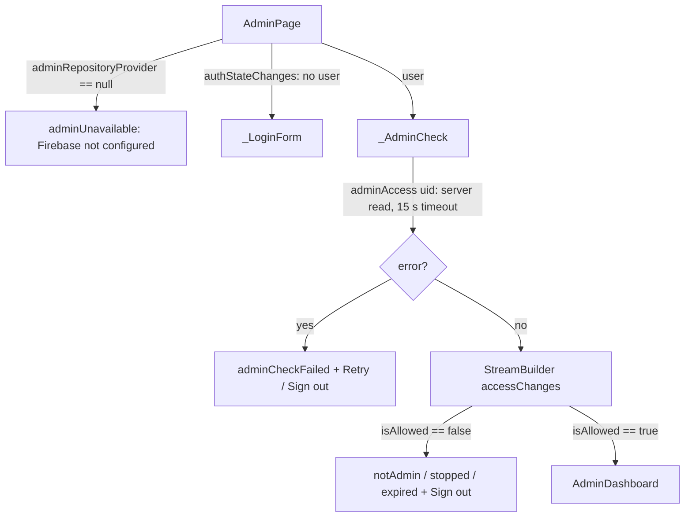

# 07 — Admin dashboard (`/admin`)

Code: `lib/ui/admin/` — `admin_page.dart`, `admin_access.dart`, `admin_schema.dart`, `doc_editor.dart`, `block_editors.dart`, `collection_list.dart`,
`features_editor.dart`, `admin_screens.dart`, `admin_validators.dart`, `confirm_named.dart`, `unsaved_guard.dart`,
`pending_delete.dart`, `unsaved_bar.dart`; data access `lib/data/admin_repository.dart`.
Tests: `test/admin_test.dart`; server rules: `firestore.rules` + `tool/rules_test`.

## How to sign in

1. Open **`https://maximos-domadios-church.web.app/admin`** (not linked from the public site; `AppConfig.adminPath`).
2. Email + password (Firebase Auth). "Forgot password?" sends a reset email.
3. The account must have a document **`admins/{uid}`** (`{email, role}`). Otherwise: «هذا الحساب ليس لديه صلاحية
   التعديل» + Sign out.
4. Arabic-first; `EN`/`ع` toggles the language. Desktop (≥ 1000 px): sidebar; phones: ☰ drawer.

Bootstrap the **first owner** (no owner can exist before): Firebase console → Firestore → `admins/<UID>` =
`{ "email": "...", "role": "owner" }`, or the **Seed Firestore** workflow input `admin_email` (finds/creates the Auth
user, makes it owner, emails a set-password link), or `admin` = `UID:email`, or locally
`node tool/seed_firestore.js --only none --admin <UID>:<email>`.

## Sign-in / permission flow (`admin_page.dart`)

- `adminAccess(uid)` (`lib/ui/admin/admin_access.dart`) reads `admins/{uid}` **from the server** (`Source.server`) so a cold cache never shows "not admin";
  network errors show Retry instead of a misleading denial. The login form `AdminLoginForm` localizes the email field
  label via `context.tr('emailLabel')` («البريد الإلكتروني» / "Email").
- `accessChanges(uid)` then streams the `AdminAccess` status live: a demoted owner loses the Admins screen, and a paused,
  expired, or removed admin loses the dashboard immediately. Cache-only "missing" snapshots are skipped.

## Roles

| Capability | Editor | Owner |
|---|---|---|
| All content collections (CRUD, hide/show, reorder) | ✔ | ✔ |
| Sections & home page (`settings/features`), Today & live stream | ✔ | ✔ |
| Church info (`settings/church`) | ✔ | ✔ |
| Contact messages: read, mark handled/new, delete | ✔ | ✔ |
| Owner-only settings: **Admins**, **Contact form types** (`settings/contact`), **AI assistant** (`settings/assistant`), **Season settings** (`venues`, `audiences`, `seasonVerses` in `settings/features`), **English version switch** (`englishEnabled` in `settings/features`), and **Advanced** (Sentry switch/test, App Check status, VAPID key/queues, APK install settings) | ✘ («ownerOnly» + blocked in `firestore.rules`) | ✔ |
| Change or remove **themselves** | ✘ | ✘ (UI + rules) → an owner always remains |

The same matrix is enforced server-side by `firestore.rules` (`isAdmin()` vs `isOwner()`, P2-18R, P2-27b).

## Navigation (`adminDestinations(role)`, PR 3E / P2-18)

Grouped under `AdminGroup` headers (`nav-group-<name>`): **7 editor groups** (`18` entries) plus an **8th owner-only group** (`ownerSettings`, `5` entries, `23` unique entries total):
1. **Home (`home`)**: `overview` («الرئيسية»)
2. **Schedule (`schedule`)**: `liturgies`, `meetings`, `today`, `seasons` (merged `SeasonsHubScreen` with tabs «قائمة المواسم» / «تجهيز الموسم»; deep links to `'seasonPreset'` open tab 1)
3. **Announcements (`announcements`)**: `alerts`, `app` (`AppAndNotificationsScreen` — announcements & notification types; technical VAPID/queues/APK moved to owner `advanced`)
4. **Church (`church`)**: `priests` (unified serving + departed priests with «الكل / يخدم / متنيح» filter, P2-20), `saints`, `milestones`, `church`
5. **Services & activities (`services`)**: `facilities`, `activities`
6. **Pages (`pages`)**: `features`, `pages` («الصفحات المخصصة», with «صفحة تبرعات جاهزة» template since PR 3D), `categories` («الأقسام المخصصة» — unified sections & nested items since PR 3D)
7. **Messages (`messages`)**: `messages` (shows unread inbox count badge `nav-messages-badge` when > 0)
8. **Settings (owner only, `ownerSettings`)**: `admins`, `contactCats`, `assistant`, `seasonSettings`, `advanced` (`AdvancedOwnerScreen` with tabs `System & queues` and `App install & APK`).

Deep links to `'entries'` redirect to `'categories'`, `'departedPriests'` redirect to `'priests'`, and `'seasonPreset'` routes to `SeasonsHubScreen(initialTab: 1)`.
Every entry has its own icon (`adminIcon`), and every screen displays an `AdminScreenHeader` (`Key('screen-title')` + `Key('screen-help')`, P2-19) wrapping cleanly at 320 px / 200% text. The nav is a `Material` (not a coloured `Container`, which hid the tiles'
ink), so the selected entry shows the gold highlight; icons are burgundy, labels ink, and the selected entry's icon
and label are both burgundy (`ListTile.iconColor/textColor/selectedColor`, PR #23).
The app bar shows "Admin — <screen>", a 🌐 button to the public site and the language toggle; the nav shows the
signed-in email + role and Sign out.

## Screens

### Overview (`OverviewScreen`, `admin_screens.dart`, PR 3E / P2-23)
Starts with `AdminScreenHeader`, then **«محتاج انتباهك» (`attention-section` / `attention-all-clear`)** powered by pure Dart `attentionItems(...)` (`lib/domain/attention.dart`) from existing already-watched streams (zero extra Firestore reads): open visitor messages → alerts expiring within 48 hours → unconfirmed (`sample: true`) docs → live stream switched on without a link → missing English translations (counted across `adminCollections` via `englishFieldPairs` + `docMissingEnglish` only when `englishEnabled` is true). When unconfirmed items span multiple sections, a subtitle breakdown is displayed (`att_unconfirmedBreakdown`: «منها {c} في {sec}»). In `admin_strings.dart`, sample switches use «غير مؤكد (تجريبي)» (`switch_sample`) versus «مؤكد» (`switch_confirmed`). Each attention row navigates to its target screen on tap. Below it sit the **6 quick task buttons (`quick-tasks`)** for tasks T1–T6 (`task-schedules`, `task-announcement`, `task-inbox`, `task-service`, `task-priest`, `task-donations`), the compact **Sections summary** card («ملخص الأقسام» + «افتح في الموقع»), and the **8 latest edits** (title, `updatedAt`, `updatedBy`). If the screen is rebuilt with a different backend (`widget.repo`), `didUpdateWidget` cancels and re-subscribes every stream (BUG-18).
- **Per-stream stall timeouts & partial failure recovery (PR 6D, ADR-089):** `_OverviewScreenState` tracks a 10-second `Timer` per watched stream (`_streamTimers`) and a `_timedOut` key set cleared when data or an error arrives (and cancelled in `_cancel()` / `dispose()`). When `settings/features` times out or fails, «ملخص الأقسام» (`sections-summary`) renders `'—'` (never stuck on `'…'`) alongside an inline `sections-retry` button while loaded attention cards remain visible; when any collection stream fails or times out, `attention-error` (`attention-retry`, wrapping cleanly at `320 px`) appears below any loaded attention items and tapping Retry re-subscribes all streams.

### Sections & home page (`FeaturesScreen` / `FeaturesEditor`, `features_editor.dart`) → `settings/features`
- Switch each of the 19 sections on/off (PR #16 added «آية اليوم» / Verse of the day, PR #18 «الأقسام المخصصة» / Custom sections and «الصفحات المخصصة» / Custom pages) (+ "enable all"); labels from `Sections.labels`. **«الصور» /
  Images**, hides every optional item image site-wide (default on). For owners (`isOwner`), a separate **«النسخة الإنجليزية»** switch (`ValueKey('features-englishEnabled')`, `settings/features.englishEnabled`, default on) controls the public EN button and hides all `lang: 'en'` fields/subfields across `DocEditor` and `FeaturesEditor` while preserving stored English values across Arabic-only edits (`featuresSaveWrites` omits `englishEnabled` when unchanged so editors never trigger the owner-only rule).
- **Save echo guard:** `FeaturesScreen` and `ChurchInfoScreen` track `saving` on the active editor; when saving is in progress, incoming Firestore pending-write local echoes or failed-save rollbacks never trip `stale` (`updatedElsewhere` banner) or overwrite form edits.
- **Form error summary & persistent save error banner (`DocEditor`, PR 3G / P2-27a, PR #83, PR #90):**
  - When `save()` fails validation, a sticky top banner (`Key('editor-error-summary')`, Arabic dual/pluralized count e.g. «فيه حقلين محتاجين تصحيح») lists every invalid shown field—including fields inside collapsed `ExpansionTile` groups or `advanced` cards; tapping any entry (`ValueKey('error-summary-<id>')`) expands its card if closed, scrolls it into view, and focuses the field; fixing errors clears the summary automatically. Duplicate slugs append `context.tr('slugTaken')` («هذا الرابط مستخدم بالفعل» / «This address is already used») to the `slug` summary entry label. Empty heading blocks (`BlockTypes.heading`) enforce required Arabic heading text (`blockHeadingRequired` / «عنوان الفقرة (عربي) مطلوب.» via `validateHeadingBlock` and `validateDocument`); tapping the error expands the block and focuses `textAr`.
  - When `save()` fails due to document validation, server rules, or network error, a persistent inline error banner (`Key('editor-save-error')`) with `Icons.error_outline` and dismiss button appears at the very top of the form, smoothly scrolling into view (never failing silently), surfacing structured Firebase error codes via `formatAdminError(Object)` (e.g. `[permission-denied]`) along with the error description. Any form edit or re-save attempt clears the banner. The same `formatAdminError` helper formats error snackbars across `CollectionListScreen`, `MessagesScreen`, `AdminsScreen`, and `SeasonPresetScreen`.
- **Home layout**: drag to reorder the 7 blocks — or tap **Move up / Move down** (`ValueKey('home-<block>-up|down')`,
  WCAG 2.5.7 single-pointer alternative) — show/hide each; a block whose section is off is flagged
  («blockSectionOff»). Below 600 px the move buttons sit in the tile's subtitle row and only the switch stays
  trailing (PR #10).
- Hero title/subtitle AR/EN (≤ 200/300), announcement banner (on/off, AR/EN text ≤ 500, link validated by
  `isValidUrl(allowPath: true)`).
- **Site theme & occasions** card (PR #17, ADR-025; `OccasionThemeEditor`, `occasion_editor.dart`): theme chips with
  swatches (`ValueKey('theme-<key>')`, white label when selected); a line "In force today: … — manual / schedule /
  Easter / fallback"; switch **Switch the theme automatically by date** (`occasions-auto`; off = the selected theme
  always applies — the manual override); with it on: **Holy Week & Resurrection from the Coptic Easter date**
  (shows this year's computed dates) + Resurrection length (1/3/7/14/40/50 days), and the **occasion schedule** (up to
  12 ranges: theme, From/To date pickers — To never before From — remove). **Edit a theme's colours** (collapsible):
  pick a preset, one `#RRGGBB` field per palette colour with swatch, a live preview, a status line ("All text is
  readable" or "Will be saved corrected for readability: key old→new"), and "Reset to the preset colours". Saves
  store the corrected colours (`OccasionConfig.withReadableCustom`).
  **ADR-043:** switch «الثيم يتبع الموسم الكنسي الجاري» (`occasions-followSeason`, default on) and, under it, «ثيم كل
  موسم» (`occasions-seasonMap`): one dropdown per season key (`occasions-season-<key>-theme`) with «بدون ثيم» + the
  pickable presets (only differences from the defaults are saved). The "in force today" line can say «حسب الموسم
  الكنسي الجاري». The `purple` chip is gone (`ThemePresets.pickable`); a document that still holds it shows it.
- ~~Hero video library (YouTube) card~~ (PR #17, ADR-026) — **removed in PR #25 (ADR-036)**: no `HeroVideoEditor`, no
  YouTube links; the hero always plays the bundled clip, switched by *Hero motion & video*. The dashboard itself
  always uses the Golden hour palette.
- **Page titles, subtitles & intro notes** (PR #12): one collapsible row per customizable page (`about, schedule,
  education, activities, services, contact, ask` — `ValueKey('page-<key>')`, `maintainState: true`) with
  title AR/EN ≤ 200, subtitle AR/EN ≤ 300, intro AR/EN ≤ 1500 (`ValueKey('features-page-<key>-<field>')`); a
  **«مخصّص / Customized»** badge while any field is filled and **«إعادة للافتراضي / Reset»** to clear the page
  (empty = the page's built-in text). A too-long field opens its row on Save.
- **Site footer (FR-G-04)** (PR #12): switches *Show phone numbers / social links / quick links*
  (`ValueKey('footer-<key>')`) and footer notes AR/EN ≤ 500 (`ValueKey('footer-noteAr|noteEn')`). Rendered by the public `Footer` since PR #13.
- "Save changes" writes `FeatureSettings.toMap()` with `saveDoc` (mergeFields + stamp) — since PR #12 in two writes
  when the page headers changed: everything else, then `{pageHeaders}` (PR #17 adds `{occasions}` and `{themeColors}`
  writes, each only when changed / non-default; `heroVideos` is never written since PR #25) (`featuresSaveWrites`; the whole doc plus
  8 page headers in one write exceeds the rules' expression cap). `collect()` round-trips `pageHeaders`/`footer`, so
  the echo of your own save keeps the form (BUG-12). If the doc does not exist yet, a
  note says everything is on by default. If someone else saves while you have unsaved edits, a banner offers a reload
  instead of wiping your edits. The snapshot of **your own save** no longer remounts the form (BUG-12):
  `isEchoOfEditor(shown, latest, editorValues)` (`admin_validators.dart`) — if only metadata changed or every changed
  field already equals what the form holds, the editor key is kept, so the scroll position stays.

- **Sections** card (ADR-052): under «محطات تاريخية (قصتنا)» an indented switch **«إظهارها أيضًا في «عن الكنيسة»» /
  "Also on the About page"** (`ValueKey('features-aboutMilestones')`, `settings/features.aboutMilestones`, default on;
  disabled while the milestones section is off). The Home «قصتنا» block keeps its own home-layout switch.

- **Hero texts** card (PR #22, ADR-032): besides title / subtitle AR/EN and *Hero motion & video*, a
  **"Show address in hero"** switch (`ValueKey('features-heroShowAddress')`, `heroShowAddress`, default off): the
  address ribbon under the hero title when no subtitle is set.

- **Error reports (`settings/features.errorReporting`):** Moved in PR 3E (P2-21) to the owner-only **«متقدم» (`AdvancedOwnerScreen`, `lib/ui/admin/advanced_owner_screen.dart`)** screen (alongside App Check status, Web Push VAPID key + live-subscribed queue health via shared `WebPushHealthRows` in `lib/ui/admin/web_push_health.dart`, and the **App install & APK** tab `appInstallDoc`). `FeaturesEditor` no longer shows Sentry controls or the duplicated assistant switch. Each `AdminScreenHeader` renders `Key('screen-title')` + `Key('screen-help')` (`lib/ui/admin/screen_header.dart`) across all 14 `adminCollections`, single docs, and custom admin screens.

- **Verse of the day** card (PR #16, ADR-024; since PR #17 it controls the **hero** verse): "Show the verse of the day" switch (same flag as the
  `dailyVerse` section toggle), mode chips "A different verse
  every day" / "A fixed verse I choose"; fixed mode shows the Arabic text (required, ≤500) and reference (≤60) fields, plus optional English text (≤500) and
  English reference (≤60) since ADR-047 →
  `settings/features.dailyVerse`. Saving in daily mode clears the (hidden, unvalidated) fixed-verse fields.
- **Image display** card (PR #15, ADR-023): one dropdown per image collection (avatar / card / banner) →
  `settings/features.imageStyles`; the dropdown shows the built-in default until changed.
- Item forms on image collections have **"Image display (— = section default)"** under the image (`imageStyle`,
  nullable choice); a new document does not write it while unset.

### Season settings («إعدادات المواسم», `ChurchInfoScreen(doc: seasonSettingsDoc)`) → `settings/features` (PR #32, ADR-041)

Top-level keys `venues` and `audiences` (encoded-row lists, ≤ 12 rows each: key, Arabic name, English name; empty =
the defaults). They feed the run-time dropdowns «المكان / القاعة» and «الفئة» of the programme group. The generic form
writes only the keys it changed. Since PR #33 (ADR-042) it also holds «آيات المواسم» `seasonVerses` (≤ 40 rows:
season choice, verse text, reference; since ADR-047 optional English text and English reference, stored as a
`␟textEn␟refEn` tail only when filled — `FieldDef.encodedOptionalTail: 2`).

Since PR #36 (Sentry CHURCH-PORTAL-9) the dashboard keys each `ChurchInfoScreen` by section (`ValueKey('today')`,
`ValueKey('seasonSettings')`, `ValueKey('church')`) and `ChurchInfoScreen.didUpdateWidget` rebuilds the form when the
`DocDef` itself changes, not only its path: «اليوم والبث المباشر» and «إعدادات المواسم» share `settings/features`
with different fields, and a reused `DocEditor` kept Today's per-field state, so opening Season settings next threw
`Null check operator` on `_rows['venues']!`. Guarded by the dashboard Today → Season → Today test in
`test/accessibility_test.dart`.

### Season preparation («تجهيز الموسم», `SeasonPresetScreen`, `lib/ui/admin/season_preset_admin.dart`) (PR #33, ADR-042)

Season dropdown (upcoming first; names carry the year — ADR-043, sim B5) → checklist of 7 options (8 with «ثيم الموسم
(ألوان الموقع)», ADR-043: offered only for a season key that brings a theme, ticked by default only while the theme
does not already follow the season) with per-season defaults (`PresetRequest.defaultsFor`), a
live-link field and a Drive-link + button-text fields when ticked → «تطبيق تجهيز الموسم» → confirmation dialog listing
every change → one transaction (`saveDocsFresh`: re-reads `settings/features` + the season and re-plans, so another admin's change meanwhile is kept and a preset applied meanwhile is never overwritten) writing `settings/features` + the season. While a preset is applied the screen shows
it (season, applied / end dates, options), says whether the season is running or over (visitors already back to
normal), and offers «استرجاع الإعدادات السابقة» (confirmed; never recreates a deleted season). Bad links are refused
before the dialog. The assistant form gains «أقصى عدد أسئلة في اليوم أثناء المواسم الاستثنائية» (`perDaySeason`).
**ADR-051:** fasting keys (`fast`, `great_lent`, `apostles`, `kiahk`) tick «إخفاء حجز الأفراح» by default. The live
option shows «ينتهي شريط البث: …» = tonight's last service of the season + 30 min (23:59 when none; the season's first
evening when applied ahead; read from one `liturgies` read when a season is picked) with an edit button (date + time
pickers); `liveEndsAt` gets that value, the auto-revert stays the season end. An additive season's `replaceDates` show
as chips («يحل محل الجدول العادي في:»). The assistant form adds «المواسم الاستثنائية» (`exceptionalSeasons`,
`FieldType.choices`: one chip per season key, missing = the defaults ticked). The season form adds «أيام يحل فيها
الموسم محل الجدول العادي (ليلة العيد)» (`replaceDates`, `FieldType.dateList`: date chips, × to remove, «إضافة تاريخ»
opens the date picker, ≤ 10). The season-key dropdown lists 13 keys (adds صوم الآباء الرسل، النيروز وعيد الصليب، شهر
كيهك، الصوم الكبير المقدس). «اليوم والبث المباشر» → `liveLabelEn` hint: English pages only, blank = "Live now from the
church".

### Programme group on liturgies, meetings and seasons (PR #32, ADR-041)

Collapsible card «البرنامج: المتكلم والمكان والفئة وملف PDF» (`FieldGroup.program`, between basic and details):
speaker, topic, choir (ar/en), venue and audience (dropdowns read from `settings/features` when the editor opens,
defaults otherwise), PDF link (https only; hint explains sharing a Google Drive file as "Anyone with the link"), and
the button text. `collection_list.dart` passes `dynamicChoices` `venues` / `audiences`.

### Today & live stream («اليوم والبث المباشر», `ChurchInfoScreen(doc: todaySettingsDoc)`) → `settings/features` (PR #31, ADR-039/040)

Generic form over the today keys of `settings/features` (writes only changed keys, so it never clobbers the
Sections & home page editor and vice versa): Coptic date strip (every page / Home only / off), start of the
liturgical day (fixed time — default 18:00 — or sunset at the church), the fixed time, Home "Today's event" card,
automatic feast / commemoration (Katameros), church events by date (≤ 20 rows: date, until, from / to, titles,
speaker, topic, note, link), live-stream banner switch, stream link, banner texts, automatic switch-off, and (PR #35,
ADR-044) «إخفاء شارة البث في الرئيسية عند ظهور الشريط» / "Hide the live badge on Home while the banner shows"
(`liveBadgeHideOnHome`, `missingBool`/`newBool` true). PR #38 (ADR-045): «عند عدم وجود حدث: اعرض خدمة اليوم / الليلة من
برنامج الموسم» (`topEventServices`, default on), and three more event columns: «رابط ملف PDF (Google Drive، اختياري)»
(https), «نص زر الملف (عربي / إنجليزي)». The assistant's «أقصى عدد أسئلة في الدقيقة» hint explains it applies with
the daily / season limit. Since PR #35 a non-empty `dayEvents` list is saved in its own
write after the other keys (`separatelySavedKeys`; 20 events plus another Today key exceed the rules' 1,000-expression
budget in one write).

### App & notifications («التطبيق والإشعارات», `AppAndNotificationsScreen`, `lib/ui/admin/notifications_admin.dart`) → `settings/features` & `settings/notifications` (ADR-057, ADR-059; UX rework PR #55)

Two tabs: «الإشعارات» (`NotificationsAdminSection`, kept alive across tab switches) and «تثبيت التطبيق»
(`ChurchInfoScreen` over `appInstallDoc`). The notifications tab is one list of cards, Arabic first:
1. **Status** — master switch (`push`) with on/off explanation and a «متوقفة» banner; sender health from
   `health.lastRunAt` in plain words: ok (≤ 1 h, «آخر فحص منذ …» in Cairo time), late (> 1 h), stopped (> 3 h or
   `status: error`), never run (no stamp — neutral, not red). Since ADR-060: web push subscriber stats from
   `meta/push_topics` (`activeSubscribers`), web reminder planner status from `meta/push_plan` (upcoming reminder topics
   count and next service time in Cairo), and queue rate throttle cap warning banner when meta/push_topics.cronQueue.capReached is true (1,000 web opt-in batch writes/day limit reached). Both `AdvancedOwnerScreen` and `NotificationsAdminSection` (`showTechnical: true`) render these rows via `WebPushHealthRows` (`lib/ui/admin/web_push_health.dart`), which subscribes live to `watchDoc('meta/push_topics')` and `watchDoc('meta/push_plan')` (with 1-minute age recomputation) rather than one-shot `.first` so stale IndexedDB cache emissions are replaced immediately when server snapshots arrive.
2. **Scheduled announcements** (`schedule`, ≤ 20) — numbered 5-step editor: Arabic title + body (both required, as
   the rules and `parseScheduleRow` require), English optional (`draft-english`, collapsed by default — hidden
   alongside the English phone preview option when `settings/features.englishEnabled` is false while preserving
   stored `titleEn`/`bodyEn` values, and auto-revealed + expanded via `ExpansibleController` only if legacy stored
   English text fails validation); «في أقرب وقت» or Cairo date + time
   (default tomorrow 09:00; past times refused; switching to «في أقرب وقت» auto-clears past-time errors); timing and target chips use `context.pal.bar` background for high-contrast visibility; targets «الجميع / تطبيق أندرويد فقط / المتصفح و iPhone فقط»;
   «ماذا يفتح» picker (built-in pages, custom pages/categories, liturgies `lit-`, meetings `meeting-`, today's
   events `day-`, seasons `season-` — one-off reads when the dialog opens; ids the rules reject open the page without
   an `eventKey`) or a custom `/path`; phone preview ar/en; «جرّب على هذا الجهاز». Pure field validation routes
   through `validateScheduledNotificationFields` (`admin_validators.dart`) directly beneath each input
   (`titleAr`, `bodyAr`, `titleEn`, `bodyEn`, `targets`, `link`), while `_saveDraft` handles scheduled-time checks
   (setting the `when` error for past times and checking again after confirmation), auto-expanding `draft-english` if
   needed and scrolling the first error into view (`SingleChildScrollView` + `Column` keeps off-screen keys mounted at
   320 px / 200 %);
   editing clears that field's error while server concurrency/cap conflicts (`nm_errRowGone`, `nm_errAlreadySending`,
   `nm_errFull`) stay in the form-level `draft-error` banner.
   Rows grouped «القادمة» / «السابقة» with icon status chips and a one-line explanation per state; «تعديل» while
   the row has no `status` entry, «أعد الإرسال» (copy, targets narrowed) for partial / error / unconfirmed /
   expired, «حذف» with a confirmation dialog. Saving an announcement that targets everyone (`_draft.targets == 'all'`)
   or is sent soon (`_draft.soon == true`) triggers a named confirmation dialog (`confirmNamedAction`, `confirm_named.dart`)
   matching recipients and timing: send-all soon («هيتبعت لكل المشتركين دلوقتي: {t}», `nm_confirmSendAllSummary`, `nm_sendToAllBtn`),
   targeted soon («هيتبعت ({target}) دلوقتي: {t}», `nm_confirmSendTargetSoonSummary`, `nm_sendNowBtn`), scheduled all
   («هيتبعت لكل المشتركين {when}: {t}», `nm_confirmScheduleAllSummary`, `nm_confirmScheduleBtn`), or scheduled targeted
   («هيتبعت ({target}) {when}: {t}», `nm_confirmScheduleTargetSummary`, `nm_confirmScheduleBtn`), followed by a post-await
   past-time recheck.
   Closing an open draft with unsaved text (`_closeDraft`, `ValueKey('draft-cancel')` / `ValueKey('editor-close')`) prompts
   `confirmDiscardChanges`. Saves go through `saveDocsFresh` (fresh read: an edit is refused once
   the sender has claimed the row; the 20-row cap is checked on the fresh list).
3. **Types offered** — one card per type with a switch (`pushTypes`), icon, description and the delivery channel in
   words; «تعديل الوقت والنص»: time picker (no typed HH:mm), seasons «قبل بدايته بـ» 0–7, templates with
   «أدرج» chips named in Arabic (`placeholderLabel`), live sample (`placeholderSamplesAr/En`), reset with
   confirmation. Announcements have no template (their text is written per announcement). Only modified types are
   stored in `notifyTypes`.
4. **«ذكّرني»** — source switches (`reminderSources`, stored in the fixed order `lit,mtg,day`), 1–4 lead chips
   (inline note on the limit, not a snack bar that would cover the save bar), default lead. Since ADR-060:
   informational notice on web reminder delivery delay («تنبيهات المتصفح تعتمد على جدول الخادم كل ربع ساعة...»)
   recommending 15–30 min lead times.
5. **Sent log** — last 30 entries with Cairo time, kind (announcement / automatic season alert) and a result chip;
   owner-only clear with confirmation.
6. **Technical settings** (collapsed) — VAPID key with where to find it and format validation.
Cards 1, 3, 4, 6 share the bottom bar «لديك تعديلات لم تُحفظ — حفظ الإعدادات / تراجع» (writes `settings/features`);
loading a snapshot never marks the form dirty.

### Church info (`ChurchInfoScreen`) → `settings/church`
(`ChurchInfoScreen` takes a `DocDef doc` — default `churchInfoDoc` — and an optional `header`; PR #19 reuses it for
`settings/assistant`.)
`DocEditor` over `churchInfoDoc` fields (saving identical flat keys on `settings/church`): basic identity (`nameAr`/`nameEn`, `bishopAr`/`bishopEn`, `addressAr`/`addressEn`, `sample`) stays open at the top (`FieldGroup.basic`), while secondary sections sit in four collapsible `ExpansionTile` cards (`maintainState: true`, PR 3J / P3-30):
- **Location & map (`FieldGroup.location`)**: `transportAr`/`transportEn`, `lat`/`lng` (with degree hints and ranges), `mapsQuery` (with search hint), `mapsUrl`.
- **Contact & links (`FieldGroup.contacts`)**: `phones` (`objectList` ≤ 20 rows), `whatsapp`, `whatsappChannel`, `facebook`, `youtube`, `instagram`.
- **Front banner & verse (`FieldGroup.hero`)**: `verseAr`/`verseEn`, `verseRefAr`/`verseRef`, `heroImageUrl`.
- **History & altars (`FieldGroup.history`)**: `historyAr`/`historyEn` (≤ 8000), `altars` (`objectList`).

Live pills under each group count both non-empty text controllers and non-empty `objectList` rows (`phones`, `altars`). Same "updated elsewhere → reload" banner, and the same own-save rule (no scroll jump to the top after Save, BUG-12). In `alerts`, `priority` (`0–1000`, default `0`) explains in plain words that larger numbers appear first.

### Content lists (`CollectionListScreen`, `collection_list.dart`)
For each `CollectionDef`:
- Live list (`repo.watch(collection)`) filtered by the screen filter (`def.matches`), sorted by `sortAdminDocs`
  (orderable: by `order`; others by `order`/weekday, then start, then id).
- **Search** (all string values + id) and filter chips **all / visible / hidden / unconfirmed**; "showing N of M". On **Priests (`priests`)**, an extra status filter row **«الكل / يخدم / متنيح»** (`priestFilter-all/serving/departed`) lets editors filter serving vs departed fathers; tapping **Add** while filtered to «متنيح» defaults `status: 'departed'`.
- **Open on site** (`Key('admin-openOnSite')`, «عرض بالموقع»): opens `CollectionDef.publicPath` (e.g. `/public-services`,
  `+ ?lang=en` when the dashboard is in English — `publicPathFor`) in a new tab on web (`Uri.base.resolve`), or
  navigates there on mobile.
- Tile: title (`titleKeys`), subtitle (weekday, date, time range, season/stage/category/type/specialty labels,
  ⛔ inactive, start/end), tags *Hidden* / *Unconfirmed* / *Departed*, "updated by … at …". Tapping the row opens `DocEditor`; bottom action bar holds **«عرض بالموقع»** (`ValueKey('openItem-<id>')`, external-link icon `Icons.open_in_new_rounded`) when visible with a detail page, and a clearly named **«حذف» / «Delete»** button (`ValueKey('delete-<id>')` / `deleteEntry-<id>`) separated vertically from the top-right 👁 visibility toggle across `_tile`, `_categoryTile`, and `_entryRow`.
- The list `StreamBuilder` is keyed by `ObjectKey(_stream)` (also on Messages and Admins, PR #12): after a backend
  switch the old list is never shown while the new one loads.
- 👁 **hide/show** (`update(visible)`) — only when the collection has a `visible` field (not seasons). All four row
  builders (`_tile`, `_categoryTile`, `_sectionPageRow`, `_entryRow`) share `_visibilityButton` alongside the static
  «ظاهر / مخفي» `_Tag`: all four row builders isolate `_visibilityButton` (and trailing row controls) outside `ListTile`'s
  `InkWell` via `_splitActionRow` anchored at the top-end corner (`CrossAxisAlignment.start`), and tapping replaces the eye
  icon with an inline spinner (`savingVisibility` «جارٍ الحفظ…») inside a fixed `48×48` padded hit target
  (`MaterialTapTargetSize.padded`), disables only that row's visibility toggle button under a composite `'${collection}:${id}'`
  in-flight write lock while an always-active opaque `GestureDetector` absorbs rapid repeat taps during the write (even if a write settles mid-tap or titles wrap
  on narrow viewports) so they cannot fall through to `ListTile.onTap` (tapping the row body still opens `DocEditor`). Because the lock tracks the in-flight Firestore write rather than a fixed cooldown, rapid bursts during a save toggle once while deliberate taps after the write settles (e.g. ~0.6 s later on desktop) count as separate toggles without ever opening `DocEditor`. On failure it
  reverts visual state + shows `saveFailed`, and keeps tooltip/semantics clear («إظهار في الموقع» / «إخفاء من الموقع»).
  List scrollables also apply text-scale- and safe-area-aware bottom padding (`_listBottomPadding`) so the last card's actions stay
  clear of the `+` FAB at 320 px / 342 px / 200 %. `CollectionListScreen` also passes its own inner `ScaffoldMessenger` (`popMessenger`) to
  `DocEditor` so `savedMsg` and `noChanges` queue cleanly when `popOnSave` pops back.
- **Drag to reorder** — or tap **Move up / Move down** on each tile (`ValueKey('moveUp-<id>')`, WCAG 2.5.7) —
  (`reorder(collection, ids, base:)` → `order` = base + 10, 20, 30… in one batch) for orderable collections — facilities,
  activities, priests, saints, milestones — and only when search is empty, filter = all
  and > 1 item. Serving and departed priests never cross-reorder; **departed fathers use base 1000** (`reorderBase(def, status: 'departed')`: 1010, 1020…) and `_reorder` sends only that status group's IDs, so the two groups keep non-colliding `order` ranges inside `priests` (BUG-13, P2-20).
  Liturgies and meetings use the numeric **Order** field instead.
- `DocEditor.save`: when `onSave` fails with a **`TimeoutException`** the images uploaded for the document are
  **kept** — Firestore may still commit the queued write pointing at them; any other error deletes them (BUG-13).
  Note: `AdminRepository.save`/`saveDoc` set no timeout of their own today (the only 15 s timeout is the role/access read
  in `adminAccess`), so this path applies to a timeout raised by a caller/backend wrapper.
- **Add** (FAB) / tap to **edit** → full-screen `DocEditor`; **delete** in `collection_list.dart` prompts `confirmNamedAction` naming the item (`deleteItemConfirm`: «حذف «{n}»؟ يمكنك التراجع خلال ١٠ ثوانٍ.») across both `_tile` and `_entryRow` (cancelling leaves the item untouched with zero writes) before passing to the shared 10-second reversible soft-delete coordinator (`SoftDeleteUndo` + `PendingDelete`, `pending_delete.dart`). Non-category items register synchronously into
  `SoftDeleteUndo` and immediately write Firestore
  `deletedAt: DateTime.now().toUtc()` (allowed by `meta()` and `optTimestamp(d, 'deletedAt')` in `firestore.rules`,
  serialized per doc via `_inFlightWrites` with monotonic `_gen` guards so rapid consecutive deletes never
  race or fall back to a single-item bar),
  hide immediately from the visible list (`SoftDeleteUndo.isVisible` / `isSoftDeleted`), and show a 10-second `SnackBar`
  right away (`persist: true` driven by `_barTimer`, updating multi-delete text in place via `_barState`
  across 2 → 3+ deletes without `ScaffoldMessenger` queue churn, while leaving any external queued SnackBars untouched)
  on `CollectionListScreen`'s inner `ScaffoldMessenger`.
  While the Undo bar is active, `_UndoClearFabLocation` elevates the `+` FAB with a **48 px** vertical gap above the
  SnackBar and holds that elevated clearance across SnackBar swaps and for a **650 ms** post-close cooldown
  (`_fabCooldownTimer` driven via `onBarChanged(bool)`, paired with a transparent `undo-vacated-tap-shield` over the vacated SnackBar strip) so follow-up taps aimed at the vacated Undo button never hit the FAB or underlying rows to open `DocEditor`
  (verified across desktop, 342 px, and 320 px / 200 %). Both lists and inbox use neutral «تم مسح «{n}»» (`deletedItemUndo`) and
  action «تراجع» (`undo`) or «تراجع عن الكل» (`undoAll`), and renew `deletedAt` + extend local timers via
  `PendingDelete.holdAll` / `releaseHold` (monotonic `_PendingHold.seq`, newest extending hold wins, cancelled anchor timers cleaned up) for earlier pending items whose renewal succeeds (preserving
  remaining original deadlines on failed renewals and updating the active Undo bar if an un-renewed item expires early).
  The soft-deleted document immediately vanishes from
  public collection views (`_docs` and `_col` in `FirestoreRepository`) and sitemap exports (`sitemapContentFromExport`).
  Tapping «تراجع» / «تراجع عن الكل» (`_undoAll`) atomically cancels all pending timers, restores all rows in the UI immediately via optimistic `_restoringIds`, and clears `deletedAt: null` concurrently across the batch after each item's serialized write chain settles (`checkLazyPurge` skips pending, `_restoringIds`, and `_inFlightWrites` docs via `isProtectedFromPurge` so an expired snapshot during restore can never hard-delete an item being undone). If the 10 seconds elapse without undo, the deletion
  commits to hard delete `repo.delete(collection, id)` and (when `removeMedia: true`) cleans up orphaned media (`removeOrphanedDocMedia`).
  Pending-deletion items stay in `_lastDocs` until commit so their slugs remain reserved in `takenSlugs`, and scheduling
  deletion captures `repo`, `collection`, `media` and document data in closure. **Page refresh / navigation away (`dispose()`):**
  local timers are cancelled **without** forwarding hard deletes (`repo.delete()`); `beforeunload` is strictly NOT used
  in `PendingDelete` (exclusive to `UnsavedGuard`). Because `deletedAt` was already written at delete time and in-memory
  Undo state resets on reload, refreshing the browser ~2 s after deleting intentionally keeps the item hidden from admin
  and public lists (while the Firestore doc still remains untouched until `deletedAt + 10s`), and subsequent admin opens
  deterministically hard-delete it once expired via `SoftDeleteUndo.checkLazyPurge` (`purgeExpiredSoftDeletes`). Custom
  categories (`categories`) remain confirmed via dialog (`_deleteCategory`) because deleting a category cascades to hide
  member items and clear category links. A new item saved in several writes keeps the id the first write created (the editor's
  `onSave` remembers it).

| Screen id | Collection | Orderable | Has visible | Has sample | Notes |
|---|---|---|---|---|---|
| alerts | alerts | – | ✔ | – | title, body, active, starts/ends (Cairo), priority 0–1000 (open in basic form, not collapsed), link (path or URL) |
| seasons | seasons | – | – | – | key choice, names, starts/ends, active |
| liturgies | liturgies | – (order field) | ✔ | ✔ | needs weekday **or** one-off date; end may be before start (midnight); checkbox «يحل محل قداسات اليوم المعتادة (قداس العيد)» = `replacesDay` (ADR-050) |
| meetings | meetings | – (order field) | ✔ | ✔ | stage choice |
| facilities | facilities | ✔ | ✔ | ✔ | "Public services" |
| activities | activities | ✔ | ✔ | ✔ | category choice |
| priests | priests | ✔ | ✔ | ✔ | unified serving & departed (`status`: `serving`/`departed`, missing = serving; filter chips; separate `0+` / `1000+` order ranges) |
| saints | saints | ✔ | ✔ | – | |
| milestones | milestones | ✔ | ✔ | – | icon choice |

`CollectionDef.publicPath` drives the **Open on site** button.

### Generic form (`DocEditor`, `doc_editor.dart`)
- Field widgets by `FieldType`: text, multiline, integer, decimal, boolean, time (stored 24h `"HH:mm"`, UI labels free of `HH:mm`), weekday, weekdays (chips),
  dateTime / date (Cairo), looseDate, choice (labels via `choiceLabel`/`opt_*`), url, phone, objectList, **image**.
- **Pickers & direct typing (ADR-049, P2-26, PR 6C):** time / date / dateTime fields (top-level and inside rows) allow **direct typing** (`readOnly: false`, `onTap: null`) alongside the clock / calendar suffix (`pick-<key>`; optional fields also `clear-<key>`). `validateFieldValue` and `parseFieldValue` normalize Arabic-Indic digits (`٠٦:٣٠`, `٢٠٢٧-٠١-٠٦ ٢٠:٠٠`) and unpadded hours (`9:00`) via `normalizeDigits` + `parseFieldTime`, reject invalid calendar dates/times (`2027-02-30`, `25:00`), and store canonical 24-hour ASCII `"HH:mm"`, `"YYYY-MM-DD"`, or Cairo-wall-time UTC `DateTime` (`_Row.collect` also canonicalizes encoded row dates/times). `time` = `showTimePicker` in 12-hour AM/PM mode (ص/م in Arabic, `alwaysUse24HourFormat: false`); the field's helper shows the live 12-hour reading (`formatTimeArabic/Latin`, «06:30 م» / "06:30 PM"; date-times also the date); `date` = `showDatePicker` (2000–2100); `dateTime` = date then time. **`looseDate`** (priests' `ordinationDate`, `hegumenDate`, `departedDate`) remains directly editable (`1995`, `YYYY-MM`, `YYYY-MM-DD`) AND provides `_LooseDatePickerDialog`. `DocEditor` hides raw `ID: <docId>` text and shows `'جارٍ الحفظ…'` / `'Saving…'` (`saving`) on `saveButton`, `editor-save-top`, and `UnsavedBar` while a save is pending. Formatters `formatPickedTime/Date/DateTime`, prefill `parseFieldTime/DateTime` in `admin_validators.dart`.
- Validation (`admin_validators.dart` `validateFieldValue`): required, max length (`effectiveMaxLength`), 24h time validation,
  real calendar dates (rejects 2027-02-30), loose dates, numeric ranges (Arabic digits accepted), URLs (`https://…`
  or in-app path where `allowPath`), phones (`^\+?[0-9]{5,15}$` after normalising). Cross-field
  `validateDocument`: `requireAnyOf` (weekday or date → «needWeekdayOrDate»), end after start (except liturgies),
  `endsAt` after `startsAt`.
- New docs write all collected values (+ `newDefaults`); **existing docs write only changed fields**
  (`changedFields`, deep compare) with merge — never overwriting another admin's concurrent edits to other fields.
- **Hidden EN drafts exclusion (PR 3G, P2-27b):** When `englishEnabled` is false, `DocEditor.collect` preserves `_initialValues[f.key]` for top-level English fields (`f.lang == 'en'`) and `_Row.collect` preserves `initial[f.key]` for object-list rows, so typed or pre-existing English drafts in hidden fields are excluded from the collected payload and never overwrite stored data or trigger validation errors.
- **Top-of-form layout, Field groups & Advanced options (PR #12, PR 3F / P2-24):** `FieldDef.group` — `basic` fields stay open at the top, and on item/service collections (`priests`, `meetings`, `facilities`, `activities`, `categories`) cover `image` and primary phone (`contactPhone` / `phone`) sit open at the top of `basic` (`saints` and `milestones` keep `_plainContactsGroup`). Secondary fields (English names/descriptions, `order`, `slug`, secondary links, `imageStyle`) carry `advanced: true` and sit in the collapsed **«خيارات متقدمة» (`advancedGroup`)** card (`maintainState: true`); on Save, `_openInvalidGroups()` expands any closed `FieldGroup` or `advancedGroup` containing an invalid field before `_formKey.currentState!.validate()`. On the 6 detail collections
  `details` (**«صفحة التفاصيل والحقول الإضافية»**: «إظهار صفحة التفاصيل / Show the detail page» switch — **on by default** since PR #14 (missing field = on, new items saved with `true`; hint explains that tapping the card opens the full page and that switching it off hides the page and the «التفاصيل» link), details AR/EN ≤ 10,000, up to
  15 *extra fields* rows title AR / title EN ≤ 150 — a title in **either** language is required, checked per row
  by `FieldDef.rowRequireAnyOf` + `validateRowAnyOf` («أدخل عنوانًا بالعربية أو بالإنجليزية», like rules'
  `validExtraField`) — / value AR/EN ≤ 2000), `media` (**«معرض الصور الإضافية»**: `showDetailImages`, `gallery`) and `contacts` (**«التواصل والروابط»**: `showContacts`,
  `showSocials`, WhatsApp, WhatsApp group/channel, Facebook, YouTube, Instagram, external link `externalUrl`/`link`, button text AR/EN ≤ 80 and how-to-contact notes AR/EN ≤ 500) are `ExpansionTile` cards (`ValueKey('group-<g>')`,
  `maintainState: true` so collapsed fields still validate and save) with live pills («مفعّل / Enabled», «3 حقول /
  3 fields», «4 صور / 4 photos», «2 مُعبّأ / 2 filled»). Save with an invalid field in a closed card opens that card.
  Liturgies, seasons and alerts keep their basic layout (with English/`order`/secondary fields under «خيارات متقدمة», and a clear helper on `alerts.priority`), while `churchInfoDoc` splits its secondary fields across four collapsible cards (`location`, `contacts`, `hero`, `history`).
- **Split saves (PR #12, `splitSavePayload`):** the editor writes everything else first (it creates a new doc), then
  a non-empty `gallery`, then non-empty `extraFields` — one write with both full lists exceeds the rules' 1,000-
  expression cap. If a later write fails, the earlier ones stay saved, the form stays dirty and a retry sends only
  the rest; uploads that no saved write references are deleted (not on a timeout, BUG-13).
  Orphaned inline images (a replaced/removed cover or gallery photo) are measured from the values before the
  save's **first** attempt (`_saveBaseline`, cleared on success), so a cover replaced by a partly failed attempt
  is still deleted after the retry completes.
- Choice / weekday dropdowns are `isExpanded` (long labels ellipsize at 320 px / 200 %); object-list row actions
  (move up/down, remove) are a `Wrap`.
- **Collapsible object-list rows (`FieldDef.collapsibleRows`, PR #83 ADR-073):** On fields with `collapsibleRows: true`
  (used on `pages.blocks` «محتوى الصفحة (حتى 20 فقرة)»), rows render as compact single-open collapsible cards with
  snippet previews formatted via `blockSnippetSummary` (prefixed with `'· '`, reads first non-empty among `textAr`, `textEn`, `account`, `instapay`, `wallet`, `url`; for `BlockTypes.list`, displays the first non-empty Arabic item plus `(+N)` with localized digits when more items exist; for `BlockTypes.details`, displays first non-empty among AR summary, EN summary, AR body, EN body; suppresses snippet when an image has a URL but no caption, or displays `context.tr('emptyBlockSnippet')` / `(فاضي)` when empty, truncated to 40 characters). Tapping expand/collapse («توسيع الفقرة» / «طي الفقرة», `expandBlock` /
  `collapseBlock`) toggles `_expandedRow[f.key]`. Adding a row (`+ إضافة`) automatically expands the new block. The ready
  donation template automatically opens on the empty donation details row. When validation fails, clicking an error entry in
  `editor-error-summary` (`_jumpToError`) detects if the invalid field is within a collapsed row, expands that row automatically,
  scrolls it into view, and sets focus.
- **Featured pages hint & category preservation across placements (`admin_schema.dart`, `DocEditor.collect`, PR #83 ADR-073):**
  The `featured` switch hint is explicitly «هتظهر في «صفحات مميزة» في الرئيسية مهما كان مكانها» (`hintEn`: 'Appears in "Featured pages" on Home regardless of its placement'). When saving a custom page
  whose `placement` is `'link'` or `'nav'` (where `categoryId` is hidden by `showWhen`), `DocEditor.collect` preserves
  `_values['categoryId']` rather than blanking it. Switching `placement` back to `'section'` restores the previously
  chosen section without re-selection, while public filtering (`sectionPages`) still strictly requires `placement == 'section'`.
- **Unsaved custom page preview (`DocEditor`, `PagePreviewScreen`, `page_preview.dart`, Phase 4 PR3 / ADR-076):**
  When editing a custom page (`def.name == 'pages'` and `popOnSave`), `DocEditor` exposes **«معاينة»** / **Preview** (`Key('editor-preview-top')` in the `AppBar` — collapsing to an `IconButton` below `480 px` — and `Key('editor-preview')` beside `Key('editor-save')` in a `Wrap`). Tapping it collects live form state (`collect()`) plus `_pending['image']?.bytes` and pushes fullscreen `PagePreviewScreen` with **0 Firestore saves and 0 media uploads**, preserving `_dirty` and all unsaved edits:
  - Admin chrome stays in the admin UI language: sticky banner `Key('preview-unsaved-banner')` showing **«معاينة، مش محفوظة»** / `Preview — not saved`, plus **«مخفية عن الزوار»** (`Key('preview-hidden-badge')`) when `visible == false`.
  - When `englishEnabled` is true, an `AppBar` toggle (`Key('preview-lang-toggle')`) switches the preview header & article (`Directionality` + `Localizations.override`) between Arabic RTL and English LTR; when `englishEnabled` is false, the toggle is hidden and preview renders Arabic RTL.
  - Renders the golden-hour header (`HeroStage(motion: false, tint: false, rays: 1)` + `TextScrim` + `PosterHeading` + `TitleRibbon`, falling back to `previewUntitled` «صفحة بدون عنوان» when both titles are empty), pending cover bytes (`Key('pagePreviewPendingHero')`, cleared when switching to URL or removing cover) or saved `inline`/`url` covers via `FittedCover` (`Key('pageHero')` wrapped in `ProviderScope`), and visible `PageBlockView`s (or `Key('preview-empty-content')` «مفيش فقرات في الصفحة دي لسه» when `visibleBlocks.isEmpty`).
  - Tapping any `button` or `link` block invokes `PageBlockView.onLinkTap` to show a non-navigating SnackBar (`previewLinkDisabled`: «الرابط في المعاينة معطّل: {url}») on a preview-local `ScaffoldMessenger` so active soft-delete Undo SnackBars on `CollectionListScreen` remain undisturbed.
- **In-editor initial notice banner (`DocEditor.initialNotice`, Phase 4 PR3 / ADR-076):**
  Optional dismissible info banner (`Key('editor-initial-notice')`, close `Key('editor-initial-notice-dismiss')`) at the top of `DocEditor`, used by page duplication when an uploaded cover image was omitted so active soft-delete Undo SnackBars on `CollectionListScreen` are never clobbered.
- **Cover-image link validation & placement hints (Phase 4 PR1, ADR-074):** a stored cover image whose link is not a usable https image link is never dropped silently: `DocEditor` keeps the raw map (`_initValue` / `_collectImage`), `validateDocument` returns `invalidCoverImage` («لينك الصورة مش صالح — صلّح اللينك أو امسح الصورة.»), the save is blocked, and the error-summary entry scrolls to the image field, where the bad link is offered back for editing and «إزالة الصورة» is available. Uploading a replacement image from the device also unblocks the save (the staged upload in `_pending` replaces the stored link; CodeRabbit + Sentry review on PR #86). No migration: an old doc keeps its data until the admin fixes or removes the image. The `placement` dropdown shows a one-line hint under each option (`opt_placement_<option>_hint` in `admin_strings.dart`): «لينك بس» / «الصفحة ليها لينك، ومش ظاهرة في القوايم.»، «في القايمة» / «تظهر في قايمة الموقع.»، «جوه قسم» / «تظهر جوه قسم تختاره.».
- Every save stamps `updatedAt` (server time) and `updatedBy` (email) via `AdminRepository._stamp`.
- Boolean defaults: `missingBool` (value assumed when an existing doc lacks the field, e.g. `visible` = true,
  departed `active` = true) vs `newBool` (value for new docs, e.g. `sample` = false).

### Optional image field (`FieldType.image`, PR #5)
On priests, departed fathers, saints, milestones, activities, alerts and seasons — and since PR #12 meetings, facilities
and facilities (in the *Photos & gallery* card on the 7 detail collections) — the form has **«الصورة (اختياري) /
Image (optional)»** with a 96 px preview and:
- **Upload image** (رفع صورة): opens the device gallery/file picker (`image_picker`). The file is resized and
  compressed **in the browser/app before anything is stored** (`prepareUpload`, `lib/data/image_processing.dart`):
  long edge ≤ **800 px** (640 px second pass), quality 0.8 → 0.5 until ≤ **~250 KB**; web encodes WebP via canvas
  (JPEG where WebP is unsupported), Android uses the Dart `image` package (JPEG). Files > 25 MB are refused before
  decoding; results still > **700 KB** are refused («الصورة كبيرة جدًا…»). The preview says "uploaded when you
  save" — the `media/{id}` doc is written **only when you press Save**, then the item gets
  `image = {source: inline, mediaId, alt, w, h}`. If the save fails, the uploaded media doc is deleted again (except
  on a `TimeoutException`, see above) and the picked image stays so you can retry.
- **Image link** (رابط صورة): paste an **https://** image URL (validated: https, host, no spaces, ≤ 500) →
  `{source: url, url}`.
- **Remove image** (إزالة الصورة): saves `image: null`; the card goes back to its icon.
- **Image description** (alt, ≤ 300) for screen readers (defaults to the item's name on the site).
- Replacing or removing an inline image, or deleting the item from the list, deletes the old `media/{id}` doc
  **best effort** (`orphanedMediaIds`). Orphans can remain if that delete fails or two admins edit at once; clean-up:
  Firestore console → `media` → delete ids not referenced by any content doc's `image.mediaId` (open task).
- Upload is disabled when the backend has no `MediaRepository` (URL still works). Switch all images off/on in
  **Sections & home page → «الصور» / Images**.
- **BR-11 / FR-E-04:** on meetings (Sunday school, `/church-education`) the cover image and the gallery show a red
  warning «خصوصية الأطفال: يُحظر رفع صور واضحة للأطفال أو القُصَّر في مدارس الأحد» / "Children's privacy: never
  upload identifiable photos of minors in Sunday School" (`ValueKey('fieldHint-<key>')`).

### Gallery (`FieldType.imageList`, PR #12)
`gallery` on the 7 detail collections: up to **8** photos, each with a preview, alt text (≤ 300), **Move earlier /
Move later** and **Remove**; **Upload photo** (same resize/compress pipeline, stored only on Save) and **Add image
link** (https). "n of 8" counter; both add buttons disable at 8. On Save pending photos are uploaded, the list is
written in its own update, and removed or replaced inline photos are deleted (`orphanedDocMediaIds`, so a photo moved
between the cover and the gallery is kept). Photos show on the item's detail page (since PR #13) when `showDetailImages`
and the Images section are on.

### Contact messages (`MessagesScreen`) → `contact_messages`
(PR #12: the name/time header and the action row wrap at 320 px / 200 %.)
Newest first (`createdAt`). PR #18 (ADR-028): **box chips** (`box-<id>`) — All, one per contact type of
`settings/contact` (code defaults when missing; open count in brackets), **Anonymous box** (`inboxBoxOf`:
`anonymous: true`), and "Other / deleted type" when a message's slot no longer exists; messages without a category
are general inquiries (c1). Status chips **«محتاجة رد» / Needs reply** (default, `status == new`) / **«تمت متابعتها» / Handled** / **«الكل» / All**. Each card: name (or
«مُرسِل مجهول»), time, type / occasion / 📅 date chips, message, phone call (`msgCall-<id>`), WhatsApp (`msgWhatsApp-<id>`, shown only when `usableWhatsappLink(phone)` returns a valid `wa.me` mobile link — never for missing, malformed, or landline numbers), email (`mailto:`), internal notes.
Bookings get a **status dropdown** new → contacted → confirmed / declined (`bookingStatus-<id>`); other open messages
get one-tap **«تمّت» / Done** (`msgToggleStatus-<id>`, immediately removing the message from the default «محتاجة رد» filter). For handled non-booking messages, **«إعادة كجديدة» / Mark new** (`msgMarkNew-<id>`) sits inside an overflow dialog (`IconButton` `ValueKey('msgMore-<id>')` → `SimpleDialogOption` `ValueKey('msgMarkNew-<id>')`, label wrapped in `Flexible`) away from «تمّت» and the red Delete icon (`delete`). **Notes** (`notes-<id>`, `_NotesDialog`, ≤ 2000 → `adminNotes`), copy, and **delete** with `confirmNamedAction` confirmation and 10-second batched soft-delete undo (`SoftDeleteUndo` in `pending_delete.dart` with `removeMedia: false`, SnackBar «تم مسح «{n}» · تراجع» (`deletedItemUndo`) for single item or «تم مسح {n} عناصر (آخرهم «{last}») · تراجع عن الكل» (`deletedItemMultiUndo` / `undoAll`) for consecutive deletes, preserving queued non-undo SnackBars on the enclosing messenger, and automatic lazy purge via `checkLazyPurge` on screen open).
The overview's "new messages" counts `status == new`.

### Contact form types (`ContactCategoriesScreen`, `contact_admin.dart`) → `settings/contact` (PR #18, PR 3J / P3-31)
Cards per type (code defaults until saved): Arabic / English name, behaviour (general / booking / complaint /
suggestion), shown on the form, allow anonymous (complaint / suggestion only), booking occasions (Arabic /
English rows, ≤ 8, keys kept stable — `newSubtypeKey`), move up / down, remove (at least one stays, confirmed via
`confirmNamedAction` naming the category or «نوع بدون اسم» / "Unnamed type", explicitly warning that existing messages move to «أخرى / نوع محذوف» / "Other / deleted type" and are not deleted; deletion removes safely by stable slot identifier to prevent RangeError during concurrent updates, PR 3J / P3-31), **Add a
message type** (≤ 12; since PR #19 a fresh stable id from `ContactSettings.newId`, never an id removed in the
editor — `_retired` — so old messages of a deleted type are never re-labelled). Any edit sets dirty state, reveals the
sticky `UnsavedBar` (`unsaved-bar-save` / `unsaved-bar-cancel`), and shows the `saveContactCats` primary-highlighted FAB.
**Save** writes the whole `categories` map (`saveDoc`, one string per id, `order` renumbered 10, 20…).

### AI assistant (`AssistantAdminScreen`, `assistant_admin.dart`) → `settings/assistant` (PR #19, ADR-029)
Top card `AssistantSwitches`: **"Ask the church" section shown** (`assistantSectionSwitch`, a field-path `update` of
`settings/features` `sections.assistant` only — a stale map never reverts another admin's section change; `saveDoc`
only when the doc does not exist) and **Enable the AI assistant**
(`assistantEnabledSwitch`, writes `settings/church.assistantEnabled` alone); visitors see the assistant only when
both are on (and App Check is active); a note names the default model. Below it the generic settings form
(`ChurchInfoScreen` with `doc: assistantSettingsDoc`, same reload banner / own-save rules): Model (text,
`FieldDef.pattern` = the rules' model regex → `invalid`), Persona & style instructions, Allowed topics (one per
line), Refusal message ar/en, Welcome text ar/en, **Show suggested questions** switch (default off) + Suggested
questions ar/en (one per line, up to 3), **Sources for faith questions** (domains, default st-takla.org), **Reply for
faith questions not in the data** ar/en, **Mention unconfirmed flags** switch (default off; switches use
`newBool: false`) (PR #21, ADR-030/031), Max question length (50–1000), Max questions per minute (1–20), **Max
questions per device per day** (1–100, default 3; replaced "per visit"). Blank = default (hints say which).

### Custom sections, items and pages (PR #18, ADR-027)
Generic `CollectionListScreen`s for `categories` (note above the list: built-ins are switched in Sections & home
page and renamed in Page headers), `entries` and `pages`. In `categories`, `CollectionListScreen` streams both `entries` and
`pages` (`_entriesStream`, `_pagesStream`). Emptiness logic is unified via `isCategoryNonEmpty` (`custom_content.dart`) shared
by both visitor nav (`publicNonEmptyCategories`) and Admin `CollectionListScreen` (`categories`), displaying a badge tag
**«فاضي، مش ظاهر للزوار»** (`context.tr('emptyHiddenFromVisitors')`) on categories with 0 visible entries and 0 visible section pages,
clarifying why it is omitted from visitor navigation. Admin `CollectionListScreen` (`categories`) now lists linked section pages
(`placement == 'section'`, `_sectionPageRow` with `pageTag` «صفحة» / `'Page'`, visibility badge/toggle, and tap-to-edit)
alongside entries within the category card, and only shows `'sectionEmptyItems'` («مفيش عناصر في القسم ده لسه») when BOTH
entries and section pages are empty. Creating a new category from scratch (`CollectionListScreen(categories)` -> Add FAB -> fill Arabic name -> Save) sets default values (`order: null`, `nameEn: ''`, `introAr: ''`, `introEn: ''`, `icon: 'star'`, `showInNav: true`, `visible: true`, `slug`, `updatedAt`, `updatedBy`), verified in Firestore rules emulator (`tool/rules_test`) and Flutter widget tests across both `englishEnabled: false` and `true`. Full empty vs. linked lifecycle is verified end-to-end: newly created empty categories are hidden from visitor navigation, render `EmptyState` at `/section/<slug>`, and show the «فاضي، مش ظاهر للزوار» badge in admin; linking a visible section page (`placement == 'section'`) immediately exposes the category in visitor menus, renders `CustomPageCard` with `CardCover`, and removes the admin badge; unlinking or hiding the page reverts back to the empty state. Editor helpers (`DocEditor`): `FieldDef.slug`
(`invalidSlug`, and `slugTaken` checked via `collectTakenSlugs` against the other non-soft-deleted or locally pending-delete docs of the list — including hidden docs and trimmed slugs; in `categories`, `_CollectionListScreenState` caches the live `pages` snapshot in `_lastPages` and clears `_lastDocs`/`_lastPages` in `didUpdateWidget`, so `_openEditor` reuses `_lastPages` for `takenSlugs` and `linkTargets` without a redundant `pages` read that could fail or miss hidden slugs), `FieldDef.dynamicOptions: 'categories'` (the
entry's section dropdown, loaded when the editor opens — on `pages` only, `BuiltInSections.all` is prepended before
custom categories so custom pages can link to built-in sections `builtin_<key>` without touching `entries` or fetching
`categories/builtin_*` docs, ADR-075; a deleted category shows «قسم محذوف أو غير محدد»). In `CollectionListScreen` (`categories`),
built-in sections with linked `placement == 'section'` pages render a tile (`ValueKey('builtin_<key>')`) with badge
**«قسم أساسي»** (`builtInSectionTag`), listing the linked page rows (`_sectionPageRow` with «صفحة» badge, visibility
toggle, **«تكرار»** `ValueKey('duplicateSectionPage-<id>')` `48x48` icon button, and tap-to-edit) and «عرض بالموقع» (`openItem-builtin_<key>`), with no delete or add-item button. Custom category tiles list the same `_sectionPageRow` controls, and the `pages` list tile footer includes **«تكرار»** (`ValueKey('duplicate-<id>')`).
- **Duplicate custom page (`_duplicatePage`, `buildDuplicatePageDefaults` in `admin_validators.dart`, Phase 4 PR3 / ADR-076):**
  Tapping «تكرار» opens a **new unsaved draft** in `DocEditor` (`data: null`, `titleOverride: 'تكرار — ...'`) with zero immediate Firestore writes (cancelling creates nothing; saving immediately with zero further edits creates a new `pages` doc). `buildDuplicatePageDefaults` forces `visible: false` and `featured: false`, prefixes «نسخة من » / `Copy of ` without double-prefixing (leaving blank `titleEn` empty and clamping at 200 chars), preserves `placement`/`categoryId`/`order` and deep-copied `blocks`, strips `updatedAt`/`updatedBy`/`deletedAt`, generates a unique valid `<= 60`-char slug (`-copy`, `-copy-2`, … without `-copy-copy`, trimming trailing hyphens, reserving active, hidden, and locally pending-delete slugs via `collectTakenSlugs`), copies external `url` cover images safely, and drops owned `inline`/`storage` covers (`droppedOwnedImage: true`) surfacing `duplicateDroppedImage` («اتنسخت الصفحة من غير صورة الغلاف المرفوعة، ارفع صورة جديدة لو عايز.») via `DocEditor(initialNotice: ...)` so active soft-delete Undo SnackBars remain intact. `_openingEditor` guards `_duplicatePage` and `_openEditor` against async double-tap route stacking.
`FieldDef.linkPicker` («اختيار صفحة…» on alert / entry / block links: custom pages, custom categories, built-in
routes — excluding soft-deleted docs, hidden ones tagged), page `blocks` as an `objectList` with `encodedRows` (one string per row) and
`showWhen` (only the fields of the row's block type). For `BlockTypes.list` («قائمة», `opt_list`, Phase 4 PR 4A / ADR-079), `DocEditor` delegates to `ListBlockEditor` / `ListItemDraft` in `lib/ui/admin/block_editors.dart` (isolated in the deferred `/admin` bundle): renders style chips «شكل القائمة» (`listStyleLabel`: «نقاط» `opt_listStyle_bullet` / «مرقّمة» `opt_listStyle_numbered`), «عناصر القائمة» (`listItemsLabel`) counter up to 20 (`listBlockMaxItems`), «إضافة عنصر» (`addListItem`, auto-focusing the new Arabic item; seeding 1 item when switching an empty block to `list`), per-item «العنصر (عربي)» (`listItemArLabel`) and «العنصر (إنجليزي)» (`listItemEnLabel`, ≤ 200 chars), and «لأعلى» (`moveUp`) / «لأسفل» (`moveDown`) / «إزالة» (`remove`) controls. When `englishEnabled` is `false`, `ListItemDraft.initialEn` stays paired with its Arabic item across edits, reorders, and removals. Shared `validateListBlock` in `admin_validators.dart` (`blockListEmpty`, `blockListItemRequired`, `blockListTooMany`, `blockListItemTooLong`) feeds both `validateDocument` and `DocEditor._collectErrors` + `_focusErrorEntry` auto-expansion, and `BlockTypes.list` integrates with live unsaved `PagePreviewScreen` and `Duplicate` (`buildDuplicatePageDefaults`). For `BlockTypes.details` («تفاصيل قابلة للفتح», `opt_details`, Phase 4 PR 4B / ADR-080), `DocEditor` delegates to `DetailsBlockEditor` / `DetailsDraft` in `lib/ui/admin/block_editors.dart`: renders `detailsHint`, required «العنوان الظاهر (عربي)» (`detailsSummaryArLabel`, ≤ 200 chars), optional «العنوان الظاهر (إنجليزي)» (`detailsSummaryEnLabel`, ≤ 200 chars), required «التفاصيل (عربي)» (`detailsBodyArLabel`, ≤ 3,500 chars), and optional «التفاصيل (إنجليزي)» (`detailsBodyEnLabel`, ≤ 3,500 chars), preserving stored `initialSummaryEn`/`initialBodyEn` when `englishEnabled: false`; shared `validateDetailsBlock` (`blockDetailsSummaryRequired`, `blockDetailsSummaryTooLong`, `blockDetailsBodyRequired`, `blockDetailsBodyTooLong`) feeds `validateDocument` and `DocEditor._collectErrors` (banner entries formatted via `detailsErrorSummaryLabel`: «بلوك {n} (تفاصيل) — {field}»); both `save()` failure and tapping a banner entry auto-expand the broken collapsed row via `_focusErrorEntry`, scroll to it, and focus the offending field, and `details` integrates with live `PagePreviewScreen` and `Duplicate`. `validateDocument` also rejects an image block without an https
link, and rejects empty heading blocks (`BlockTypes.heading`) without Arabic text via `validateHeadingBlock`. **Deleting a category** (`_deleteCategory`): confirmation naming how many items it holds → `visible: false`
on each visible entry → delete the category. "Open on site" for a category / page row opens its slug route.

### Admins (`AdminsScreen`, owners only) → `admins`
List with role dropdown (owner/editor) and remove button — disabled for yourself ("(you)"). Removing an admin
prompts with named confirmation (`confirmNamedAction`, displaying the admin's email and alert-styled «إزالة المشرف»).
Since PR #12 they wrap
under the UID (the role menu ellipsizes) so nothing overflows at 320 px / 200 %. **Add admin** dialog: UID
(validated by `isValidAdminUid`: 1–128 chars, no `/`; copy it from Firebase console → Authentication → Users), email,
role. The Auth user itself must be created in the console (or via the Seed workflow) first. Since PR #10
`setAdmin` stamps `admins/{uid}` with `updatedAt`/`updatedBy` (`_stamp`), like every other admin write.

## Safe actions & unsaved edits architecture (PR 3A)

Implemented in Stage 1 of the admin panel simplification (PR 3A, items 6, 7, 8, 11):

### Named confirmation dialog (`confirmNamedAction`, `confirm_named.dart`)
Standard modal dialog replacing vague confirmation prompts by explicitly naming the target action or item in its summary text:
- **Collection items & custom-category sub-entries:** deleting any non-category item in `CollectionListScreen` (`_tile` and `_entryRow`) names the item via `deleteItemConfirm` («حذف «{n}»؟ يمكنك التراجع خلال ١٠ ثوانٍ.») with alert-styled «حذف» button (`destructive: true`) before triggering the 10-second `SoftDeleteUndo` flow; cancelling performs 0 writes.
- **Push broadcast:** sending a draft announcement to «الجميع» (`_draft.targets == 'all'`) or «في أقرب وقت» (`_draft.soon == true`) in `notifications_admin.dart` prompts with summary «هيتبعت لكل المشتركين دلوقتي: {t}» (`nm_confirmSendAllSummary`) and confirm action «ابعت للكل» (`nm_sendToAllBtn`).
- **Messages delete:** deleting a visitor message in `MessagesScreen` names the sender (or «مُرسِل مجهول») with alert-styled «حذف» button (`destructive: true`).
- **Admins remove:** removing an administrator in `AdminsScreen` names the admin's email with alert-styled «إزالة المشرف».

### Unsaved changes protection (`UnsavedGuard`, `unsaved_guard.dart`)
Guards uncommitted edits across all administrative exit vectors:
- **Dialog:** `confirmDiscardChanges` prompts «لديك تعديلات غير محفوظة. هل تريد تجاهلها؟» (`discardChanges`) with primary `FilledButton` «متابعة التعديل» (`discard-keep`, returns false) and `TextButton` «تجاهل» (`discard-confirm`, returns true).
- **In-app navigation:** `UnsavedGuard` wraps forms in a `PopScope(canPop: !handlePop || !dirty)`. Embedded tabs (`_open`, `_handleNavTap` in `AdminDashboard`) check `UnsavedGuardRegistry.isDirty` and prompt before switching destinations or logging out (`_handleSignOut`).
- **Web tab close, reload & browser back (PR #83):** on web platforms (`unsaved_guard_web.dart`), `addDirtyToken()` registers a browser `beforeunload` event handler (preventing accidental tab close/refresh) AND pushes a history sentinel (`_pushSentinel()`) with a capture-phase `popstate` event listener. When Browser Back is clicked while a form is dirty, `popstate` stops immediate propagation and triggers `confirmDiscardChanges`. Choosing «متابعة التعديل» repushes the sentinel; confirming discard safely pops the route. When the form is cleaned, the sentinel is cleanly popped via `history.back()`.
- **Announcement draft:** closing or cancelling an open announcement editor (`_closeDraft`) checks dirty draft state and asks confirmation.

### 10-second undo deletion (`PendingDelete` & `SoftDeleteUndo`, `pending_delete.dart`)
Shared reversible soft-delete buffer for collection items (`collection_list.dart`) and the inbox (`MessagesScreen` in `admin_screens.dart`):
- After `confirmNamedAction` confirms deleting a collection item, custom-category sub-entry, or contact message, it is registered immediately in `PendingDelete`, writes `deletedAt: Timestamp` to Firestore (renewed across consecutive deletes in the same batch with serialized per-ID write guards and `holdAll` / `releaseHold` alignment), and is hidden immediately from the admin list (`SoftDeleteUndo.isVisible`) and filtered out of all public collections (`FirestoreRepository._docs` and `_col`) and sitemaps.
- A 10-second `SnackBar` appears: «تم مسح «{n}»» (`deletedItemUndo`) with action «تراجع» (`undo`), upgrading in-place to «تم مسح {n} عناصر (آخرهم «{last}»)» (`deletedItemMultiUndo`) with «تراجع عن الكل» (`undoAll`) when multiple deletions overlap (preserving any queued non-undo SnackBars).
- The SnackBar (`persist: true`, managed by `_controller` and `_barTimer` in `SoftDeleteUndo`) stays open through rapid deletes across the normal 10-second grace window (or until any in-flight `PendingDelete` write hold finishes), after which deferred non-undo error SnackBars flush once the Undo bar closes. FAB elevation (`_UndoClearFabLocation`), 48 px clearance, and 650 ms post-close cooldown (`_fabCooldownTimer`, `undo-vacated-tap-shield`) remain local to `CollectionListScreen`.
- Tapping «تراجع» / «تراجع عن الكل» cancels the batch atomically, restores all rows in UI immediately, records undone `deletedAt` cutoffs (`_undoneCutoffs`) so stale pre-undo lazy-purge snapshots never delete restored docs, and clears `deletedAt: null` in Firestore cleanly (`_restoringIds` + `_inFlightWrites`).
- When the 10 seconds expire, the deletion commits to hard delete `repo.delete` and (when `removeMedia: true`, i.e., `CollectionListScreen`) deletes unreferenced media (`removeOrphanedDocMedia`); `MessagesScreen` passes `removeMedia: false`.
- **Deterministic lazy purge on exit:** disposing `CollectionListScreen` or `MessagesScreen` cancels local timers without fire-and-forget delete calls and closes any active Undo bar via a microtask while keeping `_barState` alive until exit finishes; expired soft-deleted docs are safely purged on subsequent admin open via `SoftDeleteUndo.checkLazyPurge` (`purgeExpiredSoftDeletes`). Browser `beforeunload` is strictly NOT used in `PendingDelete`.
- **Category exception:** custom categories (`categories`) do not use `SoftDeleteUndo`; they require an explicit confirmation dialog due to cascading changes (hiding items in that category).

### Sticky unsaved changes bar (`UnsavedBar`, `unsaved_bar.dart`)
Bottom bar anchored to the bottom of the viewport whenever an editor is dirty:
- Shows message (`unsavedBarText`: «فيه تعديلات مش محفوظة» or custom label such as `nm_unsaved`: «لديك تعديلات لم تُحفظ») and action buttons «حفظ» / `save` (switching to spinner + `'جارٍ الحفظ…'` / `'Saving…'` via `saving` while in flight) and «تراجع» / `cancel`.
- Responsive layout via `Wrap` prevents overflow at 320 px viewport width and 200% text scaling.
- Integrated across `DocEditor` (standalone bottom navigation bar), `FeaturesEditor`, `ContactCategoriesScreen`, and `NotificationsAdminSection`.

## Gotchas for agents

- Adding a field = schema `FieldDef` + model + rules allow-list + seed (+ tests). The admin test cross-checks the
  rules allow-lists against `adminCollections` and seed keys.
- Max lengths in `FieldDef` must not exceed the rules limits (e.g. alert body form 1000 vs rule 2000 is fine; the
  reverse would make saves fail with permission-denied).
- `AdminBackend` is an interface so widget tests use an in-memory fake; keep new admin I/O behind it.
  `AdminBackend.media` (default null) exposes the `MediaRepository`; `DocEditor` takes `media`, `pickImage` and
  `prepareImage` so tests inject bytes and a fake store (`test/media_test.dart`).
- PR #10 a11y details: selected weekday `FilterChip`s and the theme `ChoiceChip`s use a white label/checkmark on the
  dark fill (`chipTheme` also sets `checkmarkColor` / `secondaryLabelStyle` white); the image field stacks preview
  above its buttons below 420 px or at ≥ 1.5× text; the search clear button («مسح البحث» / Clear search) and the
  admin Home button (`backHome`) have tooltips.

### Season schedule & hero tint (PR #45, ADR-050)
- Liturgy form: **«يحل محل قداسات اليوم المعتادة (قداس العيد)»** (`replacesDay`, default off, hint under it). Off: in a
  season that does not replace the regular schedule, a seasonal mass hides only the regular mass at the same time;
  on: a feast liturgy hides every regular mass of that day.
- **Override live preview (PR 3B, Packet P1-10):** When editing a liturgy with `replacesDay: true`, `DocEditor` renders
  an inline card showing the date/weekday heading and every regular mass overridden by it via `liturgiesHiddenBy`
  (matching `occurrencesForDay` semantics exactly), formatted with 12-hour Cairo time (e.g. «07:00 ص – 09:00 ص»).
- «الأقسام والصفحة الرئيسية» → theme card: switch **«لون الموسم على صورة الواجهة»** (`heroSeasonTint`, default on).

### Written-state switches & row status badges (PR 3B, Packet P1-09)
- **`AdminStateSwitch` (`lib/ui/admin/state_switch.dart`):** Standard switch across all `/admin` screens replacing raw
  `Switch` / `SwitchListTile`. Renders an explicit written state badge pill (`onLabel` / `offLabel`) alongside the toggle
  (e.g. «ظاهر / مخفي», «مفعّل / مقفول», «نشط / موقوف», «بيانات تجريبية / مؤكد») so sighted users and screen readers see the
  state without relying on colour alone. Uses responsive `Wrap` layouts to eliminate `RenderFlex` overflow at 320 px viewport
  width and 200% text scaling.
- **Explicit row status tags (`collection_list.dart`):** List item titles display explicit tags:
  - «ظاهر» / «مخفي» for collections with visibility.
  - «موقوف» when `active == false`.
  - «منتهي» when an announcement, event, notice or dated item's date/endDate/endsAt is in the past in Cairo time.
  - «بيانات تجريبية» when `sample == true`.

### Admin active/expiry status & 30-minute idle session policy (PR 3C, Packets P1-12 & P1-13)
- **Temporary pause & optional end date (`AdminsScreen`, `AdminCheckGate`, `AdminAccess`):**
  - For other admins, each row renders an `AdminStateSwitch` («نشط / موقوف») toggled with `confirmNamedAction` confirmation. For the signed-in owner's own account (`self`), it displays an explicit active badge `'حسابك (نشط)'` (`selfActiveTag` with `Icons.verified_user_outlined`) instead of a greyed-out disabled switch. Other rows also provide an optional end-date picker (`adminNoExpiry` / `adminExpiresOn` / `adminExpiredOn` expiry chip) and «إزالة تاريخ الانتهاء» (`clearEndDate`) clear button. `admins/{uid}` stores `active` (missing = true) and `expiresAt` (timestamp, nullable).
  - `evaluateAdminAccess(data, now)` in `lib/data/admin_repository.dart` classifies access as `active`, `stopped`, `expired`, or `none`.
  - `AdminCheckGate` (`lib/ui/admin/admin_page.dart`) streams live `accessChanges` and schedules an exact expiry `Timer` for `expiresAt` so an open dashboard immediately locks out on pause, expiry, or removal, showing «تم إيقاف هذا الحساب مؤقتًا» or «انتهت صلاحية هذا الحساب المؤقت» with Sign out (never deleting `admins/{uid}`). `didUpdateWidget` resets `_future` and the timer when `uid` or `loadAccess` changes.
- **Remember me & 30-minute idle sign-out (`SessionPolicy`, `AdminSessionGuard`, `lib/ui/admin/session_policy.dart`):**
  - `AdminLoginForm` includes «افتكرني (جهاز شخصي)» (`login-remember-me`, persisted via `SharedPreferences` `admin_remember_me`, cleared on sign-out).
  - When unticked (shared office device), `AdminSessionGuard` wraps `AdminDashboard`, resetting the idle timer (`SessionPolicy`: 30 minutes limit, 60-second warning) on both pointer events (`PointerDownEvent`/`PointerMoveEvent`/`PointerSignalEvent`/`PointerPanZoomStartEvent`) and keyboard input (`HardwareKeyboard` + `Focus`).
  - At 29 minutes idle, an alert banner (`session-idle-warning`) counts down with «خليك مسجّل» (`session-stay-btn`). At 30 minutes, if `unsaved.isDirty` is true, `confirmDiscardChanges` runs before signing out; choosing «متابعة التعديل» resets the idle clock instead of losing unsaved work.
- **Deferred admin copy (`admin_strings.dart`):** Admin-only strings live in `lib/ui/admin/admin_strings.dart` and register lazily via `registerAdminStrings()` so `main.dart.js` stays within the public bundle ceiling.
