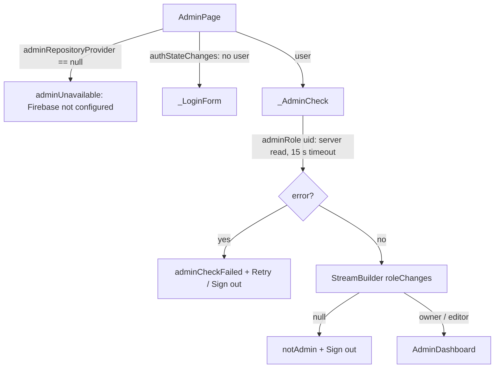

# 07 — Admin dashboard (`/admin`)

Code: `lib/ui/admin/` — `admin_page.dart`, `admin_schema.dart`, `doc_editor.dart`, `collection_list.dart`,
`features_editor.dart`, `admin_screens.dart`, `admin_validators.dart`; data access `lib/data/admin_repository.dart`.
Tests: `test/admin_test.dart`; server rules: `firestore.rules` + `tool/rules_test`.

## How to sign in

1. Open **`https://maximos-domadios-church.web.app/admin`** (not linked from the public site; `AppConfig.adminPath`).
2. Email + password (Firebase Auth). "Forgot password?" sends a reset email.
3. The account must have a document **`admins/{uid}`** (`{email, role}`). Otherwise: «هذا الحساب ليس لديه صلاحية
   التعديل» + Sign out.
4. Arabic-first; `EN`/`ع` toggles the language. Desktop (≥ 1000 px): sidebar; phones: ☰ drawer.

Bootstrap the **first owner** (no owner can exist before): Firebase console → Firestore → `admins/<UID>` =
`{ "email": "...", "role": "owner" }`, or the **Seed Firestore** workflow input `admin_email` (finds/creates the Auth
user, makes it owner, emails a set-password link), or `admin` = `UID:email`, or locally
`node tool/seed_firestore.js --only none --admin <UID>:<email>`.

## Sign-in / permission flow (`admin_page.dart`)

- `adminRole(uid)` reads `admins/{uid}` **from the server** (`Source.server`) so a cold cache never shows "not admin";
  network errors show Retry instead of a misleading denial.
- `roleChanges(uid)` then streams the role live: a demoted owner loses the Admins screen, a removed admin loses the
  dashboard immediately. Cache-only "missing" snapshots are skipped.

## Roles

| Capability | Editor | Owner |
|---|---|---|
| All content collections (CRUD, hide/show, reorder) | ✔ | ✔ |
| Sections & home page (`settings/features`) | ✔ | ✔ |
| Church info (`settings/church`) | ✔ | ✔ |
| Contact messages: read, mark handled/new, delete | ✔ | ✔ |
| **Admins** screen: add / change role / remove **other** admins | ✘ ("ownerOnly") | ✔ |
| Change or remove **themselves** | ✘ | ✘ (UI + rules) → an owner always remains |

The same matrix is enforced server-side by `firestore.rules` (`isAdmin()` vs `isOwner()`). Note: the business case
wanted settings and message deletion owner-only; the implementation deliberately grants them to editors (ADR-011).

## Navigation (`adminDestinations(role)`)

`overview` → `features` → `church` → `assistant` (AI assistant, PR #19) → one entry per `adminCollections` item (alerts, seasons, liturgies, meetings,
clinics, facilities, activities, priests, departedPriests, saints, milestones, **categories** (Custom sections),
**entries** (Section items), **pages** (Custom pages) — PR #18) → `messages` → `contactCats` (Contact form types,
PR #18) → `admins` (owners only).
The **Clinics** screen («العيادات») stays in the menu although the owner deleted the 11 placeholder clinics (3 Nov 2026) and
switched the clinics section off (4 Nov 2026) — it is where real clinics would be added before switching the
section back on.
Every entry has its own icon (`adminIcon`; the assistant uses `smart_toy_outlined` since PR #23 so it no longer
shares saints' `auto_awesome_outlined`). The nav is a `Material` (not a coloured `Container`, which hid the tiles'
ink), so the selected entry shows the gold highlight; icons are burgundy, labels ink, and the selected entry's icon
and label are both burgundy (`ListTile.iconColor/textColor/selectedColor`, PR #23). The PR #18 entries (custom
sections, section items, custom pages, contact form types) drew without icons on phones that had cached an older
tree-shaken icon font for 7 days — fixed by fingerprinting the icon fonts (05-firebase, Hosting headers).
The app bar shows "Admin — <screen>", a 🌐 button to the public site and the language toggle; the nav shows the
signed-in email + role and Sign out.

## Screens

### Overview (`OverviewScreen`, `admin_screens.dart`)
Live counts per collection (respecting each screen's filter, e.g. serving vs departed priests) with hidden /
unconfirmed sub-counts, **new messages** (status ≠ handled, red when > 0), **sections on** (`N/16`), quick links
(church info, sections & home, alerts, open site) and the **8 latest edits** (title, `updatedAt`, `updatedBy`). A
failed stream shows "—". If the screen is rebuilt with a different backend (`widget.repo`), `didUpdateWidget`
cancels and re-subscribes every stream (BUG-18; `ChurchInfoScreen` does the same, and since PR #10 so do
`FeaturesScreen` — which also resets its shown version and editor key — `MessagesScreen` and `AdminsScreen`).

### Sections & home page (`FeaturesScreen` / `FeaturesEditor`, `features_editor.dart`) → `settings/features`
- Switch each of the 19 sections on/off (PR #16 added «آية اليوم» / Verse of the day, PR #18 «الأقسام المخصصة» / Custom sections and «الصفحات المخصصة» / Custom pages) (+ "enable all"); labels from `Sections.labels`. **«الصور» /
  Images**, hides every optional item image site-wide (default on).
- **Home layout**: drag to reorder the 7 blocks — or tap **Move up / Move down** (`ValueKey('home-<block>-up|down')`,
  WCAG 2.5.7 single-pointer alternative) — show/hide each; a block whose section is off is flagged
  («blockSectionOff»). Below 600 px the move buttons sit in the tile's subtitle row and only the switch stays
  trailing (PR #10).
- Hero title/subtitle AR/EN (≤ 200/300), announcement banner (on/off, AR/EN text ≤ 500, link validated by
  `isValidUrl(allowPath: true)`).
- **Site theme & occasions** card (PR #17, ADR-025; `OccasionThemeEditor`, `occasion_editor.dart`): theme chips with
  swatches (`ValueKey('theme-<key>')`, white label when selected); a line "In force today: … — manual / schedule /
  Easter / fallback"; switch **Switch the theme automatically by date** (`occasions-auto`; off = the selected theme
  always applies — the manual override); with it on: **Holy Week & Resurrection from the Coptic Easter date**
  (shows this year's computed dates) + Resurrection length (1/3/7/14/40/50 days), and the **occasion schedule** (up to
  12 ranges: theme, From/To date pickers — To never before From — remove). **Edit a theme's colours** (collapsible):
  pick a preset, one `#RRGGBB` field per palette colour with swatch, a live preview, a status line ("All text is
  readable" or "Will be saved corrected for readability: key old→new"), and "Reset to the preset colours". Saves
  store the corrected colours (`OccasionConfig.withReadableCustom`).
- ~~Hero video library (YouTube) card~~ (PR #17, ADR-026) — **removed in PR #25 (ADR-036)**: no `HeroVideoEditor`, no
  YouTube links; the hero always plays the bundled clip, switched by *Hero motion & video*. The dashboard itself
  always uses the Golden hour palette.
- **Page titles, subtitles & intro notes** (PR #12): one collapsible row per customizable page (`about, schedule,
  education, activities, clinics, services, contact, ask` — `ValueKey('page-<key>')`, `maintainState: true`) with
  title AR/EN ≤ 200, subtitle AR/EN ≤ 300, intro AR/EN ≤ 1500 (`ValueKey('features-page-<key>-<field>')`); a
  **«مخصّص / Customized»** badge while any field is filled and **«إعادة للافتراضي / Reset»** to clear the page
  (empty = the page's built-in text). A too-long field opens its row on Save.
- **Site footer (FR-G-04)** (PR #12): switches *Show phone numbers / social links / quick links*
  (`ValueKey('footer-<key>')`) and footer notes AR/EN ≤ 500 (`ValueKey('footer-noteAr|noteEn')`). Rendered by the public `Footer` since PR #13.
- "Save changes" writes `FeatureSettings.toMap()` with `saveDoc` (mergeFields + stamp) — since PR #12 in two writes
  when the page headers changed: everything else, then `{pageHeaders}` (PR #17 adds `{occasions}` and `{themeColors}`
  writes, each only when changed / non-default; `heroVideos` is never written since PR #25) (`featuresSaveWrites`; the whole doc plus
  8 page headers in one write exceeds the rules' expression cap). `collect()` round-trips `pageHeaders`/`footer`, so
  the echo of your own save keeps the form (BUG-12). If the doc does not exist yet, a
  note says everything is on by default. If someone else saves while you have unsaved edits, a banner offers a reload
  instead of wiping your edits. The snapshot of **your own save** no longer remounts the form (BUG-12):
  `isEchoOfEditor(shown, latest, editorValues)` (`admin_validators.dart`) — if only metadata changed or every changed
  field already equals what the form holds, the editor key is kept, so the scroll position stays.

- **Hero texts** card (PR #22, ADR-032): besides title / subtitle AR/EN and *Hero motion & video*, a
  **"Show address in hero"** switch (`ValueKey('features-heroShowAddress')`, `heroShowAddress`, default off): the
  address ribbon under the hero title when no subtitle is set.

- **Error reports** card (PR #24, ADR-034), last card of the page: switch **"Send error reports (Sentry)"**
  (`ValueKey('features-errorReporting')`, `settings/features.errorReporting`, default on; off = the web / Android app
  sends nothing). **Owners** also see **"Send test error"** (`ValueKey('features-sendTestError')`): one harmless
  `StateError('Test error from /admin (ignore)')` tagged `section: admin`, `test: true`; a snackbar says whether it
  was sent (not sent when the build has no DSN or the switch is off).

- **Verse of the day** card (PR #16, ADR-024; since PR #17 it controls the **hero** verse): "Show the verse of the day" switch (same flag as the
  `dailyVerse` section toggle), mode chips "A different verse
  every day" / "A fixed verse I choose"; fixed mode shows the Arabic text (required, ≤500) and reference (≤60) fields →
  `settings/features.dailyVerse`. Saving in daily mode clears the (hidden, unvalidated) fixed-verse fields.
- **Image display** card (PR #15, ADR-023): one dropdown per image collection (avatar / card / banner) →
  `settings/features.imageStyles`; the dropdown shows the built-in default until changed.
- Item forms on image collections have **"Image display (— = section default)"** under the image (`imageStyle`,
  nullable choice); a new document does not write it while unset.

### Church info (`ChurchInfoScreen`) → `settings/church`
(`ChurchInfoScreen` takes a `DocDef doc` — default `churchInfoDoc` — and an optional `header`; PR #19 reuses it for
`settings/assistant`.)
`DocEditor` over `churchInfoDoc` fields: names, bishop, address, transport, lat/lng (ranges), map query, Maps link,
**phones** (object list: label AR/EN, number, mobile/WhatsApp — ≤ 20 rows), WhatsApp number/channel, Facebook,
YouTube, Instagram, verse + references, hero image URL, history AR/EN (≤ 8000), **altars** (object list: name AR/EN,
kind main/second/annex), `assistantEnabled`, `sample`. Same "updated elsewhere → reload" banner, and the same
own-save rule (no scroll jump to the top after Save, BUG-12).

### Content lists (`CollectionListScreen`, `collection_list.dart`)
For each `CollectionDef`:
- Live list (`repo.watch(collection)`) filtered by the screen filter (`def.matches`), sorted by `sortAdminDocs`
  (orderable: by `order`; others by `order`/weekday, then start, then id).
- **Search** (all string values + id) and filter chips **all / visible / hidden / unconfirmed**; "showing N of M".
- **Open on site** (`Key('admin-openOnSite')`, «عرض بالموقع»): opens `CollectionDef.publicPath` (e.g. `/clinics`,
  `+ ?lang=en` when the dashboard is in English — `publicPathFor`) in a new tab on web (`Uri.base.resolve`), or
  navigates there on mobile.
- Tile: title (`titleKeys`), subtitle (weekday, date, time range, season/stage/category/type/specialty labels,
  ⛔ inactive, start/end), tags *Hidden* / *Unconfirmed*, "updated by … at …". Since PR #12 an item whose detail page is on (since PR #14: unless
  `detailsEnabled` is explicitly `false`) shows a **«صفحة تفاصيل / Detail page»** badge (own line under the title), and when it is also
  visible an **Open detail page on site** icon (`ValueKey('openItem-<id>')`, `itemPublicPathFor`: e.g.
  `/clinics/<id>`, `/about/saints/<id>`; built from `detailPathFor` — the public routes exist since PR #13). On
  phones (< 600 px) that icon sits in the row under the subtitle with the move buttons (PR #14), so the title keeps
  its width now that almost every row has it.
- The list `StreamBuilder` is keyed by `ObjectKey(_stream)` (also on Messages and Admins, PR #12): after a backend
  switch the old list is never shown while the new one loads.
- 👁 **hide/show** (`update(visible)`) — only when the collection has a `visible` field (not seasons).
- **Drag to reorder** — or tap **Move up / Move down** on each tile (`ValueKey('moveUp-<id>')`, WCAG 2.5.7; under
  600 px they sit in their own row under the subtitle so the title keeps its width) —
  (`reorder(collection, ids, base:)` → `order` = base + 10, 20, 30… in one batch) for orderable collections — clinics,
  facilities, activities, priests, departed fathers, saints, milestones — and only when search is empty, filter = all
  and > 1 item. **Departed fathers use base 1000** (`reorderBase(def)`: 1010, 1020…) because they share the
  `priests` collection with serving priests, so the two lists never get colliding `order` values (BUG-13).
  Liturgies and meetings use the numeric **Order** field instead.
- `DocEditor.save`: when `onSave` fails with a **`TimeoutException`** the images uploaded for the document are
  **kept** — Firestore may still commit the queued write pointing at them; any other error deletes them (BUG-13).
  Note: `AdminRepository.save`/`saveDoc` set no timeout of their own today (the only 15 s timeout is the role read
  in `adminRole`), so this path applies to a timeout raised by a caller/backend wrapper.
- **Add** (FAB) / tap to **edit** → full-screen `DocEditor`; **delete** with confirmation dialog (also deletes the
  item's inline cover and gallery `media` docs, `orphanedDocMediaIds`). A new item saved in several writes keeps the id
  the first write created (the editor's `onSave` remembers it).

| Screen id | Collection | Orderable | Has visible | Has sample | Notes |
|---|---|---|---|---|---|
| alerts | alerts | – | ✔ | – | title, body, active, starts/ends (Cairo), priority 0–1000, link (path or URL) |
| seasons | seasons | – | – | – | key choice, names, starts/ends, active |
| liturgies | liturgies | – (order field) | ✔ | ✔ | needs weekday **or** one-off date; end may be before start (midnight) |
| meetings | meetings | – (order field) | ✔ | ✔ | stage choice |
| clinics | clinics | ✔ | ✔ | ✔ | `active` missing = true |
| facilities | facilities | ✔ | ✔ | ✔ | "Public services" |
| activities | activities | ✔ | ✔ | ✔ | category choice |
| priests | priests (status = serving) | ✔ | ✔ | ✔ | missing status = serving |
| departedPriests | priests (status = departed) | ✔ | ✔ | ✔ | new docs start with `status: departed` |
| saints | saints | ✔ | ✔ | – | |
| milestones | milestones | ✔ | ✔ | – | icon choice |

`CollectionDef.publicPath` drives the **Open on site** button.

### Generic form (`DocEditor`, `doc_editor.dart`)
- Field widgets by `FieldType`: text, multiline, integer, decimal, boolean, time (HH:mm), weekday, weekdays (chips),
  dateTime / date (Cairo), looseDate, choice (labels via `choiceLabel`/`opt_*`), url, phone, objectList, **image**.
- Validation (`admin_validators.dart` `validateFieldValue`): required, max length (`effectiveMaxLength`), `HH:mm`,
  real calendar dates (rejects 2027-02-30), loose dates, numeric ranges (Arabic digits accepted), URLs (`https://…`
  or in-app path where `allowPath`), phones (`^\+?[0-9]{5,15}$` after normalising). Cross-field
  `validateDocument`: `requireAnyOf` (weekday or date → «needWeekdayOrDate»), end after start (except liturgies),
  `endsAt` after `startsAt`.
- New docs write all collected values (+ `newDefaults`); **existing docs write only changed fields**
  (`changedFields`, deep compare) with merge — never overwriting another admin's concurrent edits to other fields.
- **Field groups (PR #12):** `FieldDef.group` — `basic` fields stay open at the top; on the 7 detail collections
  `details` (**«صفحة التفاصيل والحقول الإضافية»**: «إظهار صفحة التفاصيل / Show the detail page» switch — **on by default** since PR #14 (missing field = on, new items saved with `true`; hint explains that tapping the card opens the full page and that switching it off hides the page and the «التفاصيل» link), details AR/EN ≤ 10,000, up to
  15 *extra fields* rows title AR / title EN ≤ 150 — a title in **either** language is required, checked per row
  by `FieldDef.rowRequireAnyOf` + `validateRowAnyOf` («أدخل عنوانًا بالعربية أو بالإنجليزية», like rules'
  `validExtraField`) — / value AR/EN ≤ 2000), `media` (**«الصور ومعرض
  الصور»**: cover `image`, `showDetailImages`, `gallery`) and `contacts` (**«التواصل والروابط»**: `showContacts`,
  `showSocials`, the collection's own phone — `contactPhone`, clinics `bookingPhone`, facilities `phone` — WhatsApp,
  WhatsApp group/channel, Facebook, YouTube, Instagram, the external link — `externalUrl`, activities `link` — its
  button text AR/EN ≤ 80 and how-to-contact notes AR/EN ≤ 500) are `ExpansionTile` cards (`ValueKey('group-<g>')`,
  `maintainState: true` so collapsed fields still validate and save) with live pills («مفعّل / Enabled», «3 حقول /
  3 fields», «4 صور / 4 photos», «2 مُعبّأ / 2 filled»). Save with an invalid field in a closed card opens that card.
  Liturgies, seasons, alerts and church info stay a flat form.
- **Split saves (PR #12, `splitSavePayload`):** the editor writes everything else first (it creates a new doc), then
  a non-empty `gallery`, then non-empty `extraFields` — one write with both full lists exceeds the rules' 1,000-
  expression cap. If a later write fails, the earlier ones stay saved, the form stays dirty and a retry sends only
  the rest; uploads that no saved write references are deleted (not on a timeout, BUG-13).
  Orphaned inline images (a replaced/removed cover or gallery photo) are measured from the values before the
  save's **first** attempt (`_saveBaseline`, cleared on success), so a cover replaced by a partly failed attempt
  is still deleted after the retry completes.
- Choice / weekday dropdowns are `isExpanded` (long labels ellipsize at 320 px / 200 %); object-list row actions
  (move up/down, remove) are a `Wrap`.
- Every save stamps `updatedAt` (server time) and `updatedBy` (email) via `AdminRepository._stamp`.
- Boolean defaults: `missingBool` (value assumed when an existing doc lacks the field, e.g. `visible` = true,
  clinic `active` = true) vs `newBool` (value for new docs, e.g. `sample` = false).

### Optional image field (`FieldType.image`, PR #5)
On priests, departed fathers, saints, milestones, activities, alerts and seasons — and since PR #12 meetings, clinics
and facilities (in the *Photos & gallery* card on the 7 detail collections) — the form has **«الصورة (اختياري) /
Image (optional)»** with a 96 px preview and:
- **Upload image** (رفع صورة): opens the device gallery/file picker (`image_picker`). The file is resized and
  compressed **in the browser/app before anything is stored** (`prepareUpload`, `lib/data/image_processing.dart`):
  long edge ≤ **800 px** (640 px second pass), quality 0.8 → 0.5 until ≤ **~250 KB**; web encodes WebP via canvas
  (JPEG where WebP is unsupported), Android uses the Dart `image` package (JPEG). Files > 25 MB are refused before
  decoding; results still > **700 KB** are refused («الصورة كبيرة جدًا…»). The preview says "uploaded when you
  save" — the `media/{id}` doc is written **only when you press Save**, then the item gets
  `image = {source: inline, mediaId, alt, w, h}`. If the save fails, the uploaded media doc is deleted again (except
  on a `TimeoutException`, see above) and the picked image stays so you can retry.
- **Image link** (رابط صورة): paste an **https://** image URL (validated: https, host, no spaces, ≤ 500) →
  `{source: url, url}`.
- **Remove image** (إزالة الصورة): saves `image: null`; the card goes back to its icon.
- **Image description** (alt, ≤ 300) for screen readers (defaults to the item's name on the site).
- Replacing or removing an inline image, or deleting the item from the list, deletes the old `media/{id}` doc
  **best effort** (`orphanedMediaIds`). Orphans can remain if that delete fails or two admins edit at once; clean-up:
  Firestore console → `media` → delete ids not referenced by any content doc's `image.mediaId` (open task).
- Upload is disabled when the backend has no `MediaRepository` (URL still works). Switch all images off/on in
  **Sections & home page → «الصور» / Images**.
- **BR-11 / FR-E-04:** on meetings (Sunday school, `/church-education`) the cover image and the gallery show a red
  warning «خصوصية الأطفال: يُحظر رفع صور واضحة للأطفال أو القُصَّر في مدارس الأحد» / "Children's privacy: never
  upload identifiable photos of minors in Sunday School" (`ValueKey('fieldHint-<key>')`).

### Gallery (`FieldType.imageList`, PR #12)
`gallery` on the 7 detail collections: up to **8** photos, each with a preview, alt text (≤ 300), **Move earlier /
Move later** and **Remove**; **Upload photo** (same resize/compress pipeline, stored only on Save) and **Add image
link** (https). "n of 8" counter; both add buttons disable at 8. On Save pending photos are uploaded, the list is
written in its own update, and removed or replaced inline photos are deleted (`orphanedDocMediaIds`, so a photo moved
between the cover and the gallery is kept). Photos show on the item's detail page (since PR #13) when `showDetailImages`
and the Images section are on.

### Contact messages (`MessagesScreen`) → `contact_messages`
(PR #12: the name/time header and the action row wrap at 320 px / 200 %.)
Newest first (`createdAt`). PR #18 (ADR-028): **box chips** (`box-<id>`) — All, one per contact type of
`settings/contact` (code defaults when missing; open count in brackets), **Anonymous box** (`inboxBoxOf`:
`anonymous: true`), and "Other / deleted type" when a message's slot no longer exists; messages without a category
are general inquiries (c1). Status chips **open** (default, `status == new`) / done / all. Each card: name (or
«مُرسِل مجهول»), time, type / occasion / 📅 date chips, message, phone (call), email (`mailto:`), internal notes.
Bookings get a **status dropdown** new → contacted → confirmed / declined (`bookingStatus-<id>`); other messages
**Mark handled / Mark new**. **Notes** (`notes-<id>`, `_NotesDialog`, ≤ 2000 → `adminNotes`), copy, delete with
confirmation. The overview's "new messages" counts `status == new`.

### Contact form types (`ContactCategoriesScreen`, `contact_admin.dart`) → `settings/contact` (PR #18)
Cards per type (code defaults until saved): Arabic / English name, behaviour (general / booking / complaint /
suggestion), shown on the form, allow anonymous (complaint / suggestion only), booking occasions (Arabic /
English rows, ≤ 8, keys kept stable — `newSubtypeKey`), move up / down, remove (at least one stays), **Add a
message type** (≤ 12; since PR #19 a fresh stable id from `ContactSettings.newId`, never an id removed in the
editor — `_retired` — so old messages of a deleted type are never re-labelled). **Save** writes the whole
`categories` map (`saveDoc`, one string per id, `order` renumbered 10, 20…).

### AI assistant (`AssistantAdminScreen`, `assistant_admin.dart`) → `settings/assistant` (PR #19, ADR-029)
Top card `AssistantSwitches`: **"Ask the church" section shown** (`assistantSectionSwitch`, a field-path `update` of
`settings/features` `sections.assistant` only — a stale map never reverts another admin's section change; `saveDoc`
only when the doc does not exist) and **Enable the AI assistant**
(`assistantEnabledSwitch`, writes `settings/church.assistantEnabled` alone); visitors see the assistant only when
both are on (and App Check is active); a note names the default model. Below it the generic settings form
(`ChurchInfoScreen` with `doc: assistantSettingsDoc`, same reload banner / own-save rules): Model (text,
`FieldDef.pattern` = the rules' model regex → `invalid`), Persona & style instructions, Allowed topics (one per
line), Refusal message ar/en, Welcome text ar/en, **Show suggested questions** switch (default off) + Suggested
questions ar/en (one per line, up to 3), **Sources for faith questions** (domains, default st-takla.org), **Reply for
faith questions not in the data** ar/en, **Mention unconfirmed flags** switch (default off; switches use
`newBool: false`) (PR #21, ADR-030/031), Max question length (50–1000), Max questions per minute (1–20), **Max
questions per device per day** (1–100, default 3; replaced "per visit"). Blank = default (hints say which).

### Custom sections, items and pages (PR #18, ADR-027)
Generic `CollectionListScreen`s for `categories` (note above the list: built-ins are switched in Sections & home
page and renamed in Page headers), `entries` and `pages`. Editor helpers (`DocEditor`): `FieldDef.slug`
(`invalidSlug`, and `slugTaken` against the other docs of the list), `FieldDef.dynamicOptions: 'categories'` (the
entry's section dropdown, loaded when the editor opens; a deleted category shows «قسم محذوف أو غير محدد»),
`FieldDef.linkPicker` («اختيار صفحة…» on alert / entry / block links: custom pages, custom categories, built-in
routes; hidden ones tagged), page `blocks` as an `objectList` with `encodedRows` (one string per row) and
`showWhen` (only the fields of the row's block type). `validateDocument` rejects an image block without an https
link. **Deleting a category** (`_deleteCategory`): confirmation naming how many items it holds → `visible: false`
on each visible entry → delete the category. "Open on site" for a category / page row opens its slug route.

### Admins (`AdminsScreen`, owners only) → `admins`
List with role dropdown (owner/editor) and remove button — disabled for yourself ("(you)"); since PR #12 they wrap
under the UID (the role menu ellipsizes) so nothing overflows at 320 px / 200 %. **Add admin** dialog: UID
(validated by `isValidAdminUid`: 1–128 chars, no `/`; copy it from Firebase console → Authentication → Users), email,
role. The Auth user itself must be created in the console (or via the Seed workflow) first. Since PR #10
`setAdmin` stamps `admins/{uid}` with `updatedAt`/`updatedBy` (`_stamp`), like every other admin write.

## Gotchas for agents

- Adding a field = schema `FieldDef` + model + rules allow-list + seed (+ tests). The admin test cross-checks the
  rules allow-lists against `adminCollections` and seed keys.
- Max lengths in `FieldDef` must not exceed the rules limits (e.g. alert body form 1000 vs rule 2000 is fine; the
  reverse would make saves fail with permission-denied).
- `AdminBackend` is an interface so widget tests use an in-memory fake; keep new admin I/O behind it.
  `AdminBackend.media` (default null) exposes the `MediaRepository`; `DocEditor` takes `media`, `pickImage` and
  `prepareImage` so tests inject bytes and a fake store (`test/media_test.dart`).
- PR #10 a11y details: selected clinic-day `FilterChip`s and the theme `ChoiceChip`s use a white label/checkmark on the
  dark fill (`chipTheme` also sets `checkmarkColor` / `secondaryLabelStyle` white); the image field stacks preview
  above its buttons below 420 px or at ≥ 1.5× text; the search clear button («مسح البحث» / Clear search) and the
  admin Home button (`backHome`) have tooltips.
