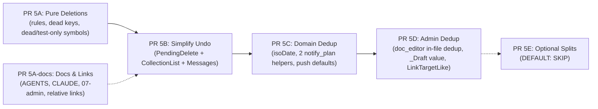

# المرحلة الخامسة — تنظيف الكود وإزالة التكرار (Phase 5 — Dead-Code Removal & Simplification)

> **Baseline:** `main` @ `deb8328` (after PR #97 / PR #98), based on the Phase 5 over-engineering audit (25 Nov 2026) and peer review.
> **Core Principle (YAGNI):** Delete dead code and simplify duplicated logic **before** splitting files. Never split a file merely for line count if doing so adds state-plumbing or export-barrel ceremony without reducing real coupling.

---

## ١. الهدف ونطاق التغيير (Goal & Behavior Scope)

**Goal:** Remove verified dead code, test-only surface area, and duplicated domain/admin logic across small, focused PRs (`5A` → `5D`), keeping every feature, security rule, and web bundle ceiling (`<= 1,399,000 B` gzip `-9`) intact.

**Behavior Scope:**
- `5A`, `5A-docs`, `5C`, `5D` are **strictly behavior-preserving**.
- `5B` simplifies the soft-delete + 10s undo flow first and then wires `MessagesScreen` to it — **explicitly upgrading the inbox (`MessagesScreen`) from single-item undo to batched `"Undo all"`** (a deliberate, visible UX improvement).

---

## ٢. فهرس الملفات (Directory Index)

| File | Purpose |
|---|---|
| [README.md](README.md) | Overview, baseline metrics, PR stack, intentional invariants, rejected refactors, and owner decisions |
| [HANDOFF.md](HANDOFF.md) | Lean execution runbook (worktrees, verification commands, PR review loop, deploy verification) |
| [SMALL-MODEL-GUIDE.md](SMALL-MODEL-GUIDE.md) | Symbol-first targeting rules, deferred isolation guardrails, and stop/escalate triggers |
| [STATUS.md](STATUS.md) | Tickable checklist for owner decisions, open PR prerequisites, packets, and PR gates |
| [PR-5A-pure-deletions.md](PR-5A-pure-deletions.md) | **PR 5A:** Dead `/clinics` rules + `contentCollections()`, 11 dead UI strings, dead/test-only Dart symbols, optional `StorageMediaRepository` |
| [PR-5A-docs-links-and-paths.md](PR-5A-docs-links-and-paths.md) | **PR 5A-docs:** Fix `AGENTS.md` / `project-rules.md` commands, `CLAUDE.md` targets, stale `adminExpiresAt` doc, and local `file:///` links |
| [PR-5B-simplify-undo.md](PR-5B-simplify-undo.md) | **PR 5B:** Simplify `PendingDelete` + `CollectionListScreen` undo first (preserving all 14 `testWidgets` race tests), then share with `MessagesScreen` |
| [PR-5C-domain-dedup.md](PR-5C-domain-dedup.md) | **PR 5C:** Unify the 3 byte-identical `YYYY-MM-DD` formatters, extract 2 helpers in `planNotifications`, centralize push defaults |
| [PR-5D-admin-dedup.md](PR-5D-admin-dedup.md) | **PR 5D:** In-file dedup in `doc_editor.dart`, collapse `_draft*`/`_initialDraft*` in `notifications_admin.dart` into `_Draft`, remove `LinkTargetLike` |
| [PR-5E-optional-splits.md](PR-5E-optional-splits.md) | **PR 5E (Optional — Default: SKIP):** Criteria if any file still hurts after 5A–5D |

---

## ٣. القياسات المرجعية والتنسيق مع الطلبات المفتوحة (Baseline & Open PRs)

- **Main commit:** `deb8328` (PR #97).
- **Web bundle (`main.dart.js` gzip `-9`):** **`1,330,341 B`** (`+68,659 B` headroom under `1,399,000 B` ceiling, per PR #97; PR #98 was `1,348,752 B`).
- **Open PRs to coordinate with:**
  - **PR #99** (`fix(admin): prevent disposed state access when doc editor rebuilds`) modifies `lib/ui/admin/collection_list.dart` — **merge or coordinate before starting PR 5B**.
  - **PR #95** modifies `docs/memory-bank/11-open-tasks.md` — **coordinate before touching `11-open-tasks.md` in PR 5A-docs**.

---

## ٤. ثوابت ممنوع المساس بها + ما تم رفضه (Do NOT Touch & Rejected Refactors)

### Intentional Complexity (Keep As-Is)
1. `firestore.rules` `\u001f`-packed regexes and `changed.hasOnly(legacyKeys)` branches (1,000-expression Firestore limit).
2. `_PlatformRouteObserver` & `resolveLangSync` in `lib/router.dart` (two-way `?lang=en` sync).
3. `SeedGate` / `settleFirst` in `lib/data/content_repository.dart` (ADR-033 / ADR-038 cold-start loading).
4. Conditional exports (`*_stub.dart` / `*_web.dart` / `*_io.dart`) & all 11 tracked deferred chunks + hero chunks (`tool/check_web_bundle.mjs`, `test/bundle_isolation_test.dart`).
5. 1-implementation test interfaces (`AdminBackend`, `PushEnv`, `InstallEnv`, `LanguageStore`).
6. `tool/` Cloudflare Worker modules (`push_sender.js`, `push_reminders.js`, `push_queue.js`, `push_daily.js`, `firestore_rest.js`).
7. `/clinics` redirect in `lib/router.dart` and `retired` IDs in `tool/gen_seed.py`.

### Rejected Over-Engineered Refactors (Do NOT Do)
- **No** `Footer` + `common.dart` export barrel (relocates code without reducing state).
- **No** 10-parameter `NotificationStatusCard` extraction from `notifications_page.dart`.
- **No** `part of` + `extension on State` + `_updateState` shims in `doc_editor.dart` or `notifications_admin.dart` (prefer clean in-file dedup).
- **No** 13-helper `parse_helpers.dart` + thin public forwarders.
- **No** 7-helper `planNotifications` split (2 helpers suffice).
- **No** 6-parameter, 2-constructor `AdminChip` replacing 3 tiny private chips.
- **No** speculative test-file splits (`admin_test.dart`, `custom_content_test.dart`, `rules.test.mjs`) unless a file still hurts after 5A–5D (`PR-5E` default: SKIP).

---

## ٥. تسلسل الطلبات (PR Stack)

---

## ٦. قرارات المالك (Owner Decisions)

| ID | Decision | Default | Notes |
|---|---|---|---|
| **D1** | Legacy `clinics` / `heroVideos` keys in `settings/features` allow-lists (`firestore.rules`) | **KEEP** | Removing them without a read-only check of live `settings/features` can break admin saves if those keys exist in production. |
| **D2** | Speculative `StorageMediaRepository` & `AppConfig.mediaBackend` (`lib/data/media_repository.dart`, `lib/config/app_config.dart`) | **REMOVE** | Zero callers in tests; throws `UnsupportedError` on `upload`/`delete`. `MediaRepository` abstract interface and `MediaSource.storage` URL rendering stay intact. |
| **D3** | Test-only `topicFor`, `NotifyConfig.isReminderSourceEnabled`, `NotifySchedule.dueNow` in `lib/domain/push.dart` | **CHECK WORKER PARITY** | Keep if their tests guard Worker JS parity; remove only if redundant. |
