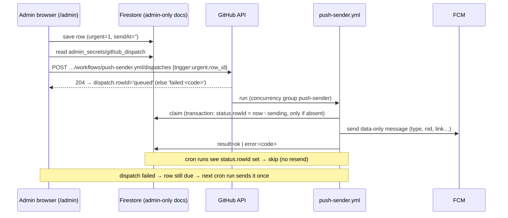

# PR C — مدير الإشعارات في لوحة التحكم + مُرسِل FCM + الروابط العميقة (Admin notification manager + FCM sender + deep links)

| | |
|---|---|
| Branch → base | `feat/p2c-notification-manager` → `feat/p2b-android-local-notifications` (stacked chain, HANDOFF §1; **do not merge** until the whole chain is approved) |
| ADR | **ADR-059** |
| Depends on | PR A (types, `push`, `pushTypes`), PR B (APK, local planner) |
| Owner console work | enable the FCM API, create the `push-sender` service account + secret `FIREBASE_SA_PUSH`; create the fine-grained **dispatch token** for urgent sends (§15, §16) |
| Live effect after merge | admin screen visible; the sender runs but sends nothing while `push` is off |

## ١. الهدف (Goal)

The admin, from the web `/admin` only, **decides which notification types exist and are offered, their texts,
times and lead times**, and **creates / edits / deletes scheduled one-off notifications** (or sends one now) with a
**deep link to any page**. A free GitHub Action sends them through **FCM topics** with a **dual trigger** (§16): a
scheduled cron for routine work (scheduled one-offs, daily season checks) and an **immediate `workflow_dispatch`**
fired from `/admin` when the admin sends an **urgent** one-off, so FCM delivers it within ~1–2 minutes. FCM carries
**only remote-owned types** (announcements — live broadcasts, emergencies, ordinary notices — and dynamic season
alerts; README §3.1); the Android app keeps the daily verse, feasts and recurring mass / occasion reminders **local**
and never receives them by FCM. Tapping a notification opens the chosen page on Android and (PR D) on the web /
installed PWA.

## ٢. قصص المستخدم (User stories)

- كمشرف أفتح «الإشعارات» وأرى الأنواع الخمسة: أفعّل/أعطّل عرض كل نوع للزوار، أعدّل نص العنوان والرسالة بالعربي
  والإنجليزي، ووقت الإرسال، ومدة التذكير قبل القداس.
- كمشرف أضيف إشعارًا: «قداس عيد النيروز غدًا الساعة ٧ صباحًا»، أحدد وقت الإرسال، وأختار الصفحة التي تفتح عند
  الضغط من قائمة («مواعيد القداسات»، صفحة مخصصة، موسم…)، وأرى معاينة كما تظهر على الهاتف، ثم أحفظ.
- أعدّل أو أحذف أي إشعار لم يُرسل بعد؛ أرى سجل ما أُرسل ومتى ونتيجته.
- «إرسال عاجل الآن» (إعلان طارئ أو بث مباشر) يصل خلال دقيقة أو دقيقتين تقريبًا، وأرى حالته: «في الطابور» ← «جارٍ
  الإرسال» ← «أُرسل» أو «تعذّر الإرسال الفوري — سيُرسل في الدورة التالية».
- الإشعار المجدول العادي يُرسل في أقرب دورة بعد موعده (خلال ~١٥–٣٠ دقيقة) — موضح في الشاشة.
- «جرّب على هذا الجهاز» يعرض الإشعار على جهاز المشرف نفسه فورًا (بدون خادم).
- كمستخدم Android يصلني إعلان الكنيسة حتى لو كان التطبيق مغلقًا، والضغط يفتح الصفحة المختارة.

## ٣. الخصائص الفرعية (Complete sub-features)

| Sub-feature | Detail |
|---|---|
| Types editor | 5 rows (fixed set). Per type: offered (writes `pushTypes`), time `HH:mm` (verse, feasts, seasons), days before (seasons 0–7), lead minutes (occasions 15–240), title/body templates ar/en with placeholders, default link. Placeholder help under each field. Each card shows its **channel** (README §3.1): «محلي على تطبيق Android» for `verse_daily` / `feasts` / `occasions` (no web push — shown on the site's Home only), «عبر FCM» for `announcements` / `seasons` |
| Placeholders | `{verse}` `{ref}` (verse), `{season}` `{days}` (seasons), `{feast}` (feasts), `{service}` `{time}` `{place}` (occasions), `{date}` everywhere; unknown placeholders flagged by the validator |
| One-off schedule | stored in the **admin-only** doc `settings/notifications` (never streamed by visitors, unreadable by the public — unsent texts stay private); list ≤ 20; row = title ar/en (≤ 80), body ar/en (≤ 240), send-at (Cairo date + time picker, 12-hour UI / 24-hour stored like ADR-049; blank = «في أقرب دورة»), deep link (route picker), targets (web, app; default both), **«عاجل — إرسال فوري»** switch (`urgent`, §16) — **only for «now»**: the switch is enabled only while send-at is blank, and setting a time turns it off (validator). A row with a future time is a normal scheduled notice: the cron sends it at its time (15–30 min latency); no urgent target is promised for it. If a stale row ever arrives with `urgent = 1` and a future `sendAt`, the sender ignores the flag and waits for the time. One-offs are **always type `announcements`** (no type field): a «feast» one-off would otherwise reach users who turned feasts off (CodeRabbit) and would duplicate the APK's local feast notification (README §3.1) — word a feast reminder as an announcement |
| Route picker | existing `FieldDef.linkPicker` («اختر صفحة…»): built-in routes (`/`, `/mass-schedule`, `/mass-schedule?tab=seasons`, `/about`, `/church-education`, `/church-activities`, `/clinics`, `/public-services`, `/contact`, `/ask`, `/notifications`), custom pages `/page/<slug>`, categories `/section/<slug>`, item detail pages (`/about/saints/<id>`, `/church-activities/<id>`…), plus the live-stream https link. Free text accepted if it passes the URL/path validator |
| Create / edit / delete | generic `objectList` editor (encoded rows), saved with `AdminRepository.saveDocsFresh` (the existing fresh-read transaction, ADR-042) so the edited row is merged into the **latest** `schedule` — a stale editor cannot drop another admin's rows — edit allowed until sent; the sender writes the row's status (`sentAt` + `result`) into the separate map field `status.<rowId>` of the same doc (permanent sent marker, independent of the capped log, **never overwritten by an admin save** — Sentry round 2, §5); a sent row shows «أُرسل ١٠:١٥ ص» and is read-only, delete allowed. An unsent row whose `sendAt` is more than 24 h in the past is **expired** («فات موعده ولم يُرسل») and is never sent later |
| Preview | live card under the row: notification mock (seal icon, app name, title, body, «الآن») in Arabic and English, character counters, truncation warning (Android shows ~2 lines collapsed) |
| Test on this device | admin browser: `Notification.permission` → `registration.showNotification(...)` via the PR A service-worker scaffold (no server). If permission not granted, explains how |
| Send now | two buttons: «إرسال عاجل الآن» = `sendAt` blank + `urgent` on → saves the row, then fires the instant dispatch (§16; ~1–2 min); «أرسل في الدورة القادمة» = `sendAt` blank, not urgent → cron (screen says «يُرسل خلال ١٥–٣٠ دقيقة») |
| Dispatch status (admin UI) | per row, from `dispatch.<rowId>` (written by the admin client) + `status.<rowId>` (written by the sender) → chip: «في الطابور (فوري)» (`queued`), «جارٍ الإرسال» (`sending`), «أُرسل ١٠:١٥ ص» (`ok`), «فشل الإرسال الفوري — سيُرسل في الدورة التالية» (`dispatch = failed:<code>`, row still due), «خطأ: …» (`error:<code>`), «لم يُتأكد — راجِع ثم أعد الإرسال» (`error:unconfirmed`). The open admin screen already streams `settings/notifications`, so the chip updates live without polling |
| Sent log | `sentLog` (in `settings/notifications`) table: when, what (title), topic(s), result (`ok` / `error:<code>`), from the sender. «مسح السجل» (owner only) |
| Kill switch | `push` off → the sender sends nothing (and the client UI hides) |
| Quiet hours (server side) | the sender never sends **season alerts** between 22:00–06:00 Cairo (moved to 06:00); one-offs are sent when scheduled (admin's choice; urgent ones immediately), Android / the SW show them silently inside the user's quiet hours (data message → local display) |
| Android FCM | `firebase_messaging` subscribes **only to remote-owned topics**: `app_announcements_<lang>` (type `announcements` on) and `app_seasons_<lang>` (type `seasons` on); unsubscribes on off / unsubscribe-all / language change. `topicFor(type, …)` throws for local-owned types, so the APK cannot subscribe to a topic duplicating a local notification (unit-tested). Data-only messages (`android.priority = high`) → background handler → **client guard** (below) → local notification on the type's channel, honouring quiet hours (silent), stored in the inbox |
| Message payload | every FCM message is **data-only**: `type` (`announcements` \| `seasons`), `nid` (dedupe key: one-off row `id`, or `season:<seasonId>:<yyyy-mm-dd>`), `title`, `body`, `link`, `lang`, `urgent` (`0`/`1`). No `notification` block (so the OS never shows an unguarded copy) |
| Client guard + dedupe | Android handler and web SW: (1) **drop** a message whose `type` is local-owned (`verse_daily`, `feasts`, `occasions`) or unknown — log a Sentry breadcrumb `push.dropped_local_type` (no content); (2) **drop** a message whose `nid` is in the device's seen-set (last 100 nids, `shared_preferences` / IndexedDB; covers FCM re-delivery and a dispatch + cron race that the sender's claim already prevents); (3) display with a stable notification id = hash(`nid`) (Android) / `tag: nid` (web) so a duplicate at worst replaces, never stacks |
| Deep links | payload `data.link`; Android: `onMessageOpenedApp`, `getInitialMessage`, local `onDidReceiveNotificationResponse` → `router.go(safeNotificationLink(link))`; external https only for the live-stream link (opens browser). Fallback: unknown / deleted page → 404 with «الرجوع للرئيسية»; switched-off section → FeatureGate notice |
| Dedup (server) | one-offs: the row's `status.<rowId>` entry, set by the **claim transaction** (§7) — whichever run claims first (cron or urgent dispatch) wins; every other run sees `sentAt` set and skips, so the cron never re-sends a dispatched one-off. Season alerts: key `season:<seasonId>:<date>` — the sender only computes **today's** items, so a key can only matter on its own day; the log keeps ≥ 60 entries and keys older than today are ignored, so eviction can never cause a re-send. The same key is sent as `nid` for the client dedupe |
| Local planner follows admin | PR B planner reads `notifyTypes` (templates, times, leads) and `pushTypes` from the already-streamed doc — re-plans on change |

## ٤. الشاشات (Screens — `/admin` → «الإشعارات», `Icons.notifications_active_outlined`)

1. Header card: switch «تشغيل الإشعارات» (`push`), status line («المُرسِل يعمل كل ١٥ دقيقة — آخر تشغيل: …» from
   the last `sentLog` entry), link to the guide.
2. «أنواع الإشعارات» — 5 collapsible cards (generic `DocEditor` fields of `notifyTypes`, one encoded row per type).
3. «إشعارات مجدولة» — list with «إضافة إشعار»; each row: preview, send-at, link, targets, state.
4. «سجل الإرسال» — table (latest first).
Implementation: a dedicated `NotificationsAdminScreen` composed of the generic `ChurchInfoScreen` pieces with
`notifyTypesDoc` (`DocDef('settings/features', …)`, field `notifyTypes`) and `notifyScheduleDoc`
(`DocDef('settings/notifications', …)`, field `schedule`) + a read-only `sentLog` widget; each writes only its changed
keys (like `todaySettingsDoc`). `AdminRepository` gains read/write of `settings/notifications` (admin session only).

## ٥. نموذج البيانات + القواعد (Data model + rules)

Two places (encoded rows, `␟` = U+001F, like `dayEvents`):

**Public — top-level key of `settings/features`** (needed by the APK's local planner; templates are not secret):
```
notifyTypes:   'type␟time␟daysBefore␟leadMin␟titleAr␟titleEn␟bodyAr␟bodyEn␟link'       (≤ 5, unique type)
```

**Admin-only — new doc `settings/notifications`** (Sentry review on the plan PR: unsent announcements must not be
publicly readable, and the sender's writes must not wake every visitor's `settings/features` listener):
```
schedule:  'id␟sendAt␟titleAr␟titleEn␟bodyAr␟bodyEn␟link␟targets␟urgent'   (≤ 20; always type announcements; ADMIN columns only)
           id = [A-Za-z0-9]{8} (random, never reused); sendAt = '' | 'YYYY-MM-DDTHH:mm' (Cairo wall time);
           targets = 'web,app' | 'web' | 'app'; urgent = '0' | '1'
status:    map rowId → { at: ISO, topics: { <topic>: 'sending' | 'ok' | 'error:<code>' | 'unconfirmed' }, result }
           (SENDER only; result = 'sending' | 'ok' | 'partial' | 'error:<code>' | 'unconfirmed' | 'expired')
dispatch:  map rowId → 'queued' | 'failed:<code>'   (ADMIN client, §16)
sentLog:   'key␟sentAtIso␟result␟title'                                                   (≤ 60, newest first; trimmed by the sender)
updatedAt, updatedBy                                                                       (admin stamp, as other settings docs)
```
Dart: `NotifyConfig.fromFeatures(m)` + `NotifySchedule.fromDoc(m)` (`lib/domain/push.dart`), `ScheduledNotification`
(with `sentAt`, `isExpiredAt(now)`), `SentEntry`, `dueNow(...)`, `renderTemplate(...)`. The admin screen streams
`settings/notifications` only while it is open (admins only).

Rules:
```
match /settings/{docId} {
  allow read: if docId != 'notifications' || isAdmin();          // was: if true
  allow create, update: if isAdmin() && (… existing docs …
      || (docId == 'notifications' && validNotifications(request.resource.data)));
  allow delete: if false;
}
// in validFeatures:
&& (!('notifyTypes' in changed) || validNotifyTypes(d))
function validNotifications(d) {
  let changed = changedKeys(d);
  return keysAllowed(['schedule', 'status', 'dispatch', 'sentLog', 'updatedAt', 'updatedBy'])
    && (!('schedule' in changed) || validNotifySchedule(d))
    // admins may only REMOVE status entries («أعد الإرسال»); only the sender (Admin SDK) adds / changes them
    && (!('status' in changed) || (resource != null
          && d.get('status', {}).diff(resource.data.get('status', {})).addedKeys().size() == 0
          && d.get('status', {}).diff(resource.data.get('status', {})).changedKeys().size() == 0))
    && (!('dispatch' in changed) || (d.get('dispatch', {}) is map && d.get('dispatch', {}).size() <= 40))
    // admins may only CLEAR the log (owner button); only the sender (Admin SDK, bypasses rules) appends to it
    && (!('sentLog' in changed) || d.get('sentLog', []).size() == 0)
    && (!changed.hasAny(['updatedAt', 'updatedBy']) || stampOk(d));
}
```
`validNotifyTypes`: list ≤ 5, joined with `\u001e`, one regex:
`(announcements|verse_daily|seasons|feasts|occasions)\x1f(|[01][0-9]:[0-5][0-9]|2[0-3]:[0-5][0-9])\x1f[0-7]?\x1f[0-9]{0,3}\x1f[^\x1f\x1e]{0,80}\x1f[^\x1f\x1e]{0,80}\x1f[^\x1f\x1e]{0,240}\x1f[^\x1f\x1e]{0,240}\x1f(|/[^\x1f\x1e ]{0,300}|[Hh][Tt][Tt][Pp][Ss]://[^\x1f\x1e ]{1,300})`
repeated `{0,4}` after `\x1e`. `validNotifySchedule`: list ≤ 20, same technique:
`[A-Za-z0-9]{8}\x1f(|20[2-9][0-9]-(0[1-9]|1[0-2])-(0[1-9]|[12][0-9]|3[01])T([01][0-9]|2[0-3]):[0-5][0-9])\x1f[^\x1f\x1e]{1,80}\x1f[^\x1f\x1e]{0,80}\x1f[^\x1f\x1e]{1,240}\x1f[^\x1f\x1e]{0,240}\x1f(link)\x1f(web,app|web|app)\x1f[01]`. Impossible calendar dates (31 Feb) cannot be
expressed in a regex: the admin form's date picker cannot produce them, `admin_validators.dart` rejects them, and
the sender marks an unparsable `sendAt` `error:bad-date` instead of sending.
**No lost updates between admin and sender** (Sentry round 2): admin and sender never write the same field. The
admin UI saves with field-level `update({schedule, updatedAt, updatedBy})` (never `set` of the whole doc), so a
save cannot touch `status`, `dispatch` or `sentLog`; the urgent flow writes only `update({'dispatch.<rowId>': …})`
(field path); «أعد الإرسال» writes only `update({'status.<rowId>': FieldValue.delete()})`. The sender writes only
`status.<rowId>` (claim + result, in a transaction that reads `schedule` + `status`) and `sentLog`, never
`schedule`. Edits of a row after its claim are ignored for sending (the UI turns the row read-only as soon as the
streamed `status` shows it). Two admins editing `schedule` at the same moment could still overwrite each other's
rows; the editor therefore saves through `saveDocsFresh` (transaction: re-read `settings/notifications`, merge
the edited / added / deleted row into the fresh `schedule`, write only `schedule` + stamp) and aborts with «تغيّرت
القائمة، أعد الفتح» if the same row changed since it was loaded. The sender removes `status` / `dispatch`
keys whose row no longer exists when it writes anyway (garbage). Admins cannot forge log entries (only clearing is
allowed) or sent markers (only removing is allowed). Emulator tests: valid rows pass; `javascript:` link, 21 rows, bad date, oversize text, stranger write
→ denied; an admin adding a non-empty `sentLog` → denied, clearing it → allowed; an admin adding or changing a
`status` entry → denied, removing one → allowed; a `schedule` save leaves `status` / `dispatch` untouched; **a visitor (unauthenticated or non-admin) cannot read `settings/notifications`** while `settings/features`
stays public; unrelated `settings/features` saves still within budget.

**Admin-only doc `admin_secrets/github_dispatch`** (urgent instant dispatch, §16) — the only place the dispatch token
lives; never streamed, never exported:
```
match /admin_secrets/{docId} {
  allow read: if docId == 'github_dispatch' && isOwner();           // owner-role admins only; 1 read per urgent send
  allow create, update: if docId == 'github_dispatch' && isOwner()
    && request.resource.data.keys().hasOnly(['token', 'expiresOn', 'updatedAt', 'updatedBy'])
    && request.resource.data.token is string
    && request.resource.data.token.matches('^github_pat_[A-Za-z0-9_]{20,255}$')
    && request.resource.data.expiresOn is string
    && request.resource.data.expiresOn.matches('^20[2-9][0-9]-(0[1-9]|1[0-2])-(0[1-9]|[12][0-9]|3[01])$')
    && stampOk(request.resource.data);
  allow delete: if docId == 'github_dispatch' && isOwner();          // revoke = delete the doc
}
```
`isOwner()` (existing helper: admin with `role == 'owner'`) rather than `isAdmin()` narrows who can ever read the
token; if the owner wants every admin to send urgent notices, widen it to `isAdmin()` (README §8 #12). Emulator
tests: owner reads / writes; a non-owner admin, a visitor and a stranger → read denied; a token not matching
`github_pat_…`, an extra key, a bad `expiresOn` → denied. `tool/export_public_content.js`, the seed tools and any
backup script must never include `admin_secrets` (a test asserts the exporter's collection list).

## ٦. التكلفة (Cost)

| Item | Reads | Writes | Notes |
|---|---|---|---|
| Visitors | +0 | +0 | `notifyTypes` rides the existing `settings/features` stream; the schedule and log live in the admin-only doc |
| Admin edits | — | 1 per save | |
| Urgent instant send (§16) | 1 (`admin_secrets/github_dispatch`, admin client) | 1 (`dispatch.<rowId>` → `queued` / `failed:…`) | plus the dispatched sender run's own reads below; a few per month |
| Sender run (every 15 min + each urgent dispatch) | 2 (`settings/features` for `push` + `notifyTypes`; `settings/notifications`) | 0, or 1–2 when something was sent (claim + result, `settings/notifications`) | ≤ 192 reads + ~5–10 writes/day (+2 reads per urgent dispatch); visitors never see these writes (admin-only doc) |
| FCM | — | — | free, no quota cost |
| GitHub Actions | — | — | free while the repo is public (~40 s/run); if it is made private, 96 cron runs/day × 1 billed minute ≈ 2,900 min/month > the 2,000 free minutes → switch the cron to hourly (README §8 #15) |

## ٧. الملفات (Files)

Create:
- `tool/push_sender.js` — Node 22, `firebase-admin` (Firestore read/write + `getMessaging().send`). Steps: (0) **always** drain `push_queue` first (PR D; subscription changes and unsubscribes are processed even
  while `push` is off, so tokens are deleted as promised — CodeRabbit); (1) load
  `settings/features` and `settings/notifications`; stop sending (not draining) if `push` false; compute due items (one-offs with empty
  `sentAt` and `now − 24 h <= sendAt <= now` — urgent rows have a blank `sendAt` and are due at once; older unsent
  rows get `result = expired`; **today's season alerts** via `tool/push_daily.js`, skipped if their key is in
  `sentLog`; **never** a verse / feast / occasion message — those types are local-only and `topicFor` refuses them);
  **claim** each item in a transaction before
  calling FCM — **per topic** (a one-off goes to up to 4 topics: `app|web` × `ar|en`): each topic is marked
  `sending` in `status.<rowId>.topics` before its `send`, then `ok` / `error:<code>` right after (daily key logged
  the same way). **Partial-send recovery** (CodeRabbit round 2): next runs send only topics that are **unattempted**
  (absent) or failed with a **transient** code (`messaging/internal-error`, `unavailable`, `quota-exceeded`, HTTP 5xx
  / 429 — at most 3 attempts per topic, then `error:<code>` final); topics already `ok` are never resent; permanent
  errors (`invalid-argument`, `unknown topic`…) are not retried; a topic still `sending` after 10 minutes (the run
  crashed between FCM and the write) becomes `unconfirmed` and is **never re-sent automatically**. Row `result` =
  `ok` (all topics ok), `partial` (some ok, others final error / unconfirmed), `error:<code>` or `unconfirmed`. The
  admin sees the per-topic list and «أعد الإرسال» (removes `status.<rowId>` — resends **all** topics, the admin's
  explicit choice; «أعد إرسال الفاشل فقط» removes only the non-`ok` topics). A duplicate
  is worse than a rare unconfirmed send for a parish; the job's concurrency group prevents two runs claiming
  together. Print a job summary
  (`$GITHUB_STEP_SUMMARY`) without tokens or personal data.
- `tool/push_daily.js` — **season alerts only** (the one remote-owned daily type): season starts (and N days
  before, `notifyTypes.seasons.daysBefore`) from the `seasons` collection, read **only on days a season could
  start** (1 query/day, ≤ 20 reads), sent to `app_seasons_<lang>` and `web_seasons_<lang>`. No verse / feast /
  occasion port and no Dart↔JS verse parity fixture any more (owner, 6 Nov evening: the daily verse never goes
  through FCM).
- `tool/push_sender.test.mjs` (node:test, no network: fake messaging + fake Firestore objects).
- `lib/data/github_dispatch.dart` — admin-only (web): reads `admin_secrets/github_dispatch`, `POST
  https://api.github.com/repos/Kerollosmm/church-portal/actions/workflows/push-sender.yml/dispatches` with
  `{ref: 'main', inputs: {trigger: 'urgent', row_id}}`, `Authorization: Bearer <token>`,
  `X-GitHub-Api-Version: 2022-11-28`; 204 → `dispatch = queued`, else `failed:<http status or 'network'>`. Token
  kept in a local variable for the call only (never in a provider, log, Sentry event or error message).
- `.github/workflows/push-sender.yml` (§12).
- `lib/ui/admin/notifications_admin.dart`, `lib/data/push_messaging.dart` (Android FCM: init, topic sync,
  background handler — conditional import, web stub), `lib/domain/notify_config.dart` (or inside `push.dart`).
- `test/notify_config_test.dart`, `test/notifications_admin_test.dart`, `test/deep_link_test.dart`,
  `test/github_dispatch_test.dart` (fake HTTP: 204 / 401 / 403 / 404 / 422 / timeout → the right `dispatch` value;
  the token string never appears in thrown errors or logs), `test/push_guard_test.dart` (local-owned type dropped,
  seen `nid` dropped, unknown type dropped).
- `documentation/features/notifications.md` (Arabic admin manual), ADR-059.

Modify:
- `pubspec.yaml`: `firebase_messaging: ^17.0.1` (compatible with `firebase_core ^5.1.0`).
- **`web/index.html`**: `window.flutterfire_ignore_scripts = ['messaging'];` before Flutter boots — the
  `firebase_messaging_web` plugin would otherwise make `firebase_core_web` inject the messaging JS SDK on **every
  page load** (PageSpeed). PR D loads it lazily on tap instead. Verify in DevTools → Network.
- `android/app/src/main/AndroidManifest.xml`: default channel meta-data
  `com.google.firebase.messaging.default_notification_channel_id = announcements`, default icon `ic_stat_seal`.
- `android/app/google-services.json` (public config, via `flutterfire configure` or the Firebase console download)
  + Gradle plugin `com.google.gms.google-services` **only if** background messages fail without it (FlutterFire
  initialises from Dart options; test on a real device first and record the result in ADR-059).
- `lib/main.dart` (`FirebaseMessaging.onBackgroundMessage` top-level handler on Android only),
  `lib/router.dart` (initial link from `getInitialMessage`), PR B planner (reads `notifyTypes`).
- `lib/core/sentry*.dart` `beforeSend`: scrub any `github_pat_[A-Za-z0-9_]+` and `Bearer …` substring (defence in
  depth; ADR-034 rules).
- `lib/ui/admin/admin_page.dart` (destination), `lib/ui/admin/admin_schema.dart` (`notifyDoc`; «رمز الإرسال
  الفوري» card for the owner: paste token + expiry date, shows only «محفوظ — ينتهي في …», never the value),
  `lib/ui/admin/admin_validators.dart` (template placeholders, sendAt in the future warning).
- `firestore.rules`, `tool/rules_test/rules.test.mjs`, `tool/package.json` (`firebase-admin ^13.0.0` is already a dependency; add a `test` script).
- Docs: memory bank 04/05/07/08/10/11, `documentation/operations.md` (sender runbook), `documentation/en/*`.

## ٨. الحزم (Packages)

| Package | Version | Where |
|---|---|---|
| `firebase_messaging` | `^17.0.1` | Flutter (Android FCM; web plugin registered but its SDK ignored on load) |
| `firebase-admin` (npm) | `^13.0.0` (already in `tool/package.json`) | `tool/` (sender) |

## ٩. خطوات التنفيذ (Step-by-step)

1. Domain: `NotifyConfig`, encode/decode rows, templates, `dueNow`, dedup keys + tests.
2. Rules + emulator tests.
3. Admin screen (types, schedule with route picker, preview, test-on-device, log) + widget tests.
4. Sender (`tool/push_sender.js`, `tool/push_daily.js` — season alerts only) + node tests (claim, dual trigger, guard).
5. Workflow `push-sender.yml` with `workflow_dispatch` inputs `dry_run` (default true until launch), `trigger`
   and `row_id` (§12) — prints what it *would* send.
5b. Instant dispatch (§16): `admin_secrets/github_dispatch` rules + tests, `github_dispatch.dart`, the «عاجل»
   switch, status chips, the owner's token card; spike once on the preview channel that `api.github.com` accepts
   the call from the browser (CORS) with an `Actions: write`-only token.
6. Android FCM (`lib/data/push_messaging.dart`): topic sync, data-message handler → local notification, inbox
   entry, deep link; `flutterfire_ignore_scripts` on web.
7. Deep-link handling for local + FCM taps; fallback tests.
8. Docs + ADR-059. Owner sets up the service account (§15), runs the workflow manually with `dry_run=true`, then
   `false` with `PUSH_TEST_ENABLED=true` and input `topic_override=test_<random>` (fixed test message, no row claimed;
   §12); set `PUSH_TEST_ENABLED` back to `false` afterwards.

## ١٠. الاختبارات (Tests)

- Dart: rows round-trip, invalid rows dropped, template rendering ar/en with missing values, `dueNow` (past,
  future, blank = now, already sent), Cairo times across the summer-time switch, `safeNotificationLink` with every
  picker output.
- Admin widgets: add / edit / delete a one-off writes only `settings/notifications.schedule` (field-level update; a
  concurrent sender `status` write survives the save — fake Firestore test); sent rows read-only; preview text;
  validators (title required, link invalid, sendAt in the past warns).
- Node (partial sends): 4 topics, FCM ok for 2 then a transient error → next run sends only the failed topic, never
  the ok ones; permanent error → not retried, row `partial`; crash after `send` before the write → `unconfirmed`,
  not retried; «أعد إرسال الفاشل فقط» clears only non-ok topics.
- Node (topic override): override run sends only the fixed test text to `test_*`, writes nothing to `status` /
  `sentLog`, refuses a non-`test_` topic and refuses to run unless `PUSH_TEST_ENABLED=true`.
- Node (dual trigger): urgent run with `row_id` claims and sends that row; a cron run starting while the urgent run
  holds the claim (`sending`) skips it; a cron run after `ok` skips it; dispatch failed (`dispatch = failed:403`)
  → the next cron run sends it exactly once; urgent run with an unknown / already-sent `row_id` sends nothing and
  exits 0; season alert never sent twice in a day; a message with type `verse_daily` / `feasts` / `occasions` can
  never be built (`topicFor` throws).
- Node: claim → crash (FCM ok, second write fails) → next run marks `error:unconfirmed`, sends nothing; «أعد
  الإرسال» makes it due again; queue drained while `push` is off; a sent one-off is never re-sent even after 100 later sends evict its log entry or the log is cleared; an
  unsent row older than 24 h becomes `expired`, never sent; sender skips when `push` false; sends due one-off to `web_announcements_ar`/`_en` and
  `app_announcements_ar`/`_en` per targets and language (Arabic text to `_ar`, English to `_en`, fallback to
  Arabic when English blank); never twice (dedup); trims log to 60; season alert once per day after its time;
  no season alerts 22:00–06:00; every message data-only with `type` + `nid`; FCM error recorded as `error:<code>`;
  dry run sends nothing.
- Deep links: router receives `/page/x`; deleted page → 404 widget; external non-live URL → `/`.
- Rules emulator: as in §5.

## ١١. اختبار يدوي (Manual QA)

| # | Scenario | Expected |
|---|---|---|
| 1 | `PUSH_TEST_ENABLED=true`, manual run with `topic_override=test_<random>` (dry run off) | Android test phone (subscribed via a debug toggle to the test topic) gets the fixed test message; no schedule row changes |
| 1b | Admin creates a one-off for now+5 min (dry run off, test phone subscribed to the real topic in a debug build) | arrives within ~30 min; tap opens the link |
| 2 | Same with the app killed | arrives; tap cold-starts on the page |
| 3 | Quiet hours on the phone | arrives silently, listed in the inbox |
| 4 | Edit the one-off before it is sent | new text sent |
| 5 | Delete before sent | nothing sent |
| 6 | Change verse time in «أنواع الإشعارات» | Android re-plans (next verse at the new time) |
| 7 | Untick «آية اليوم» as offered | disappears from users' pages; Android cancels its alarms |
| 8 | Link to a page then delete that page | tap → «الصفحة غير موجودة» + Home |
| 9 | `push` off | sender logs "push off", nothing sent |
| 10 | English user | English text (or Arabic fallback) |
| 11 | Admin UI at 320 px / tablet / desktop | usable; no overflow |
| 12 | «إرسال عاجل الآن» (test phone on the real topic, debug build; or `PUSH_DRY_RUN=true` to see the run only) | chip «في الطابور» → «جارٍ الإرسال» → «أُرسل»; phone receives it in ~1–2 min |
| 12b | 4-topic one-off with one topic forced to fail (fake / test project) | row «أُرسل جزئيًا» with the failing topic listed; next run retries only that topic |
| 13 | Same with the token deleted / expired | chip «فشل الإرسال الفوري — سيُرسل في الدورة التالية»; arrives with the next cron run, once |
| 14 | Urgent send, then the cron fires 1 min later | exactly one notification (claim) |
| 15 | Admin sends a «feast» text as a one-off while the phone also has local feasts on | the one-off arrives as an announcement; the local feast notification is unaffected; no duplicate of the same `nid` |

## ١٢. CI — `.github/workflows/push-sender.yml`

```yaml
name: Push sender (FCM)
on:
  schedule:
    - cron: '7,22,37,52 * * * *'   # every 15 min, off the top of the hour (GitHub delays busy minutes)
  workflow_dispatch:          # manual runs AND the urgent instant dispatch from /admin (§16)
    inputs:
      dry_run: { type: boolean, default: true }          # manual runs only
      topic_override: { type: string, default: '' }      # test topic only, see below
      trigger: { type: choice, options: [manual, urgent], default: manual }
      row_id: { type: string, default: '' }              # urgent: the schedule row to send first
concurrency: { group: push-sender, cancel-in-progress: false }   # one run at a time; never cancel a run mid-send
permissions: { contents: read }
jobs:
  send:
    runs-on: ubuntu-latest
    timeout-minutes: 10
    steps:
      - uses: actions/checkout@v5
      - uses: actions/setup-node@v5
        with: { node-version: 22 }
      - run: npm install --no-audit --no-fund   # tool/ has no lockfile (as synaxarium.yml)
        working-directory: tool
      - name: Credentials
        env: { SA: '${{ secrets.FIREBASE_SA_PUSH }}' }
        run: printf '%s' "$SA" > "$RUNNER_TEMP/sa.json"
      - name: Send due notifications
        env:
          GOOGLE_APPLICATION_CREDENTIALS: ${{ runner.temp }}/sa.json
          # cron and urgent dispatches follow the repo variable; only a hand-started manual run uses its input
          DRY_RUN: ${{ (github.event_name == 'schedule' || inputs.trigger == 'urgent') && vars.PUSH_DRY_RUN || inputs.dry_run }}
          TOPIC_OVERRIDE: ${{ inputs.topic_override }}
          TRIGGER: ${{ github.event_name == 'schedule' && 'cron' || inputs.trigger }}
          ROW_ID: ${{ inputs.row_id }}
        run: node tool/push_sender.js
      - if: always()
        run: rm -f "$RUNNER_TEMP/sa.json"
```
- Repo **variable** `PUSH_DRY_RUN` = `true` until launch day (then `false`).
- GitHub disables scheduled workflows after **60 days without repository activity** — the runbook (LAUNCH §10)
  covers re-enabling; any commit keeps it alive.
- `ci.yml`: add `node --test tool/push_sender.test.mjs` to the rules job (Node is already set up there).
- **Concurrency and the dual trigger:** GitHub keeps at most one *running* and one *pending* run per group; a newer
  pending run replaces an older pending one. That is safe here because every run processes **everything** due
  (the urgent `row_id` only orders it first), and the claim transaction prevents double sends. Latency of an urgent
  send ≈ dispatch queue (usually seconds–1 min) + run (~40 s) + FCM fan-out; if a cron run is already in progress
  the urgent run waits for it (≤ the job's 10 min timeout, normally < 1 min).
- Speed-up (optional, for the ~1 min target): commit `tool/package-lock.json` and use `npm ci` +
  `actions/setup-node` `cache: npm` (saves ~10–20 s per run).
- `TRIGGER` is printed in the job summary (`cron` / `urgent` / `manual`) so the admin log shows which path sent it.
- **`topic_override` safeguards** (CodeRabbit round 2 — the dispatch token can set any input): an override run (a)
  requires the repo **variable** `PUSH_TEST_ENABLED=true` — set by the owner in GitHub settings only while testing;
  variables cannot be changed with the dispatch token (it has no Variables permission), so this is an
  authorization independent of it; (b) accepts only `^test_[a-z0-9]{6,20}$`; (c) never reads or claims
  production rows: it sends one fixed built-in test message («رسالة تجريبية من الكنيسة», link `/`) to that topic
  and writes nothing to `status` / `sentLog`. Normal cron / urgent runs ignore `topic_override` entirely, so
  production rows always go to their intended topics. To test a real row's text, use «جرّب على هذا الجهاز» (no
  server). §8 step 8 and QA #1 use this mode.

## ١٣. التوثيق (Docs / ADR)

ADR-059: admin-managed types/one-offs inside `settings/features`; GitHub Actions sender (no Functions) with a
**dual trigger** — cron for routine (honest 15–30 min latency) + `workflow_dispatch` from `/admin` for urgent
one-offs (~1–2 min) with the token in the owner-only `admin_secrets/github_dispatch` doc (§16); strict channel
segregation (FCM = announcements + season alerts only, data-only messages with `type` + `nid`, client guard);
topics per platform/type/language; data-only messages on Android for quiet hours +
inbox; one-offs marked sent in their own row and kept in the admin-only `settings/notifications` (Sentry review),
daily keys per day in `sentLog`; deep links in-app only; messaging JS ignored at load. Arabic manual
`documentation/features/notifications.md` (admin how-to with the exact labels) + `operations.md` runbook.

## ١٤. المخاطر (Risks)

| Risk | Mitigation |
|---|---|
| Cron delay (5–30 min, occasionally skipped under load) | UI says so; time-critical items are local on Android; send-at a bit early |
| Service-account key leak | separate least-privilege SA, secret only in GitHub, rotate yearly (runbook) |
| Org policy blocks key creation | personal project (no organisation) — allowed; if blocked use Workload Identity Federation (documented alternative) |
| Duplicate on Android (FCM + local) | strict ownership (README §3.1): local-owned types have **no topic at all**; `topicFor` throws for them; client guard drops a remote message of a local-owned type; `nid` seen-set + stable notification id |
| Dispatch token leak (owner account or `/admin` XSS) | fine-grained, **this repo only, `Actions: write` only** (cannot read code or secrets, cannot push); owner-only rule; ≤ 90-day expiry + rotation runbook (LAUNCH §14); Sentry scrubbing; worst case = someone triggers / cancels workflow runs until revoked (§16.4) |
| Dispatch fails (expired token, GitHub outage, offline admin) | row stays due → the next cron run sends it once; chip tells the admin |
| Template text too long | counters + preview + rules caps |
| Scheduled workflow disabled after 60 days idle | runbook monthly check; Sentry/GitHub email on failure |
| FCM topic fan-out latency | normal (seconds–minutes) |

## ١٥. ما يفعله المالك (Owner steps — click by click)

1. **Enable the API**: https://console.cloud.google.com/apis/library/fcm.googleapis.com?project=asafra-church-portal →
   **Enable** ("Firebase Cloud Messaging API"). (Firebase console → ⚙ Project settings → **Cloud Messaging** tab
   should then show "Firebase Cloud Messaging API (V1) — Enabled".)
2. **Service account**: https://console.cloud.google.com/iam-admin/serviceaccounts?project=asafra-church-portal →
   **+ Create service account** → name `push-sender` → **Create and continue** → roles: **Firebase Cloud Messaging
   API Admin** and **Cloud Datastore User** → **Done**.
3. Open `push-sender@…` → **Keys** → **Add key** → **Create new key** → **JSON** → download.
4. GitHub → repo → **Settings** → **Secrets and variables** → **Actions** → **New repository secret** →
   `FIREBASE_SA_PUSH` = the whole JSON file content → **Add secret**. Delete the downloaded file from your computer
   (keep no copy; a new key can always be created).
5. Same page → **Variables** tab → **New repository variable** → `PUSH_DRY_RUN` = `true`.
6. GitHub → **Actions** → «Push sender (FCM)» → **Run workflow** (dry run ✓) → open the run → the summary lists what
   would be sent.
7. **Dispatch token (urgent sends)** — LAUNCH-AND-OPERATIONS §14 click by click: GitHub → your avatar →
   **Settings** → **Developer settings** → **Personal access tokens** → **Fine-grained tokens** → **Generate new
   token** → name `church-portal-urgent-dispatch`, expiration **90 days**, Repository access **Only select
   repositories** → `Kerollosmm/church-portal`, Repository permissions → **Actions: Read and write** (Metadata:
   Read-only is added automatically; **nothing else** — no Contents) → **Generate** → copy. `/admin` →
   «الإشعارات» → «رمز الإرسال الفوري» → paste + expiry date → **حفظ**. Test with «إرسال عاجل الآن» to the test
   topic.
8. On launch day set `PUSH_DRY_RUN` = `false` and `/admin` → «الإشعارات» → «تشغيل الإشعارات» on.

## ١٦. الإرسال الفوري للإعلانات العاجلة (Instant dispatch for urgent one-offs — dual trigger)

### 16.1 Why and what
Routine work stays on the **cron** (every 15 min: scheduled one-offs at their time, today's season alerts, the
`push_queue` drain). An **urgent** one-off (emergency notice, a live broadcast starting now, a sudden change of
mass time) must not wait 15–30 min, so `/admin` also **triggers the same workflow immediately** through GitHub's
REST API `workflow_dispatch`. Both triggers run the identical `tool/push_sender.js`; correctness never depends on
which one runs first.



### 16.2 Where the GitHub token lives (Spark: no Cloud Functions; the token must never be public)
| Option | How | Verdict |
|---|---|---|
| **A — fine-grained PAT in an owner-only Firestore doc** (recommended now) | token in `admin_secrets/github_dispatch` (rules §5: readable **only** by `isOwner()`), read by the admin client at send time (1 read) and used for one `fetch`; never in the web bundle, git, `settings/features`, logs or Sentry | **safest option that needs no new service**; the token only ever reaches the browser of a signed-in owner, who can already change every public text |
| B — free **Cloudflare Worker** proxy (optional hardening) | Worker holds the token as an encrypted secret; the admin client sends its **Firebase ID token**; the Worker verifies it (Google JWKS, `aud = asafra-church-portal`) and an allow-list of owner UIDs, then calls GitHub. Free tier ≈ 100k requests/day | token **never** reaches any browser; costs a Cloudflare account + ~60 lines of Worker code + one more thing to maintain. Switch to it if more people get admin access or if the owner prefers |
| ✗ token in the web bundle / `settings/features` / a public doc / a GitHub Actions variable read by the client | — | **never** (anyone could trigger and cancel workflows) |
| ✗ `repository_dispatch` | needs **Contents: write** (could push code) | rejected — `workflow_dispatch` needs only **Actions: write** |
| ✗ classic PAT / the deploy service account | far too broad | rejected |

### 16.3 Token scope (option A)
Fine-grained personal access token of the repo owner: **Only select repositories → `Kerollosmm/church-portal`**;
repository permissions **Actions: Read and write** + Metadata: Read-only (mandatory); **everything else No
access**. Per GitHub's permission table `POST /repos/{owner}/{repo}/actions/workflows/{workflow_id}/dispatches`
requires "Actions" (write)
(https://docs.github.com/en/rest/authentication/permissions-required-for-fine-grained-personal-access-tokens). If the
spike gets a 403, read the `X-Accepted-GitHub-Permissions` response header — **never** add Contents: write; use
option B instead. Expiry **90 days** (calendar reminder 7 days before; the admin card warns from 14 days before
`expiresOn`).

### 16.4 Risk notes
- What a leaked token can do: dispatch / re-run / cancel workflow runs of this repo, delete run logs and artifacts,
  disable / enable workflows. It **cannot** read or change code, read secrets or variables, create releases, push,
  or approve environment deployments (that needs **Deployments: write**, which the token does not have —
  https://docs.github.com/en/rest/authentication/permissions-required-for-fine-grained-personal-access-tokens).
- **Prerequisite — protect `production` first** (CodeRabbit round 2): `seed.yml` is `workflow_dispatch` with inputs
  `force` (overwrites documents edited in `/admin`) and `admin_email` (creates / promotes an **owner**); it runs in
  the `production` environment, which on 6 Nov 2026 has **no protection rules** (GitHub API:
  `protection_rules: []`). A leaked dispatch token could therefore overwrite production data or add an owner.
  **Before the token is created**, the owner adds **Required reviewers** (themself; optionally a second person) to
  GitHub → Settings → Environments → `production` (LAUNCH §14 step 0). Then every `seed.yml` run and every rules
  deploy (`deploy.yml` deploy-rules) waits for an approval in the GitHub UI, which the token cannot give. The
  token is not created until this is in place.
  Revoking it (GitHub → Fine-grained tokens → Delete) stops all of that instantly; then check Actions for unknown
  runs and re-enable any disabled workflow.
- Who can read it: owner-role admins only (rules); a compromised owner Google account is already full control of the
  site — 2-step verification on the owner accounts is required (LAUNCH §14).
- XSS on `/admin` could read it during a send: `/admin` renders no third-party HTML; the token is fetched only on
  «إرسال عاجل», used once and dropped; Sentry scrubbing.
- Abuse ceiling: even a flood of dispatches cannot send anything that is not already a due row in the admin-only
  doc (the sender ignores `row_id` that is not due), override runs need `PUSH_TEST_ENABLED` and only send the fixed
  test text to `test_*` topics (§12), and runs are serialised by the concurrency group.

### 16.5 Idempotency and fallback (summary)
- **Single gate = the claim transaction** on `status.<rowId>` (sender-only field), shared by cron and urgent runs → at
  most once, whatever the order or overlap.
- **Concurrency group** `push-sender` (no cancel in progress) → runs never overlap.
- **Failure fallback**: dispatch refused / network error / run failed before claiming → the row is still due → the
  next cron run sends it (within 15–30 min); a run that crashed after FCM → `error:unconfirmed`, never auto-resent
  (§7).
- **Admin status**: chips from `dispatch.<rowId>` + `status.<rowId>` (§3), live on the open admin screen; admin
  saves never overwrite sender status (separate fields, field-level updates, §5).
- Urgent rows are allowed only for «now» (send-at blank); a future time uses the cron and its 15–30 min latency — no
  ~1–2 min promise for scheduled notices.
