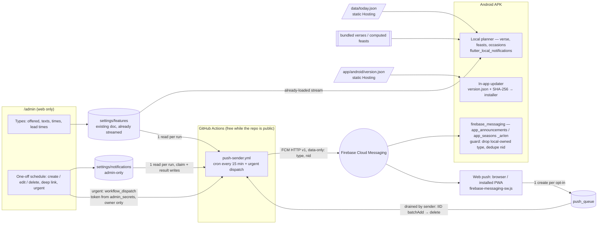

# المرحلة الثانية — الإشعارات وتطبيقات الهاتف (Phase 2 — notifications & mobile apps)

> **ADR-056** (Phase 2 architecture). Written 6 Nov 2026 against `main` @ `7e4705b`. This folder is the complete plan:
> anyone (the owner included) can implement it PR by PR without the original author. Every file is bilingual:
> Arabic headings and owner-facing steps, English technical detail. Code identifiers, paths and Firestore field
> names stay in English.

## ١. ماذا طلب المالك (The request)

6 Nov 2026, 17:29–17:37 (Cairo), in Arabic, summarised:

1. **إشعارات** for what each visitor wants to know — verse of the day, season starts, feasts / commemorations,
   occasions & mass reminders, church announcements — on **web, Android and iPhone**.
2. **Admin stays web-only** (`/admin`); the admin **chooses, schedules, edits and deletes** notifications: which
   types exist and are offered, their texts, times and lead times, and one-off scheduled notifications; the admin can
   send an ad-hoc notification with a **deep link** to any page.
3. The user **opts in / out per type** in the app's settings.
4. **Android = APK downloaded from the site** (no Play Store, no payments). **iPhone = installed web app (PWA)**,
   no Apple account, no App Store.
5. **Local notifications on the phone where possible** (scheduled on the device, no server); FCM (free) only for
   admin announcements and web push.
6. On the web, an **install option** that detects the phone's OS and can be dismissed.
7. Fully **responsive** on any screen; **small app size**.
8. Every feature ships **complete** (permission explainer, blocked state, quiet hours, test notification, inbox,
   update prompt, …) — see each PR's sub-feature table.
9. The plans cover **everything to make it real**: consoles, keys, signing, hosting, user guidance, privacy, device
   tests, release, rollback, monitoring, maintenance, launch day.

**Change requests on the plan PR, 6 Nov 2026 evening** (owner, "no code implement" — plan only):

10. **Instant dispatch for urgent one-offs**: keep the cron for routine work; an urgent one-off sent from `/admin`
    triggers the sender immediately (`workflow_dispatch`) so FCM delivers within ~1–2 min — dual trigger, token
    never public (§3.2, PR C §16, LAUNCH §14).
11. **APK sideloading guide + in-app update**: a visual step-by-step modal for the download (browser warning, Play
    Protect, «install unknown apps») (PR A §3.3); the app downloads its update itself, verifies SHA-256 against a
    version manifest and opens Android's installer — no redirect to a releases page (PR B §3.3); hosting decided
    by the owner (§8 #6).
12. **De-duplication + iOS onboarding**: strict channel segregation (§3.1) — the daily verse is never sent by FCM;
    the iOS install banner never asks for push permission; permission only inside the installed app on iOS 16.4+
    (PR D §3.1).

## ٢. الملفات (Files in this folder)

| File | What |
|---|---|
| [HANDOFF.md](HANDOFF.md) | **start here if you pick the work up**: repo / branches / worktrees, environment, standing rules, per-PR workflow, stacked-chain merge procedure, screenshots, PSI / size checks, PR body template |
| [STATUS.md](STATUS.md) | current state + per-PR checklists (tick as you go) |
| [README.md](README.md) | this overview: architecture, order, decisions, Spark constraints, cost, shared data contract |
| [PR-A-install-banner-and-prefs.md](PR-A-install-banner-and-prefs.md) | **PR A — ADR-057**: install banner on the web (OS detection, APK download + **visual sideload guide**, iPhone steps without any permission request, dismiss / remind later) + notification preferences page + type model with channel owners, behind `settings/features.push` (default off) |
| [PR-B-android-apk-local-notifications.md](PR-B-android-apk-local-notifications.md) | **PR B — ADR-058**: the Android APK (size, signing, CI build, release + version manifest, **in-app update** with SHA-256 check and the native installer, back button, language memory) + **local notifications** (verse, feasts, occasion reminders) scheduled on the phone |
| [PR-C-admin-notification-manager-fcm-sender-deeplinks.md](PR-C-admin-notification-manager-fcm-sender-deeplinks.md) | **PR C — ADR-059**: `/admin` → «الإشعارات» (types, texts, times, one-off schedule with create / edit / delete, **urgent instant send**, route picker, preview, sent log) + the GitHub Actions **FCM sender** with a **dual trigger** (cron + `workflow_dispatch`) + deep links + announcements / season alerts via FCM |
| [PR-D-web-push-pwa-ios.md](PR-D-web-push-pwa-ios.md) | **PR D — ADR-060**: web push (Android Chrome, desktop, **installed iPhone PWA iOS 16.4+**), service worker, VAPID, web subscription queue, web inbox / quiet hours / test |
| [PR-E-responsive-size-audit.md](PR-E-responsive-size-audit.md) | **PR E — ADR-061**: responsive audit 320 px → 1920 px (incl. the known ~8 px app-bar overflow), web bundle and APK size budgets, PageSpeed guard |
| [LAUNCH-AND-OPERATIONS.md](LAUNCH-AND-OPERATIONS.md) | consoles click-by-click, keystore + secrets, privacy notice, real-device test plan, release checklist, rollback, monitoring, admin runbook, **launch-day checklist** |

## ٣. البنية (Architecture)

### 3.1 فصل القنوات ومنع التكرار (Strict channel segregation — owner, 6 Nov 2026 evening)

Every type has exactly **one owner channel**; nothing is ever delivered by both.

| Type (`NotifyType`) | Owner | Android APK | Web (Android Chrome, desktop, iPhone PWA 16.4+) |
|---|---|---|---|
| `verse_daily` — آية اليوم | **local** | scheduled on the phone (bundled verses + admin fixed / season verses) | **no push** — shown on Home (a browser cannot schedule; the verse is **never** sent by FCM) |
| `feasts` — عيد / تذكار اليوم (recurring, computed) | **local** | scheduled (`copticFeastsOn` + `/data/today.json`) | no push — shown on Home |
| `occasions` — قداس / مناسبة (pre-scheduled recurring reminders) | **local** | scheduled (`computeNextMass`, `dayEvents`, programme services) | no push — shown on the mass schedule |
| `announcements` — live broadcasts, emergency notices, ordinary one-offs (urgent = instant, §3.2) | **remote (FCM)** | topic `app_announcements_<lang>` | topic `web_announcements_<lang>` |
| `seasons` — dynamic season alerts (season starts / N days before, from the admin's `seasons`) | **remote (FCM)** | topic `app_seasons_<lang>` (no local copy) | topic `web_seasons_<lang>` |

How duplicates are made impossible:
1. **Topic naming** `<platform>_<type>_<lang>` exists **only for remote types** — 8 topics in total
   (`app|web` × `announcements|seasons` × `ar|en`). There is no topic for a local-owned type, so the APK cannot
   subscribe to one; `topicFor()` throws for local-owned types (PR A), the rules allow only the 4 web topics (PR D),
   and the sender can only build messages for remote types (PR C).
2. **Message `type` field**: every FCM message is data-only with `type`, `nid`, `title`, `body`, `link`, `lang`,
   `urgent`.
3. **Client guard**: the Android handler and the web SW drop (Android) / neutralise (SW) any remote message whose
   `type` is local-owned or unknown and log `push.dropped_local_type`.
4. **Dedupe key per notification** `nid` (one-off row id, or `season:<seasonId>:<date>`): the sender's claim
   prevents a second send; the device keeps the last 100 `nid`s and drops repeats; the display id / `tag` is
   derived from `nid`, so a repeat could at worst replace, never stack. Local alarms use a separate id namespace
   (`local:type:date:key`).

Consequence (owner to confirm, §8 #13): web and iPhone-PWA users receive pushes only for announcements and season
alerts; the verse, feasts and mass reminders stay on the site itself (and as local notifications in the APK).

Local scheduling needs **no server and no Firestore read** beyond what the app already streams. The sender handles
only remote-owned types on both platforms.

### 3.2 المُرسِل بمشغّلين (Dual-trigger sender)

- **Cron** (`push-sender.yml`, every 15 min): scheduled one-offs at their time, today's season alerts, the web
  `push_queue` drain. Honest latency 15–30 min.
- **Immediate `workflow_dispatch`** when the admin presses «إرسال عاجل الآن»: the admin browser calls GitHub's
  REST API with a fine-grained token (this repo only, **Actions: write** only) kept in the **owner-only** Firestore
  doc `admin_secrets/github_dispatch` (1 read per urgent send) → the same sender runs within seconds → FCM in ~1–2
  min. Optional hardening: a free Cloudflare Worker proxy so the token never reaches a browser.
- **Idempotent**: one claim transaction per row decides who sends; the cron skips a dispatched row; concurrency group
  `push-sender`; a failed dispatch leaves the row due and the next cron run sends it; the admin sees «في الطابور /
  جارٍ الإرسال / أُرسل / فشل — سيُرسل في الدورة التالية». Details: PR C §16; token runbook: LAUNCH §14.

## ٤. ترتيب التنفيذ (Order)

The PRs form a **stacked chain**: each PR's base branch is the previous PR's branch. **Nothing is merged until the
whole chain is ready and the owner approves**; then the chain is squash-merged bottom-up into `main` without any
force-push (HANDOFF §5.6).

| # | PR | Branch → base | ADR | Owner actions |
|---|---|---|---|---|
| 0 | Plans (this folder) | `docs/phase2-plans` → `main` | ADR-056 | review & approve the plan (gate G0) |
| 1 | **A** install banner + prefs | `feat/p2a-install-prefs` → `docs/phase2-plans` | ADR-057 | visual check of the preview |
| 2 | **B** Android APK + local notifications | `feat/p2b-android-local-notifications` → A | ADR-058 | keystore + secrets (or accept debug-signed test builds); APK host (§8 #6) |
| 3 | **C** admin notification manager + FCM sender + deep links | `feat/p2c-notification-manager` → B | ADR-059 | FCM API, `push-sender` service account, `FIREBASE_SA_PUSH`, `PUSH_DRY_RUN=true`, urgent-dispatch token (§8 #12) |
| 4 | **D** web push + PWA + iPhone | `feat/p2d-web-push` → C | ADR-060 | VAPID key in `/admin` |
| 5 | **E** responsive + size audit | `fix/p2e-responsive-size` → D | ADR-061 | visual check |
| — | Merge (bottom-up) + launch | — | — | explicit "merge", then [LAUNCH-AND-OPERATIONS.md](LAUNCH-AND-OPERATIONS.md) §13 |

Each PR: draft → CI green (`ci.yml` + preview from `deploy.yml`) → `@coderabbitai review` + `@sentry review`
(≤ 2 rounds) → screenshots, size and PSI recorded → STATUS.md ticked → stays draft. Memory bank + Arabic
`documentation/` + English docs + ADR in the same PR (golden rule 11). Details: [HANDOFF.md](HANDOFF.md) §4–§8.

## ٥. قيود خطة Spark (Constraints)

- **Spark plan**: no Cloud Functions, no Cloud Storage. Free FCM (no quota cost), Firestore 50k reads / 20k writes /
  20k deletes per day, Hosting 10 GB stored / **360 MB/day transfer**.
- **No new visitor listeners / polling**: every new setting is a top-level key of the existing `settings/features`
  doc (already streamed by every visitor). Static data comes from Hosting (`/data/today.json`, bundled assets).
- **Admin-only writes** for every new `settings/features` key (rules `validFeatures` gates, 1,000-expression budget,
  emulator tests). The only public write is PR D's create-only `push_queue` (strict validation + global throttle).
- **APK hosting** (owner decision §8 #6): the **version manifest** (`/app/android/version.json`, ~500 B) is always
  on our Firebase Hosting; the APK files go to one of: (a) **Firebase Hosting** `/app/android/` (owner's original
  choice) — simplest, same domain, but every download counts against the project's Hosting transfer (Spark: 360
  MB/day on the pricing page, 10 GB/month in the Hosting docs; past it the **whole site** is disabled after a short
  grace period until the next month — https://firebase.google.com/docs/hosting/usage-quotas-pricing), i.e. roughly
  500 downloads of an 18 MB APK per month shared with all site traffic; (b) a separate **public releases repo**
  `Kerollosmm/church-portal-apk` (GitHub Releases, free, no transfer quota on our site); (c) this repo's Releases —
  **only while this repo is public**. **Repo visibility:** the GitHub API reports `Kerollosmm/church-portal` as
  **public** (checked 6 Nov 2026); the owner described it as private. If it is (or becomes) private, its release
  assets are **not publicly downloadable** (only signed-in collaborators can fetch them), so (c) is impossible and
  the choice is (a) or (b). The plans are written host-agnostic (`APK_HOST`, `APK_BASE_URL`; PR B §12).
- **GitHub Actions minutes**: free and unlimited for public repos. On a private repo (2,000 free minutes/month on
  GitHub Free) the 15-min cron alone (~96 billed minutes/day ≈ 2,900/month) would exceed it → hourly cron + urgent
  dispatch (§8 #15).
- **No stores, no payments**: no Play Console, no Apple Developer Program.
- **Admin is web-only**: `/admin` is compiled out of the APK (`kIsWeb` guard in the router).
- **No secrets in git**: keystore, service-account JSON only as GitHub secrets. The VAPID *public* key and the
  Firebase web config are public by design.

## ٦. عقد البيانات المشترك (Shared data contract — `settings/features`)

All keys are **top-level keys of `settings/features`**, admin-only write, read by everyone through the existing
stream. Missing key = the default in the table. Rules validate only changed keys (existing pattern).

| Key | Type / limits | Default | PR | Meaning |
|---|---|---|---|---|
| `installPrompt` | bool | `true` | A | show the install banner on phones |
| `installTitleAr`, `installTitleEn` | string ≤ 120 | built-in | A | banner title |
| `installBodyAr`, `installBodyEn` | string ≤ 300 | built-in | A | banner text |
| `installAndroidUrl` | `''` \| in-app path \| https URL ≤ 500 | `''` | A | APK download (arm64). Blank → browser PWA install |
| `installAndroidUrl32` | same | `''` | A | APK for older 32-bit phones (optional second link) |
| `installApkVersion` | string ≤ 20, `^[0-9]+(\.[0-9]+){0,3}$` | `''` | A | shown on the banner, e.g. `1.1.0` |
| `installApkBuild` | int 0–999999 | `0` | A (read in B) | pubspec build number of the published APK → update prompt in the APK |
| `installApkSizeMb` | number 0–200 | `0` | A | shown on the banner, e.g. `18.4` |
| `installReshowDays` | int 0–365 | `30` | A | days before the banner returns after ✕ (0 = never) |
| `installRemindDays` | int 1–60 | `3` | A | days for «ذكّرني لاحقًا» |
| `push` | bool | `false` | A | master switch: notification UI shown, sender active |
| `pushVapidKey` | `''` or `^[A-Za-z0-9_-]{80,100}$` | `''` | A (used in D) | Web Push public key |
| `pushTypes` | list ⊆ the 5 types, unique | all 5 | A | types offered to users |
| `notifyTypes` | list ≤ 5 encoded rows (`␟` U+001F) | built-in per type | C | per type: time, lead minutes, title/body templates ar/en, default link |

**Admin-only doc `settings/notifications`** (PR C; not readable by visitors, not streamed by them): `schedule`
(≤ 20 one-offs, each row carrying `urgent`, `dispatch` (admin client) and its own `sentAt` / `result` (sender)),
`sentLog` (≤ 60, written by the sender).

**Owner-only doc `admin_secrets/github_dispatch`** (PR C §16): `token` (fine-grained PAT, `github_pat_…`, this repo,
Actions: write only), `expiresOn`, `updatedAt`, `updatedBy`. Readable and writable **only** by `isOwner()`; never
streamed, exported or seeded.

**Static file `/app/android/version.json`** (PR B §3.3, Hosting, not Firestore): build, version, minimum build,
notes, signing-cert fingerprint and per-ABI `url` / `sha256` / `size`.

`pushTypes` keeps all 5 types (the APK offers all of them); the web offers only the remote-owned ones
(`announcements`, `seasons`, §3.1).

New collection (PR D only): `push_queue/{autoId}` — public **create-only** web subscription requests, drained and
deleted by the sender. Never read by visitors.

Device-only state (never in Firestore): the user's chosen types, quiet hours, language, banner dismiss date, the
notification inbox (last 30), the FCM token.

## ٧. التكلفة (Cost summary)

| PR | Visitor reads | Visitor writes | Server / Action | Notes |
|---|---|---|---|---|
| A | +0 | +0 | — | new keys ride the existing `settings/features` stream |
| B | +0 | +0 | CI minutes (free while public) | local scheduling on the phone; update check rides `installApkBuild` (+0), manifest fetch only when an update exists; APK downloads count against Hosting transfer only if hosted there (§5) |
| C | +0 | +0 | ≤ 192 reads/day (2 per sender run, every 15 min) + ≤ ~10 writes/day to the admin-only `settings/notifications`; per urgent send: +1 read (token) + 1 write (`dispatch`) by the admin + 2 reads for the dispatched run | FCM free |
| D | +0 per visit | 2 writes per web opt-in / change (queue doc + throttle doc) + ~3 security-rule document reads (`exists` / `existsAfter` / `getAfter`) | sender: 1 read + 1 delete per queued doc | ≈ 7 operations per opt-in; hard cap 1,000 queue writes/day (rules) |
| E | +0 | +0 | — | — |

Worst realistic day (500 web opt-ins): 1,000 writes + ~1,500 rule reads + 500 sender reads + 500 deletes ≈ 3,500
operations; worst abusive day (cap reached): ≈ 7,000 — both far under Spark's daily limits (50k reads, 20k writes,
20k deletes).

## ٨. قرارات المالك (Owner decisions)

| # | Decision | Status |
|---|---|---|
| 1 | Android = APK from the site, no Play Store | **decided** 6 Nov 17:32 |
| 2 | iPhone = PWA, no App Store / Apple account | **decided** 6 Nov 17:32 |
| 3 | Local notifications preferred; FCM for announcements + web | **decided** 6 Nov 17:32; **refined** 6 Nov evening: strict segregation — local (APK) = verse + recurring reminders, FCM = live broadcasts, emergencies, season alerts; verse never via FCM (§3.1) |
| 4 | Admin manages types, texts, times, one-offs, deep links | **decided** 6 Nov 17:33–17:34 |
| 5 | Release **signing keystore**: create once, back it up, store as GitHub secrets (PR B) | **open** — until then CI builds are debug-signed test builds (cannot be upgraded by a later release-signed APK) |
| 6 | APK hosting (manifest always on our Hosting): (a) **Firebase Hosting** `/app/android/` (owner's original choice; quota risk can disable the whole site for the rest of the month), (b) **public releases repo** `Kerollosmm/church-portal-apk` (**recommended**: no quota risk, works whether this repo is public or private), (c) this repo's Releases (only while it stays public) | **open — owner** |
| 7 | VAPID key generation (Firebase console, PR D) | **open** — owner or Hark's browser session |
| 8 | Service account for the sender: new `push-sender` (recommended) vs add roles to the deploy account | **open** |
| 9 | Types offered at launch and the verse time (default 07:00 Cairo) | **open** — editable in `/admin` later |
| 10 | Assistant («اسأل الكنيسة») in the APK: open the web `/ask` in the browser (App Check Play Integrity needs Play) | **recommended**, confirm |
| 11 | Google's Android developer verification (live in 4 countries since 30 Sep 2026, global in 2027): register the package in the Android Developer Console before it reaches Egypt | **open — needed before 2027**, see LAUNCH-AND-OPERATIONS §8 |
| 12 | Urgent instant dispatch token: (A) fine-grained PAT (this repo, Actions: write only, 90-day expiry) in the owner-only doc `admin_secrets/github_dispatch` (**recommended**), or (B) Cloudflare Worker proxy (token never in a browser; needs a Cloudflare account). Also: owner-only (`isOwner`, recommended) or every admin may send urgent notices | **open — owner** |
| 13 | Consequence of the channel rule: web / iPhone-PWA users get pushes only for announcements + season alerts (no verse / feast / mass-reminder pushes on the web) | **confirm** |
| 14 | `seasons` read as the owner's "dynamic seasonal alerts" → FCM on both platforms (no longer local on the APK); the alternative is keeping season starts local on the APK and FCM only on the web | **confirm** — plans follow FCM-only |
| 15 | Repo visibility: GitHub reports **public**; if it is made private → hourly cron (Actions minutes), APK host (a) or (b) | **confirm** current intent |

## ٩. خارج النطاق (Out of scope)

Google Play / App Store publishing, paid services, Cloud Functions, web push for the daily verse / feasts / mass
reminders (local-only types), per-user accounts or targeting individual users,
SMS / WhatsApp sending, analytics of who opened what (only aggregate FCM reports), offline-first service-worker
caching of the whole site.
