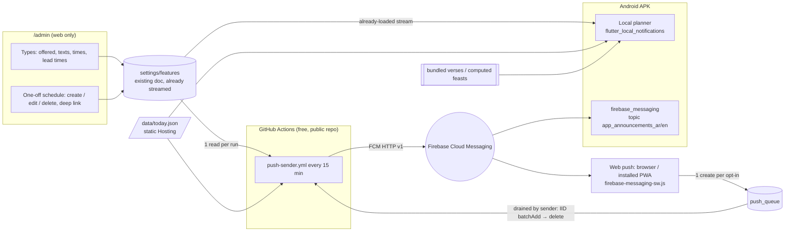

# المرحلة الثانية — الإشعارات وتطبيقات الهاتف (Phase 2 — notifications & mobile apps)

> **ADR-056** (Phase 2 architecture). Written 6 Nov 2026 against `main` @ `7e4705b`. This folder is the complete plan:
> anyone (the owner included) can implement it PR by PR without the original author. Every file is bilingual:
> Arabic headings and owner-facing steps, English technical detail. Code identifiers, paths and Firestore field
> names stay in English.

## ١. ماذا طلب المالك (The request)

6 Nov 2026, 17:29–17:37 (Cairo), in Arabic, summarised:

1. **إشعارات** for what each visitor wants to know — verse of the day, season starts, feasts / commemorations,
   occasions & mass reminders, church announcements — on **web, Android and iPhone**.
2. **Admin stays web-only** (`/admin`); the admin **chooses, schedules, edits and deletes** notifications: which
   types exist and are offered, their texts, times and lead times, and one-off scheduled notifications; the admin can
   send an ad-hoc notification with a **deep link** to any page.
3. The user **opts in / out per type** in the app's settings.
4. **Android = APK downloaded from the site** (no Play Store, no payments). **iPhone = installed web app (PWA)**,
   no Apple account, no App Store.
5. **Local notifications on the phone where possible** (scheduled on the device, no server); FCM (free) only for
   admin announcements and web push.
6. On the web, an **install option** that detects the phone's OS and can be dismissed.
7. Fully **responsive** on any screen; **small app size**.
8. Every feature ships **complete** (permission explainer, blocked state, quiet hours, test notification, inbox,
   update prompt, …) — see each PR's sub-feature table.
9. The plans cover **everything to make it real**: consoles, keys, signing, hosting, user guidance, privacy, device
   tests, release, rollback, monitoring, maintenance, launch day.

## ٢. الملفات (Files in this folder)

| File | What |
|---|---|
| [HANDOFF.md](HANDOFF.md) | **start here if you pick the work up**: repo / branches / worktrees, environment, standing rules, per-PR workflow, stacked-chain merge procedure, screenshots, PSI / size checks, PR body template |
| [STATUS.md](STATUS.md) | current state + per-PR checklists (tick as you go) |
| [README.md](README.md) | this overview: architecture, order, decisions, Spark constraints, cost, shared data contract |
| [PR-A-install-banner-and-prefs.md](PR-A-install-banner-and-prefs.md) | **PR A — ADR-057**: install banner on the web (OS detection, APK download, iPhone steps, dismiss / remind later) + notification preferences page + type model, behind `settings/features.push` (default off) |
| [PR-B-android-apk-local-notifications.md](PR-B-android-apk-local-notifications.md) | **PR B — ADR-058**: the Android APK (size, signing, CI build, GitHub Releases hosting, update prompt, back button, language memory) + **local notifications** scheduled on the phone |
| [PR-C-admin-notification-manager-fcm-sender-deeplinks.md](PR-C-admin-notification-manager-fcm-sender-deeplinks.md) | **PR C — ADR-059**: `/admin` → «الإشعارات» (types, texts, times, one-off schedule with create / edit / delete, route picker, preview, sent log) + the GitHub Actions **FCM sender** + deep links + APK announcements via FCM |
| [PR-D-web-push-pwa-ios.md](PR-D-web-push-pwa-ios.md) | **PR D — ADR-060**: web push (Android Chrome, desktop, **installed iPhone PWA iOS 16.4+**), service worker, VAPID, web subscription queue, web inbox / quiet hours / test |
| [PR-E-responsive-size-audit.md](PR-E-responsive-size-audit.md) | **PR E — ADR-061**: responsive audit 320 px → 1920 px (incl. the known ~8 px app-bar overflow), web bundle and APK size budgets, PageSpeed guard |
| [LAUNCH-AND-OPERATIONS.md](LAUNCH-AND-OPERATIONS.md) | consoles click-by-click, keystore + secrets, privacy notice, real-device test plan, release checklist, rollback, monitoring, admin runbook, **launch-day checklist** |

## ٣. البنية (Architecture)

**Who delivers what**

| Type (`NotifyType`) | Android APK | Web (Android Chrome, desktop, iPhone PWA 16.4+) |
|---|---|---|
| `verse_daily` — آية اليوم | **local** (bundled verses + admin fixed / season verses) | FCM topic `web_verse_daily_<lang>` from the sender |
| `seasons` — بداية موسم | **local** (`seasons` already cached) | FCM `web_seasons_<lang>` |
| `feasts` — عيد / تذكار اليوم | **local** (`copticFeastsOn` + `/data/today.json`) | FCM `web_feasts_<lang>` |
| `occasions` — قداس / مناسبة (تذكير قبلها) | **local** (`computeNextMass`, `dayEvents`) | FCM `web_occasions_<lang>` (church events and season programme services only, not every weekly mass — see PR C) |
| `announcements` — إعلانات الكنيسة (one-off / ad-hoc) | FCM topic `app_announcements_<lang>` | FCM `web_announcements_<lang>` |

Local scheduling needs **no server and no Firestore read** beyond what the app already streams. The sender only
handles announcements (both platforms) and the web copies of the daily types (a browser cannot schedule on its
own).

## ٤. ترتيب التنفيذ (Order)

The PRs form a **stacked chain**: each PR's base branch is the previous PR's branch. **Nothing is merged until the
whole chain is ready and the owner approves**; then the chain is squash-merged bottom-up into `main` without any
force-push (HANDOFF §5.6).

| # | PR | Branch → base | ADR | Owner actions |
|---|---|---|---|---|
| 0 | Plans (this folder) | `docs/phase2-plans` → `main` | ADR-056 | review & approve the plan (gate G0) |
| 1 | **A** install banner + prefs | `feat/p2a-install-prefs` → `docs/phase2-plans` | ADR-057 | visual check of the preview |
| 2 | **B** Android APK + local notifications | `feat/p2b-android-local-notifications` → A | ADR-058 | keystore + secrets (or accept debug-signed test builds) |
| 3 | **C** admin notification manager + FCM sender + deep links | `feat/p2c-notification-manager` → B | ADR-059 | FCM API, `push-sender` service account, `FIREBASE_SA_PUSH`, `PUSH_DRY_RUN=true` |
| 4 | **D** web push + PWA + iPhone | `feat/p2d-web-push` → C | ADR-060 | VAPID key in `/admin` |
| 5 | **E** responsive + size audit | `fix/p2e-responsive-size` → D | ADR-061 | visual check |
| — | Merge (bottom-up) + launch | — | — | explicit "merge", then [LAUNCH-AND-OPERATIONS.md](LAUNCH-AND-OPERATIONS.md) §13 |

Each PR: draft → CI green (`ci.yml` + preview from `deploy.yml`) → `@coderabbitai review` + `@sentry review`
(≤ 2 rounds) → screenshots, size and PSI recorded → STATUS.md ticked → stays draft. Memory bank + Arabic
`documentation/` + English docs + ADR in the same PR (golden rule 11). Details: [HANDOFF.md](HANDOFF.md) §4–§8.

## ٥. قيود خطة Spark (Constraints)

- **Spark plan**: no Cloud Functions, no Cloud Storage. Free FCM (no quota cost), Firestore 50k reads / 20k writes /
  20k deletes per day, Hosting 10 GB stored / **360 MB/day transfer**.
- **No new visitor listeners / polling**: every new setting is a top-level key of the existing `settings/features`
  doc (already streamed by every visitor). Static data comes from Hosting (`/data/today.json`, bundled assets).
- **Admin-only writes** for every new `settings/features` key (rules `validFeatures` gates, 1,000-expression budget,
  emulator tests). The only public write is PR D's create-only `push_queue` (strict validation + global throttle).
- **APK hosting**: 360 MB/day Hosting egress ≈ 18 downloads/day of a 20 MB APK → host APKs on **GitHub Releases**
  (repo is public; free; stable URL `…/releases/latest/download/<file>.apk`). Admin field holds the URL.
- **No stores, no payments**: no Play Console, no Apple Developer Program.
- **Admin is web-only**: `/admin` is compiled out of the APK (`kIsWeb` guard in the router).
- **No secrets in git**: keystore, service-account JSON only as GitHub secrets. The VAPID *public* key and the
  Firebase web config are public by design.

## ٦. عقد البيانات المشترك (Shared data contract — `settings/features`)

All keys are **top-level keys of `settings/features`**, admin-only write, read by everyone through the existing
stream. Missing key = the default in the table. Rules validate only changed keys (existing pattern).

| Key | Type / limits | Default | PR | Meaning |
|---|---|---|---|---|
| `installPrompt` | bool | `true` | A | show the install banner on phones |
| `installTitleAr`, `installTitleEn` | string ≤ 120 | built-in | A | banner title |
| `installBodyAr`, `installBodyEn` | string ≤ 300 | built-in | A | banner text |
| `installAndroidUrl` | `''` \| in-app path \| https URL ≤ 500 | `''` | A | APK download (arm64). Blank → browser PWA install |
| `installAndroidUrl32` | same | `''` | A | APK for older 32-bit phones (optional second link) |
| `installApkVersion` | string ≤ 20, `^[0-9]+(\.[0-9]+){0,3}$` | `''` | A | shown on the banner, e.g. `1.1.0` |
| `installApkBuild` | int 0–999999 | `0` | A (read in B) | pubspec build number of the published APK → update prompt in the APK |
| `installApkSizeMb` | number 0–200 | `0` | A | shown on the banner, e.g. `18.4` |
| `installReshowDays` | int 0–365 | `30` | A | days before the banner returns after ✕ (0 = never) |
| `installRemindDays` | int 1–60 | `3` | A | days for «ذكّرني لاحقًا» |
| `push` | bool | `false` | A | master switch: notification UI shown, sender active |
| `pushVapidKey` | `''` or `^[A-Za-z0-9_-]{80,100}$` | `''` | A (used in D) | Web Push public key |
| `pushTypes` | list ⊆ the 5 types, unique | all 5 | A | types offered to users |
| `notifyTypes` | list ≤ 5 encoded rows (`␟` U+001F) | built-in per type | C | per type: time, lead minutes, title/body templates ar/en, default link |
| `notifySchedule` | list ≤ 20 encoded rows | `[]` | C | admin one-offs: id, sendAt, title/body ar/en, link, targets |
| `pushSent` | list ≤ 60 encoded rows | `[]` | C (written by the sender) | sent log + dedup keys |

New collection (PR D only): `push_queue/{autoId}` — public **create-only** web subscription requests, drained and
deleted by the sender. Never read by visitors.

Device-only state (never in Firestore): the user's chosen types, quiet hours, language, banner dismiss date, the
notification inbox (last 30), the FCM token.

## ٧. التكلفة (Cost summary)

| PR | Visitor reads | Visitor writes | Server / Action | Notes |
|---|---|---|---|---|
| A | +0 | +0 | — | new keys ride the existing `settings/features` stream |
| B | +0 | +0 | CI minutes (free, public repo) | local scheduling on the phone |
| C | +0 | +0 | ≤ 96 reads/day (1 per sender run, every 15 min) + ≤ ~10 writes/day (`pushSent`) | FCM free |
| D | +0 per visit | 1 create per web opt-in / change (+ throttle doc) | sender: 1 read + 1 delete per queued request | ~100 opt-ins → ~300 ops once |
| E | +0 | +0 | — | — |

Worst realistic day (500 web opt-ins): ~1,500 extra operations — far under the free limits.

## ٨. قرارات المالك (Owner decisions)

| # | Decision | Status |
|---|---|---|
| 1 | Android = APK from the site, no Play Store | **decided** 6 Nov 17:32 |
| 2 | iPhone = PWA, no App Store / Apple account | **decided** 6 Nov 17:32 |
| 3 | Local notifications preferred; FCM for announcements + web | **decided** 6 Nov 17:32 |
| 4 | Admin manages types, texts, times, one-offs, deep links | **decided** 6 Nov 17:33–17:34 |
| 5 | Release **signing keystore**: create once, back it up, store as GitHub secrets (PR B) | **open** — until then CI builds are debug-signed test builds (cannot be upgraded by a later release-signed APK) |
| 6 | APK hosting: **GitHub Releases** (recommended) vs Firebase Hosting `/downloads/` | **open** — recommended GitHub Releases |
| 7 | VAPID key generation (Firebase console, PR D) | **open** — owner or Hark's browser session |
| 8 | Service account for the sender: new `push-sender` (recommended) vs add roles to the deploy account | **open** |
| 9 | Types offered at launch and the verse time (default 07:00 Cairo) | **open** — editable in `/admin` later |
| 10 | Assistant («اسأل الكنيسة») in the APK: open the web `/ask` in the browser (App Check Play Integrity needs Play) | **recommended**, confirm |
| 11 | Google's Android developer verification (live in 4 countries since 30 Sep 2026, global in 2027): register the package in the Android Developer Console before it reaches Egypt | **open — needed before 2027**, see LAUNCH-AND-OPERATIONS §8 |

## ٩. خارج النطاق (Out of scope)

Google Play / App Store publishing, paid services, Cloud Functions, per-user accounts or targeting individual users,
SMS / WhatsApp sending, analytics of who opened what (only aggregate FCM reports), offline-first service-worker
caching of the whole site.
