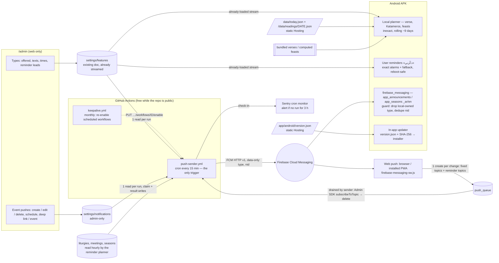

# المرحلة الثانية — الإشعارات وتطبيقات الهاتف (Phase 2 — notifications & mobile apps)

> **ADR-056** (Phase 2 architecture). Written 6 Nov 2026 against `main` @ `7e4705b`; revised 6 Nov 19:31–19:35 (owner clarification). This folder is the complete plan:
> anyone (the owner included) can implement it PR by PR without the original author. Every file is bilingual:
> Arabic headings and owner-facing steps, English technical detail. Code identifiers, paths and Firestore field
> names stay in English.

## ١. ماذا طلب المالك (The request)

6 Nov 2026, 17:29–17:37 (Cairo), in Arabic, summarised:

1. **إشعارات** for what each visitor wants to know — verse of the day, season starts, feasts / commemorations,
   occasions & mass reminders, church announcements — on **web, Android and iPhone**.
2. **Admin stays web-only** (`/admin`); the admin **chooses, schedules, edits and deletes** notifications: which
   types exist and are offered, their texts, times and lead times, and one-off scheduled notifications; the admin can
   send an ad-hoc notification with a **deep link** to any page.
3. The user **opts in / out per type** in the app's settings.
4. **Android = APK downloaded from the site** (no Play Store, no payments). **iPhone = installed web app (PWA)**,
   no Apple account, no App Store.
5. **Local notifications on the phone where possible** (scheduled on the device, no server); FCM (free) only for
   admin announcements and web push.
6. On the web, an **install option** that detects the phone's OS and can be dismissed.
7. Fully **responsive** on any screen; **small app size**.
8. Every feature ships **complete** (permission explainer, blocked state, quiet hours, test notification, inbox,
   update prompt, …) — see each PR's sub-feature table.
9. The plans cover **everything to make it real**: consoles, keys, signing, hosting, user guidance, privacy, device
   tests, release, rollback, monitoring, maintenance, launch day.

**Change requests on the plan PR, 6 Nov 2026 evening** (owner, "no code implement" — plan only):

10. ~~Instant dispatch for urgent one-offs~~ — **withdrawn 19:31** (item 13): there is no urgent / instant path.
11. **APK sideloading guide + in-app update**: a visual step-by-step modal for the download (browser warning, Play
    Protect, «install unknown apps») (PR A §3.3); the app downloads its update itself, verifies SHA-256 against a
    version manifest and opens Android's installer — no redirect to a releases page (PR B §3.3); hosting decided
    by the owner (§8 #6 — **decided 6 Nov 2026 19:57**: a separate public releases repo, manifest on our Hosting).
12. **De-duplication + iOS onboarding**: strict channel segregation (§3.1) — the daily verse is never sent by FCM;
    the iOS install banner never asks for push permission; permission only inside the installed app on iOS 16.4+
    (PR D §3.1).

**Owner decisions, 6 Nov 2026 19:57 (final)** — §8 #6 and #17:

- **Katameros text (#17):** Arabic full text (Van Dyck, public domain) + English as **references only** (e.g.
  "Gospel: John 15:1-12") — **no NKJV text**. One daily file `/data/readings/<date>.json`, target ≤ ~20–25 KB.
  Future option: swap in a public-domain English translation (WEB / ASV) without any architecture change (§3.5).
- **APK hosting (#6):** a separate **public releases repo** (proposed name `Kerollosmm/church-portal-apk`) whose
  GitHub Releases carry the APK files; the small version manifest (`version.json`, ~500 B: version, size, SHA-256,
  download URL → the Release asset) stays on Firebase Hosting. Reasons: Spark's Hosting transfer cap (10 GB/month)
  would take the **whole site** down if APKs were served from it; independence from the main repo's visibility; the
  main repo stays light (§5).

**Owner clarification, 6 Nov 2026 19:31 (Arabic, binding)** — «السرعة مش مهمة»:

13. **Admin event pushes** (§3.3, PR C): an admin sends a normal push for an event or occasion (title, body,
    optional deep link to a page / event, scheduled time) to web, iPhone PWA and APK via FCM topics. **Not urgent,
    speed does not matter — what matters is that it is delivered.** Only the scheduled sender exists (cron); no
    `workflow_dispatch` token, no «إرسال عاجل». Guaranteed delivery: idempotent per-topic send markers, retries,
    catch-up of missed runs, sent / failed status in `/admin`.
14. **User-chosen event reminders «ذكّرني»** (§3.4, new): on any event / service / occasion card (a Holy Week
    service, a revival night, a feast liturgy, a mass) the user taps «ذكّرني» and picks a lead time. APK: scheduled
    **locally** at the exact time (survives reboot, follows edits, cancelled if the event is removed). Web / iPhone
    PWA: delivered by the scheduled sender through per-event FCM topics — **may arrive up to ~30 min late** (said in
    the UI) — plus «أضف إلى التقويم» for an exact-time alternative.
15. **Local verse + Katameros** (§3.5): the APK schedules the verse of the day and the day's Katameros readings
    **locally** in a rolling ~9-day window from static Hosting JSON; tapping opens an in-app screen with the full
    verse or the full Katameros reading of that day, offline from the cache. Strictly local, never FCM. Web / iPhone:
    no local scheduling — they see verse and Katameros on Home (and the same reading screen).

**Owner additions, 19:35:** (a) keep-alive for the scheduled workflows (no dummy commits) + an alert when the sender
has not run for N hours (PR C §17, LAUNCH §14); (b) the web / iPhone «ذكّرني» delay stated plainly in the UI (PR D
§3.2); (c) OEM battery-saver guidance per brand + a diagnostic check, inexact alarms for verse / Katameros, exact
only for user reminders with a fallback (PR B §3.2, §3.4).

## ٢. الملفات (Files in this folder)

| File | What |
|---|---|
| [HANDOFF.md](HANDOFF.md) | **start here if you pick the work up**: repo / branches / worktrees, environment, standing rules, per-PR workflow, stacked-chain merge procedure, screenshots, PSI / size checks, PR body template |
| [STATUS.md](STATUS.md) | current state + per-PR checklists (tick as you go) |
| [README.md](README.md) | this overview: architecture, order, decisions, Spark constraints, cost, shared data contract |
| [PR-A-install-banner-and-prefs.md](PR-A-install-banner-and-prefs.md) | **PR A — ADR-057**: install banner on the web (OS detection, APK download + **visual sideload guide**, iPhone steps without any permission request, dismiss / remind later) + notification preferences page + type model with channel owners + the **«ذكّرني» button / sheet scaffold** and «تذكيراتي» list (stored on the device), behind `settings/features.push` (default off) |
| [PR-B-android-apk-local-notifications.md](PR-B-android-apk-local-notifications.md) | **PR B — ADR-058**: the Android APK (size, signing, CI build, release + version manifest, **in-app update** with SHA-256 check and the native installer, back button, language memory) + **local notifications**: verse + **Katameros** (rolling ~9-day window, inexact), feasts, and **user reminders** (exact alarms with fallback, reboot-safe, follow edits) + the reading screen + **OEM battery guidance and diagnostic check** |
| [PR-C-admin-notification-manager-fcm-sender-deeplinks.md](PR-C-admin-notification-manager-fcm-sender-deeplinks.md) | **PR C — ADR-059**: `/admin` → «الإشعارات» (types, texts, times, reminder lead options, **event pushes** with create / edit / delete, route / event picker, preview, status, sent log) + the **scheduled** GitHub Actions FCM sender (cron only; per-topic send markers, retries, catch-up) + the **reminder planner** for web reminders + deep links + **keep-alive and sender-health alert** |
| [PR-D-web-push-pwa-ios.md](PR-D-web-push-pwa-ios.md) | **PR D — ADR-060**: web push (Android Chrome, desktop, **installed iPhone PWA iOS 16.4+**), service worker, VAPID, web subscription queue (fixed topics + **per-event reminder topics**), web «ذكّرني» with the honest delay text, web inbox / quiet hours / test |
| [PR-E-responsive-size-audit.md](PR-E-responsive-size-audit.md) | **PR E — ADR-061**: responsive audit 320 px → 1920 px (incl. the known ~8 px app-bar overflow), web bundle and APK size budgets, PageSpeed guard |
| [LAUNCH-AND-OPERATIONS.md](LAUNCH-AND-OPERATIONS.md) | consoles click-by-click, keystore + secrets, privacy notice, real-device test plan, release checklist, rollback, monitoring (sender health), admin runbook, **launch-day checklist**, workflow keep-alive runbook |

## ٣. البنية (Architecture)

### 3.1 فصل القنوات ومنع التكرار (Strict channel segregation — owner, 6 Nov evening; updated 19:31)

Every type has exactly **one owner channel per platform**; nothing is ever delivered by two channels on the same
platform.

| Type (`NotifyType`) | Android APK | Web (Android Chrome, desktop, iPhone PWA 16.4+) |
|---|---|---|
| `verse_daily` — آية اليوم | **local** (inexact, rolling ~9 days; tap → full verse screen) | **no push** — shown on Home (the verse is **never** sent by FCM) |
| `katameros_daily` — قراءات اليوم (القطمارس) — **new** | **local** (inexact, rolling ~9 days from `/data/readings/*.json`; tap → full readings of that day) | **no push** — Home card + the same reading screen |
| `feasts` — عيد / تذكار اليوم (recurring, computed) | **local** | no push — shown on Home |
| `reminders` — «ذكّرني» user-chosen event / service reminders (**replaces** the earlier blanket `occasions` type: «remind me every time» on a recurring service covers the old mass reminder) | **local** (exact alarm when allowed, inexact fallback; never FCM) | **remote (FCM)** — per-event topic `web_rem_<eventKey>_<lead>_<lang>`, sent by the scheduled sender (may be up to ~30 min late — stated in the UI) |
| `announcements` — admin event / occasion pushes (feature 1; scheduled, not urgent) | **remote (FCM)** topic `app_announcements_<lang>` | **remote (FCM)** topic `web_announcements_<lang>` |
| `seasons` — dynamic season alerts (season starts / N days before) | **remote (FCM)** topic `app_seasons_<lang>` (no local copy) | **remote (FCM)** topic `web_seasons_<lang>` |

How duplicates are made impossible:
1. **Topic naming** exists only for remote (platform, type) pairs: 8 fixed topics (`app|web` × `announcements|seasons`
   × `ar|en`) + dynamic **web-only** reminder topics `web_rem_…`. There is no `app_rem_*` topic and no topic at all
   for verse / Katameros / feasts. `topicFor()` throws for local-owned (platform, type) pairs (PR A), the rules allow
   only the 4 fixed web topics + the `web_rem_` pattern (PR D), and the sender can only build messages for remote
   pairs (PR C).
2. **Message `type` field**: every FCM message is data-only with `type`, `nid`, `title`, `body`, `link`, `lang`
   and, for event-linked messages, `eventKey`.
3. **Client guard**: the Android handler drops any remote message whose `type` is local-owned on Android
   (`verse_daily`, `katameros_daily`, `feasts`, `reminders`) or unknown; the web SW neutralises `verse_daily`,
   `katameros_daily`, `feasts` and unknown types; both log `push.dropped_local_type`.
4. **Dedupe key per notification** `nid` (event push row id; `season:<seasonId>:<date>`; web reminder
   `rem:<eventKey>:<occurrenceDate>:<lead>`): the sender's per-topic markers prevent a second send; the device keeps
   the last 100 `nid`s and drops repeats; the display id / `tag` is derived from `nid`. Local alarms use a separate
   id namespace (`local:type:date:key`).
5. **Admin push + user reminder for the same event**: when an announcement carries `eventKey` X and the device has a
   reminder for X that fired in the last 60 min or is due in the next 60 min, the two share one notification slot
   (Android id / web `tag` = `event:X`): the later one **replaces** the earlier one, never stacks; the inbox keeps
   both entries. The reminder alarm itself is not cancelled (it may carry the user's own lead time).

Consequence (owner to confirm, §8 #13): web and iPhone-PWA users receive pushes for event pushes, season alerts
and their own reminders; verse, Katameros and feasts stay on the site itself (and as local notifications in the APK).

### 3.2 المُرسِل المجدول فقط (Scheduled sender only — delivery over speed)

- **One trigger:** `push-sender.yml` on a **cron every 15 min** (public repo; hourly if the repo becomes private,
  §8 #15). It sends due event pushes, today's season alerts, due web reminders, and drains `push_queue`.
- **Expected delay (accepted by the owner, 19:31):** an event push goes out at the first run at or after its
  scheduled time — normally within 15–30 min, occasionally longer when GitHub delays scheduled runs. The admin UI
  says so; for something time-critical the admin schedules it earlier.
- **Guaranteed delivery:** per-topic send markers set by a claim transaction (at most once per topic); transient FCM
  errors retried on the next runs (≤ 3 attempts per topic); **catch-up**: a run that finds rows due since a
  missed / skipped run sends them (event pushes up to 24 h late, then «فات موعده»; reminders only while still
  useful, PR C §16); `sent` / `partial` / `failed` / `expired` status per row in `/admin`; manual «أعد الإرسال».
- **Sender health:** the sender stamps `lastRunAt` (hourly) in the admin-only doc and checks in with a Sentry cron
  monitor; `/admin` shows «آخر تشغيل للمُرسِل» and a red warning after 3 h; Sentry e-mails the owner on a missed
  check-in; `keepalive.yml` re-enables the scheduled workflows monthly so GitHub's 60-day inactivity rule never
  stops them (PR C §17, LAUNCH §14).
- **Removed (19:31):** the `workflow_dispatch` urgent trigger, the dispatch token and `admin_secrets/github_dispatch`,
  the «عاجل» switch and the `urgent` / `dispatch` fields. `workflow_dispatch` remains only for the owner's manual
  dry-run / test runs from the GitHub UI.

### 3.3 إشعارات المشرف للأحداث (Admin event pushes — feature 1)

Admin → «الإشعارات» → «إشعارات الأحداث» → «إضافة»: title ar/en, body ar/en, **optional deep link** (any page, or a
specific event / service picked from the schedule — which also sets `eventKey` for §3.1 rule 5), **scheduled time**
(or «في أقرب دورة»), targets (web, app; default both). Delivered via FCM topics `app_announcements_<lang>` and
`web_announcements_<lang>` to the APK, browsers and the installed iPhone PWA. Not urgent: the screen says «يُرسل
خلال ١٥–٣٠ دقيقة تقريبًا من الموعد». Details: PR C §3.

### 3.4 تذكيرات يختارها المستخدم «ذكّرني» (User-chosen event reminders — feature 2)

| | Android APK | Web / iPhone PWA |
|---|---|---|
| Where | «ذكّرني» on every event / service / occasion card and detail page (liturgies incl. Holy Week / Pascha / revival / feast services, meetings, today's church events `dayEvents`) | same button |
| Lead choice | sheet: «في الموعد» / «قبل ١٥ دقيقة» / «قبل ساعة» / «قبل يوم» (set and defaults admin-configurable, ≤ 4 values from 0, 5, 10, 15, 30, 60, 120, 180, 1440 min); recurring service: «هذه المرة فقط» / «كل مرة» | same; plus «أضف إلى التقويم» (exact time via the phone's calendar, existing ADR-021 feature) |
| Delivery | **local** alarm, exact when allowed (`USE_EXACT_ALARM` / `SCHEDULE_EXACT_ALARM`, §8 #16), else inexact (± ~10 min) with a note; survives reboot; re-planned on app open / data change; cancelled with a note if the event is removed or moved out of reach | **FCM** per-event topic via `push_queue`; the scheduled sender sends at the lead time — **may arrive up to ~30 min late** («قد يصل التذكير متأخرًا حتى ٣٠ دقيقة تقريبًا — للتنبيه في الموعد بالضبط استخدم «أضف إلى التقويم»») |
| «تذكيراتي» | list on `/notifications` (and a chip on each card): view, change lead, cancel; history in the inbox | same; cancelling queues an unsubscribe |
| Quiet hours | user reminders **ring normally** inside quiet hours by default (the user asked for them); switch «التذكيرات تحترم ساعات الهدوء» makes them silent (§8 #18) | same rule in the SW |
| Cost | +0 Firestore | 2 writes + ~3 rule reads per change batch (debounced), sender 1 read + 1 delete; planner ≈ 1.6k reads/day total (PR C §16) |

Why per-event topics on the web (PR C §16, PR D §3.2): Spark has no Functions; a server-side list of reminders per
browser would cost N reads per sender run; topics keep **no reminder data in Firestore** — the sender sends to every
`(eventKey, occurrence, lead, lang)` topic that is due (sends to topics nobody subscribed are free and harmless).
Web browsers cannot schedule a local notification (Notification Triggers was abandoned), so the calendar link is the
exact-time alternative.

### 3.5 الآية والقطمارس محليًا (Local verse + Katameros — feature 3)

- **Data:** verse = bundled `assets/verses/daily_verses.json` + admin fixed / season verses (as today); Katameros =
  new static files `/data/readings/<YYYY-MM-DD>.json` (yesterday … +9 days) built by an extended `synaxarium.yml`
  from the Katameros API (PR B §3.5). **Text (decided §8 #17, 6 Nov 2026):** Arabic full text (Van Dyck, public
  domain) + English **references only** (e.g. "Gospel: John 15:1-12", built from the API's book / chapter / verse
  numbers — no English verse text, no NKJV). **Size target ≤ ~20–25 KB per daily file** as served (the Arabic API
  payload measured 29–31 KB raw / ≈ 7.5–8 KB gzip on three sample days, 6 Nov 2026; the builder keeps only the
  fields the screen uses). Future option: public-domain English text (WEB / ASV) fills the existing `textEn` fields —
  no architecture change.
- **APK:** local notifications in a **rolling ~9-day window** (inexact, no exact-alarm permission); refreshed on app
  open / resume and by the daily background task when fewer than 4 days remain; each day's file is downloaded once
  and cached. Payload `{type, date}` → `/readings/<date>?tab=verse|katameros` → in-app reading screen (full verse;
  full Katameros: Vespers / Matins psalm + gospel, Pauline, Catholic, Acts, Synaxarium, Liturgy psalm + gospel),
  **offline** from the cache. Never FCM.
- **Web / iPhone:** no local scheduling — verse and Katameros on Home (decision #13 unchanged) with «اقرأ القراءات»
  opening the same `/readings/<date>` screen (one file fetched on demand).

## ٤. ترتيب التنفيذ (Order)

The PRs form a **stacked chain**: each PR's base branch is the previous PR's branch. **Nothing is merged until the
whole chain is ready and the owner approves**; then the chain is squash-merged bottom-up into `main` without any
force-push (HANDOFF §5.6).

| # | PR | Branch → base | ADR | Owner actions |
|---|---|---|---|---|
| 0 | Plans (this folder) | `docs/phase2-plans` → `main` | ADR-056 | review & approve the plan (gate G0) |
| 1 | **A** install banner + prefs | `feat/p2a-install-prefs` → `docs/phase2-plans` | ADR-057 | visual check of the preview |
| 2 | **B** Android APK + local notifications | `feat/p2b-android-local-notifications` → A | ADR-058 | keystore + secrets (or accept debug-signed test builds); create the public releases repo `Kerollosmm/church-portal-apk` (or approve the agent creating it at PR B time) + `RELEASES_REPO_TOKEN` (§8 #6, decided) |
| 3 | **C** admin notification manager + FCM sender + deep links | `feat/p2c-notification-manager` → B | ADR-059 | FCM API, `push-sender` service account, `FIREBASE_SA_PUSH`, `PUSH_DRY_RUN=true`, Sentry cron monitor (optional DSN secret); recommended: `production` required reviewers (§8 #19) |
| 4 | **D** web push + PWA + iPhone | `feat/p2d-web-push` → C | ADR-060 | VAPID key in `/admin` |
| 5 | **E** responsive + size audit | `fix/p2e-responsive-size` → D | ADR-061 | visual check |
| — | Merge (bottom-up) + launch | — | — | explicit "merge", then [LAUNCH-AND-OPERATIONS.md](LAUNCH-AND-OPERATIONS.md) §13 |

Each PR: draft → CI green (`ci.yml` + preview from `deploy.yml`) → `@coderabbitai review` + `@sentry review`
(≤ 2 rounds) → screenshots, size and PSI recorded → STATUS.md ticked → stays draft. Memory bank + Arabic
`documentation/` + English docs + ADR in the same PR (golden rule 11). Details: [HANDOFF.md](HANDOFF.md) §4–§8.

## ٥. قيود خطة Spark (Constraints)

- **Spark plan**: no Cloud Functions, no Cloud Storage. Free FCM (no quota cost), Firestore 50k reads / 20k writes /
  20k deletes per day, Hosting 10 GB stored / **360 MB/day transfer**.
- **No new visitor listeners / polling**: every new setting is a top-level key of the existing `settings/features`
  doc (already streamed by every visitor). Static data comes from Hosting (`/data/today.json`, `/data/readings/<date>.json`, bundled assets).
- **Admin-only writes** for every new `settings/features` key (rules `validFeatures` gates, 1,000-expression budget,
  emulator tests). The only public write is PR D's create-only `push_queue` (strict validation + global throttle).
- **APK hosting** (owner decision §8 #6 — **decided 6 Nov 2026 19:57**): the APK files are published as assets of
  **GitHub Releases in a separate public repo** (proposed name `Kerollosmm/church-portal-apk`, contains only a README
  and releases); the **version manifest** (`/app/android/version.json`, ~500 B: version, build, size, SHA-256 and the
  download URL of the Release asset, per ABI) stays on our Firebase Hosting. Why: (1) Spark Hosting transfer is
  capped (360 MB/day on the pricing page, 10 GB/month in the Hosting docs; past it the **whole site** is disabled
  after a short grace period until the next month — https://firebase.google.com/docs/hosting/usage-quotas-pricing),
  i.e. roughly 500 downloads of an 18 MB APK per month would be shared with all site traffic; (2) public downloads
  keep working whatever the main repo's visibility (release assets of a private repo are not publicly downloadable;
  the GitHub API reports `Kerollosmm/church-portal` as **public** on 6 Nov 2026, the owner described it as private);
  (3) the main repo stays light. Setup (PR B §12 / §15, LAUNCH §1 / §4): the owner creates the repo (or approves the
  agent creating it at PR B time — **not before**); a fine-grained token limited to that repo (Contents: Read and
  write) is stored as the main repo's Actions secret `RELEASES_REPO_TOKEN` and used only by the release workflow
  (`android.yml`) to publish there; **retention**: keep the newest 5 releases (the live one is always the newest),
  older releases and their tags are deleted by the same workflow. Rejected alternatives: (a) Firebase Hosting
  `/app/android/` (quota risk above), (c) the main repo's Releases (only while it is public). `APK_HOST` /
  `APK_BASE_URL` stay as variables (value `releases-repo`), so an emergency switch needs no code change.
- **GitHub Actions minutes**: free and unlimited for public repos. On a private repo (2,000 free minutes/month on
  GitHub Free) the 15-min cron alone (~96 billed minutes/day ≈ 2,900/month) would exceed it → hourly cron (§8 #15);
  event pushes and web reminders then arrive up to ~60–75 min late.
- **Scheduled workflows and inactivity**: GitHub disables scheduled workflows of a **public** repo after 60 days
  without repository activity → `keepalive.yml` re-enables them monthly through the API, no dummy commits (PR C §17).
- **No stores, no payments**: no Play Console, no Apple Developer Program.
- **Admin is web-only**: `/admin` is compiled out of the APK (`kIsWeb` guard in the router).
- **No secrets in git**: keystore, service-account JSON only as GitHub secrets. The VAPID *public* key and the
  Firebase web config are public by design.
- **`production` environment protection — recommended hygiene, no longer a blocker** (19:31: the dispatch token is
  gone, so nothing in Phase 2 depends on it): `seed.yml` (`force`, `admin_email` → owner) runs in `production`, which
  had no protection rules on 6 Nov 2026; Required reviewers make seed / rules runs wait for the owner's approval
  (§8 #19, LAUNCH §14).

## ٦. عقد البيانات المشترك (Shared data contract — `settings/features`)

All keys are **top-level keys of `settings/features`**, admin-only write, read by everyone through the existing
stream. Missing key = the default in the table. Rules validate only changed keys (existing pattern).

| Key | Type / limits | Default | PR | Meaning |
|---|---|---|---|---|
| `installPrompt` | bool | `true` | A | show the install banner on phones |
| `installTitleAr`, `installTitleEn` | string ≤ 120 | built-in | A | banner title |
| `installBodyAr`, `installBodyEn` | string ≤ 300 | built-in | A | banner text |
| `installAndroidUrl` | `''` \| in-app path \| https URL ≤ 500 | `''` | A | APK download (arm64). Blank → browser PWA install |
| `installAndroidUrl32` | same | `''` | A | APK for older 32-bit phones (optional second link) |
| `installApkVersion` | string ≤ 20, `^[0-9]+(\.[0-9]+){0,3}$` | `''` | A | shown on the banner, e.g. `1.1.0` |
| `installApkBuild` | int 0–999999 | `0` | A (read in B) | pubspec build number of the published APK → update prompt in the APK |
| `installApkSizeMb` | number 0–200 | `0` | A | arm64 APK size, shown on the banner and in the guide, e.g. `18.4` |
| `installApkSize32Mb` | number 0–200 | `0` | A | arm32 APK size, shown next to «هاتف قديم؟» and in the guide when that link was chosen |
| `installReshowDays` | int 0–365 | `30` | A | days before the banner returns after ✕ (0 = never) |
| `installRemindDays` | int 1–60 | `3` | A | days for «ذكّرني لاحقًا» |
| `push` | bool | `false` | A | master switch: notification UI shown, sender active |
| `pushVapidKey` | `''` or `^[A-Za-z0-9_-]{80,100}$` | `''` | A (used in D) | Web Push public key |
| `pushTypes` | list ⊆ the 6 types (`announcements`, `verse_daily`, `katameros_daily`, `seasons`, `feasts`, `reminders`), unique | all 6 | A | types offered to users |
| `notifyTypes` | list ≤ 6 encoded rows (`␟` U+001F) | built-in per type | C | per type: time, days before, title/body templates ar/en, default link |
| `reminderLeads` | list ≤ 4 ints ⊆ {0, 5, 10, 15, 30, 60, 120, 180, 1440}, unique | `[0, 15, 60, 1440]` | A | lead-time choices in the «ذكّرني» sheet (minutes before the event) |
| `reminderDefaultLead` | int ∈ `reminderLeads` | `60` | A | pre-selected lead |

**Admin-only doc `settings/notifications`** (PR C; not readable by visitors, not streamed by them): `schedule`
(≤ 20 event pushes, admin columns only, incl. optional `eventKey`), `status` (map rowId → per-topic send markers,
**sender only**), `sentLog` (≤ 60, sender), `reminderPlan` (next 36 h of web-reminder slots, sender's hourly planner),
`remindersSent` (map slot key → result, today + yesterday only, sender), `health` (`lastRunAt`, `lastPlanAt`,
`lastError`, sender) — admin and sender never write the same field, so neither can overwrite the other.

(Removed 19:31: the `urgent` column, the `dispatch` map and the owner-only `admin_secrets/github_dispatch` doc.)

**Static file `/app/android/version.json`** (PR B §3.3, Hosting, not Firestore): build, version, minimum build,
notes, signing-cert fingerprint and per-ABI `url` / `sha256` / `size`; `url` = the asset of the matching GitHub
Release in `Kerollosmm/church-portal-apk` (§8 #6).

**Static files `/data/readings/<YYYY-MM-DD>.json`** (PR B §3.5, Hosting): the day's full Katameros readings — Arabic
full text (Van Dyck) + English references only (§8 #17), target ≤ ~20–25 KB each — yesterday … +9 days, published by
`synaxarium.yml` with `/data/today.json`.

`pushTypes` keeps all 6 types (the APK offers all of them); the web offers `announcements`, `seasons` and
`reminders` (§3.1).

New collection (PR D only): `push_queue/{autoId}` — public **create-only** web subscription requests (fixed topics +
encoded reminder topics), drained and deleted by the sender. Never read by visitors.

Device-only state (never in Firestore): quiet hours, banner dismiss date, the notification inbox (last 30), the
user's reminders list «تذكيراتي», cached readings, and — on the Android APK — the chosen types, language and FCM
token (the APK subscribes to topics directly with FCM).
**Web exception:** to subscribe a browser, its FCM token **with the chosen topics (types + language + reminder
topics, which name the event and lead time)** is written to
`push_queue` and kept there only until the sender processes it (normally minutes, then deleted; PR D §5). If the
token-list fallback is ever chosen, tokens and topics are stored in Firestore **while subscribed** and the privacy
notice changes accordingly (LAUNCH §6).

## ٧. التكلفة (Cost summary)

| PR | Visitor reads | Visitor writes | Server / Action | Notes |
|---|---|---|---|---|
| A | +0 | +0 | — | new keys ride the existing `settings/features` stream; reminders list in local storage |
| B | +0 | +0 | CI minutes (free while public) | local scheduling on the phone; readings: each day's file (Arabic text + English refs, ≈ 8 KB gzip) downloaded once per device (≈ 8 MB/day of Hosting transfer for 1,000 APK users); update manifest (~500 B) only when an update exists; APK downloads are served by GitHub Releases, not Hosting (§5) |
| C | +0 | +0 | sender: ≤ 192 reads/day (2 per run) + hourly reminder planner ≈ 65 reads/run ≈ 1,560 reads/day + ≤ ~40 writes/day (markers, plan, health) on the admin-only doc | FCM free (≈ 100–200 topic sends/day for web reminders) |
| D | +0 per visit | 2 writes per web change batch (queue doc + throttle doc; «ذكّرني» changes debounced into one batch) + ~3 security-rule document reads | sender: 1 read + 1 delete per queued doc | hard cap 1,000 queue writes/day (rules) |
| E | +0 | +0 | — | — |

Worst realistic day (Holy Week, 500 web opt-ins / reminder batches): 1,000 writes + ~1,500 rule reads + 500 sender
reads + 500 deletes + ~1,750 sender / planner reads ≈ 5,250 operations; worst abusive day (cap reached): ≈ 8,750 —
both far under Spark's daily limits (50k reads, 20k writes, 20k deletes).

## ٨. قرارات المالك (Owner decisions)

| # | Decision | Status |
|---|---|---|
| 1 | Android = APK from the site, no Play Store | **decided** 6 Nov 17:32 |
| 2 | iPhone = PWA, no App Store / Apple account | **decided** 6 Nov 17:32 |
| 3 | Local notifications preferred; FCM for announcements + web | **decided** 6 Nov 17:32; **refined** 6 Nov evening and **19:31**: per platform one channel — APK local = verse, Katameros, feasts, user reminders; FCM = admin event pushes, season alerts, web / iPhone user reminders; verse and Katameros never via FCM (§3.1) |
| 4 | Admin manages types, texts, times, event pushes, deep links — **scheduled sender only, no urgent / instant path; delivery guaranteed, speed not important** | **decided** 6 Nov 17:33–17:34; **19:31** (instant dispatch removed) |
| 5 | Release **signing keystore**: create once, back it up, store as GitHub secrets (PR B) | **open** — until then CI builds are debug-signed test builds (cannot be upgraded by a later release-signed APK) |
| 6 | APK hosting: a separate **public releases repo** (proposed `Kerollosmm/church-portal-apk`) — GitHub Releases carry the APK assets; the version manifest `version.json` (~500 B: version, size, SHA-256, download URL → the Release asset) stays on Firebase Hosting. Reasons: Spark's 10 GB/month Hosting transfer cap would take the whole site down; independent of the main repo's visibility; keeps the main repo light. Steps: owner creates the repo (or approves the agent creating it at PR B time); fine-grained token for that repo only → main-repo secret `RELEASES_REPO_TOKEN` for the release workflow; retention: newest 5 releases kept (§5, PR B §12 / §15) | **decided** 2026-11-06 (19:57) |
| 7 | VAPID key generation (Firebase console, PR D) | **open** — owner or Hark's browser session |
| 8 | Service account for the sender: new `push-sender` (recommended) vs add roles to the deploy account | **open** |
| 9 | Types offered at launch and default times: verse 07:00, Katameros 06:30, feasts 07:30 Cairo; reminder leads «في الموعد / ١٥ د / ساعة / يوم» (default ساعة) | **open** — editable in `/admin` later |
| 10 | Assistant («اسأل الكنيسة») in the APK: open the web `/ask` in the browser (App Check Play Integrity needs Play) | **recommended**, confirm |
| 11 | Google's Android developer verification (live in 4 countries since 30 Sep 2026, global in 2027): register the package in the Android Developer Console before it reaches Egypt | **open — needed before 2027**, see LAUNCH-AND-OPERATIONS §8 |
| 12 | Web / iPhone «ذكّرني»: (A) **per-event FCM topics via `push_queue` + the scheduled sender**, up to ~30 min late, plus «أضف إلى التقويم» for exact time (**recommended**, §3.4), or (B) calendar link only (no push, no Firestore cost) | **confirm** |
| 13 | Consequence of the channel rule: web / iPhone-PWA users get pushes for event pushes, season alerts and their own reminders; verse, Katameros and feasts appear on Home (no push on the web) | **confirm** |
| 14 | `seasons` read as the owner's "dynamic seasonal alerts" → FCM on both platforms (no longer local on the APK); the alternative is keeping season starts local on the APK and FCM only on the web | **confirm** — plans follow FCM-only |
| 15 | Repo visibility: GitHub reports **public**; if it is made private → hourly cron (Actions minutes; event pushes / web reminders up to ~60–75 min late); the APK host (#6, separate public releases repo) is unaffected | **confirm** current intent |
| 16 | Exact alarms for APK user reminders: declare `USE_EXACT_ALARM` (Android 13+, granted at install) + `SCHEDULE_EXACT_ALARM` with `maxSdkVersion 32`; fallback inexact (± ~10 min) if exact scheduling is unavailable; verse / Katameros / feasts stay inexact. Fine for a sideloaded APK; must be revisited if the app ever goes to Google Play (policy limits `USE_EXACT_ALARM` to alarm / calendar apps) | **recommended**, confirm |
| 17 | Katameros text: **Arabic full text** (Van Dyck, public domain) + **English as references only** (e.g. "Gospel: John 15:1-12"), **no NKJV text** (NKJV gratis use is limited: ≤ 500 verses, ≤ 25 % of the work — https://www.thomasnelson.com/about-us/permissions). Daily file `/data/readings/<date>.json` target ≤ ~20–25 KB. Future option: a public-domain English translation (WEB / ASV) in the same `textEn` fields, no architecture change (§3.5, PR B §3.5) | **decided** 2026-11-06 (19:57) |
| 18 | User reminders inside quiet hours: ring normally by default (the user asked for them), switch to make them silent | **recommended**, confirm |
| 19 | `production` environment Required reviewers: good hygiene (seed / rules runs need the owner's approval), **no longer a prerequisite** of anything in Phase 2 | **recommended** |

## ٩. خارج النطاق (Out of scope)

Google Play / App Store publishing, paid services, Cloud Functions, web push for the daily verse / Katameros / feasts
(local-only types), urgent / instant sending (withdrawn 19:31), exact-time web reminders (browsers cannot schedule;
the calendar link covers it), per-user accounts or targeting individual users,
SMS / WhatsApp sending, analytics of who opened what (only aggregate FCM reports), offline-first service-worker
caching of the whole site.
