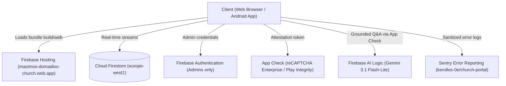

# Church Portal Documentation — Saints Maximus & Domadius and the Strong St. Moses the Black

Welcome to the comprehensive English documentation for the **Church Portal** of the Coptic Orthodox Church of Saints Maximus & Domadius and the Strong Anba Moussa the Black (End of Street 45, El-Asafra Qebly, Montaza, Alexandria, Egypt).

> **Arabic Documentation / التوثيق بالعربية:** For the original Arabic manual, see [`documentation/README.md`](../README.md).  
> **Agent & Architecture Memory Bank:** For deep internal architectural records, decision logs, and specifications for coding agents, see [`docs/memory-bank/00-README.md`](../../docs/memory-bank/00-README.md).

---

## 1. What is the Church Portal?

The Church Portal is a lightweight, high-performance public directory and digital home for the parish. It is designed to be **Arabic-first (RTL)** with seamless **English (LTR)** localization, works on both Web and Android (with iOS-ready configuration), and operates with an **offline-first fallback** on bundled seed data if Firebase services are unreachable.

### Core Distinctions
- **Public Directory, Not an ERP/CSMS:** The portal intentionally does **not** manage church membership records, confidential pastoral notes, financial ledgers, or attendance tracking (ADR-001). This eliminates data privacy risks and keeps hosting costs at zero on the Firebase Spark free plan.
- **Visitor-Centric:** Immediate answers in seconds:
  - When is the next Divine Liturgy? (with live "Happening Now" status).
  - Daily Coptic liturgical date, feast day, and today's top spiritual event.
  - Active season schedules (e.g., Holy Week Pascha, Nativity Fast, revivals).
  - Meeting schedules for all age groups (nursery to elderly).
  - Parish history, consecrated altars, and priest directory.
  - Sourced charity clinic schedules and emergency booking links.
  - One-tap navigation via Google Maps / GPS coordinates.
  - Secure contact form with anonymous suggestion/complaint boxes and hall booking.
  - Grounded AI Assistant ("Ask the Church") answering questions strictly from church data.
- **Full Non-Developer Admin Control:** Church servants and priests manage nearly all content, announcement banners, season presets, themes, and section visibility via a hidden dashboard at `/admin` without writing code.

---

## 2. Documentation Structure

This English documentation suite is structured into four primary guides:

| Document | Focus & Target Audience |
|---|---|
| [**Architecture Guide**](architecture.md) | Technical blueprint: Flutter layers, Riverpod 3 state management, Firebase infrastructure, Firestore data models, security rules, and performance optimizations. |
| [**Operations & Deployment Runbook**](operations.md) | Operator guide: CI/CD deployment workflows, environment secrets, safe Firestore database seeding, admin onboarding, Sentry error monitoring, and troubleshooting common issues. |
| [**Master Feature Reference**](features.md) | In-depth breakdown of all 32 portal features: what visitors see, exact `/admin` controls and field labels, technical models, and limitations. |
| [**Phase 2 plan**](../../docs/plans/phase2/README.md) | Notifications & mobile apps (ADR-056): architecture, stacked PR chain A–E, handoff workflow, launch & operations. Plan only — not implemented yet. |
| [**Root README**](../../README.md) | High-level repository landing page, quickstart commands, and architectural summary. |

---

## 3. System Highlights & Architecture Overview

### Key Technical Pillars
1. **Africa/Cairo Time Integrity (`CairoTime`):** All dates, liturgical transitions, and schedule calculations use Africa/Cairo timezone rules via the IANA timezone database. At 18:00 (or calculated church sunset), the portal automatically transitions to the Coptic liturgical "Eve" of the next day.
2. **Offline & First-Load Resilience:** If Firebase is unavailable, offline, or unconfigured, the application gracefully loads from `assets/seed/seed.json` without throwing errors or displaying white screens.
3. **Budget-Aware Security Rules:** Cloud Firestore security rules strictly validate every field, string length, phone format, and timestamp while remaining strictly within Firestore's 1,000-expression evaluation budget.
4. **Zero-Cost Media on Spark Plan:** Because Cloud Storage requires a paid Blaze plan, images uploaded in `/admin` are compressed in the browser (≤ 800px, WebP, ≤ 250 KB) and stored in Firestore's `media/{id}` collection, fetched lazily by individual components.

---

## 4. Live Environments

- **Production URL:** <https://maximos-domadios-church.web.app>
- **Legacy Domain (301 Permanent Redirect):** `https://asafra-church-portal.web.app`
- **Admin Dashboard:** <https://maximos-domadios-church.web.app/admin>
- **Firebase Project:** `asafra-church-portal` (Location: `europe-west1`)
